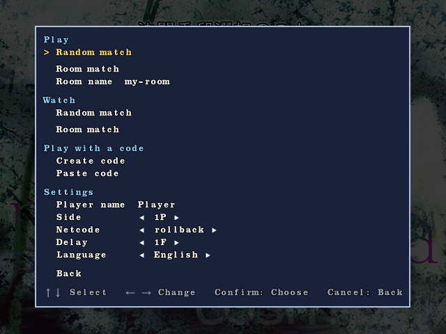
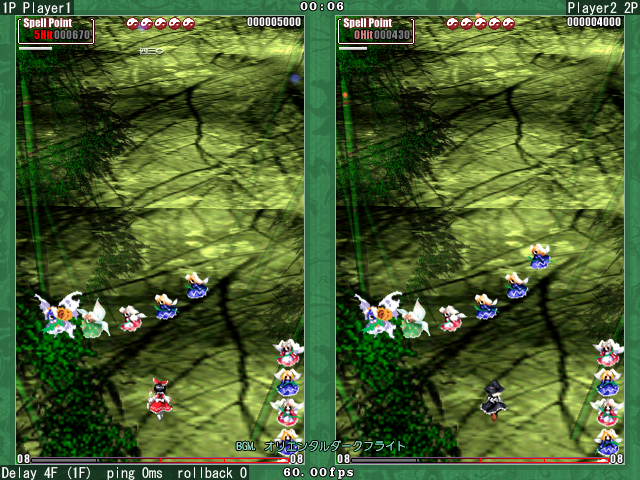
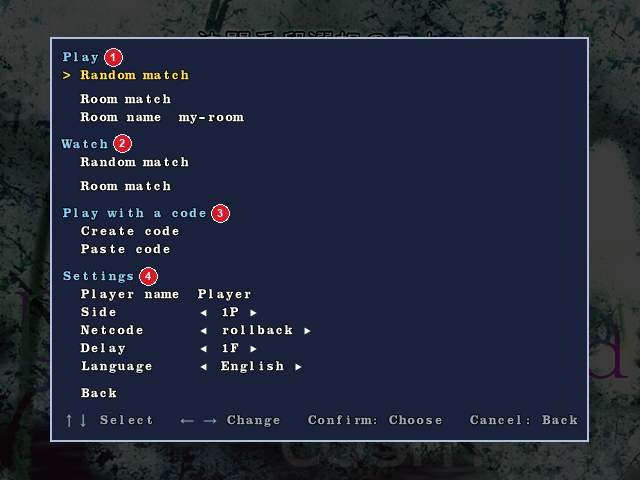
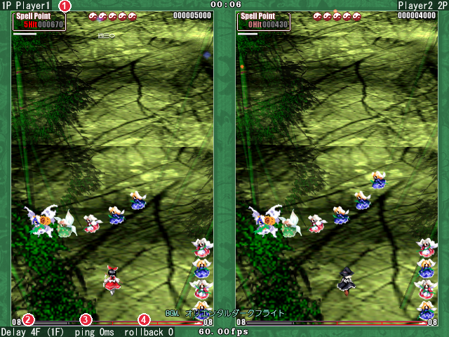

# HiganRTool

[日本語](./README.md)

An **unofficial** online battle tool for Touhou Kaeizuka ~ Phantasmagoria of Flower View (Touhou 9, ver.1.50a).

**It is not affiliated with ZUN or Team Shanghai Alice. Use at your own risk.**

It borrows the unused "妖怪 対 妖怪" entry in Match Mode and adds online battles and spectating to the in-game menu.
Like adonis and Ju.N.Owen, it exchanges both players' inputs so that both games run the same way.
It also has rollback netcode, which earlier tools for this game did not have, so you can play comfortably with less delay.

 


## Features

- **Random match**: Play someone who chose Random match at the same time, without deciding on a room name.
- **Room match**: Both players enter the same room name to play. It works much like the rooms in Ju.N.Owen.
- **Spectating**: Up to 10 people can watch a match: pick a random match from a list, or enter the room name for a room match. Spectators who join mid-match catch up from the start of the match in fast-forward.
- **Connection codes**: If rooms are not available, you can connect by sending connection codes to each other over Discord or similar. This works like Pure P2P in Ju.N.Owen.
- **Rollback netcode**: When the opponent's input is late, the game predicts it and keeps going, and goes back and re-runs the frames if the prediction was wrong. It rarely stops even on an unstable connection, and you can play with about 1-2F less delay than with adonis. You can also switch to the delay netcode, which waits for the opponent's input like adonis.
- **Change the delay at any time**: Press Ctrl + a number key, even during a match.
- **Automatic replays**: Every match is saved to `Replay_HiganRTool\`. File names are in the `th9_udXXXX.rpy` form from the start. Match information is stored inside the replay file, so it is not lost when you move the file.
- **Almost no port forwarding**: The server is used only for matchmaking. Match traffic goes directly between the two players' PCs (UDP). You need an open port only when your opponent is behind a symmetric NAT, and if your router supports UPnP the tool opens it automatically.
- **Encrypted traffic**: Match and spectator traffic is encrypted with a one-time key made for each connection.
- **Automatic updates**: Checks for a new version every time it starts and updates if there is one.


## Requirements

- Windows (tested on Windows 11)
- Touhou Kaeizuka ver.1.50a
- A way to talk to your opponent (Discord, etc.)


## Installation

1. Download the latest zip from [Releases](https://github.com/Mako-th/HiganRTool/releases).
2. Extract it **outside the game folder** (e.g. `C:\Games\HiganRTool\`).
3. Run `HiganRTool.exe`. The first time, a window asks for the game folder. Choose the folder that has `th09.exe`.
4. When the game starts, go to Title → Match Mode → 妖怪 対 妖怪 to open the online menu.
5. First, set your name with "Player name" in the menu. It is shown to your opponent and spectators.

From then on, just run `HiganRTool.exe`.
The tool is not loaded if you start `th09.exe` or vpatch directly. Always start the game from `HiganRTool.exe`.
You do not need vpatch. The tool does the frame timing instead, with a shorter time from input to screen than vpatch.


## Usage

Open the menu from Title → Match Mode → 妖怪 対 妖怪.
Use ↑↓ to select, and Confirm / Cancel to operate it. A gamepad works too.
The tool's screens follow the Windows display language (Japanese or English). To change it, use "Language" in the menu.

### Random match

Play someone who chose Random match at the same time, without deciding on a room name.

1. Choose "Random match" at the top of the menu.
2. When an opponent is found, a sound plays and you are connected automatically.
3. When both players choose 妖怪 対 妖怪, the game goes to difficulty select and the match starts.

While waiting, you can close the menu and play other modes.
To stop waiting, choose "Stop waiting" in the menu.
Only players using the same version of HiganRTool are paired.
**In a random match, your global IP address is visible to an opponent you do not know.** If that worries you, use a room match or connection codes.
Random matches appear in the Random match list under Watch, and anyone can watch them.
To keep yours off the list, set `enable = 0` under `[spectate]` in `HiganRTool.ini`.

### Room match (playing with people you know)

Two players who enter the same room name play each other.

1. Agree on a room name with your opponent. Use letters, digits, `-`, `_` and `@`, up to 32 characters. Choose a name others are unlikely to use.
2. Both players enter it in "Room name" in the menu, then choose "Room match" under Play.
3. When your opponent arrives, a sound plays and you are connected automatically.
4. When both players choose 妖怪 対 妖怪, the game goes to difficulty select and the match starts.

While waiting, you can close the menu and play other modes.
When you hear the sound, choose 妖怪 対 妖怪 at a good moment.
To stop waiting, choose "Stop waiting" in the menu.
A room holds only 2 players.

### Connection codes

This connects without the server. Use it when the room server does not respond, for example.

1. One player chooses "Create code". The code is copied to the clipboard, so send it to your opponent.
2. The other player copies that code, then chooses "Paste code". A reply code is copied to the clipboard, so send it back.
3. The first player copies the reply code, then chooses "Paste reply code".

Codes expire after 30 minutes.
Matches connected with codes cannot be spectated.

### Spectating

Up to 10 people can watch each random match and each room match.

**Watching a random match**

1. Choose "Random match" under Watch in the menu. The random matches in progress are listed as "1P name vs 2P name   spectators/limit".
2. Choose the match you want to watch. Full matches are greyed out and cannot be chosen. If there are more than 8, scroll with Up/Down.
3. The match appears. If you join mid-match, you catch up from the start of the match in fast-forward.

Only random matches where both players have `enable = 1` are listed.

**Watching a room match**

1. Ask the two players for their room name.
2. Enter it in "Room name" in the menu, then choose "Room match" under Watch.
3. The match appears when the two players start. If you join mid-match, it catches up from the start in fast-forward.

Press Esc to stop watching.
If you watch a match to the end, the replay is saved on your side too.

### Reading the screen

**Menu**



1. **Play**: Random match (play without deciding on a room name) and Room match (play with a room name). The cursor starts on Random match when the menu opens.
2. **Watch**: Random match (pick from a list) and Room match (enter the room name).
3. **Play with a code**: Connect without the server (a backup).
4. **Settings**: Change your player name, side, netcode, delay and language.

While waiting, "waiting 0:42" is shown to the right of the row you are waiting on.

**During a match**



1. **Player names**: 1P on the left, 2P on the right.
2. **Delay**: The current delay (how many frames your input is delayed before both players use it; the same as Latency in adonis). The number in brackets is a guide based on ping, and (A) means auto is in use.
3. **ping**: The round-trip time to your opponent.
4. **rollback**: The largest number of frames rolled back in the last second. Shown only with rollback netcode.

On the character select screen, the netcode is also shown at the bottom left.
While waiting in a room or with a code, a waiting line is shown at the top left.

### During a match

- **Change the delay**: Ctrl + a number key on the top row. 0-8 set the value and 9 sets auto. Both players can change it at any time.
- **Change the netcode**: Ctrl + Tab on the character select screen. Both players can change it.
- **Random character / map**: Press R, or the skip button on a gamepad. In online select screens, the keyboard Ctrl key does not pick at random.

### Settings

- **Player name**: The name shown to your opponent and spectators. It appears at the top left and right during a match.
- **Room name**: The name used for room matches and spectating. It is remembered for the next start.
- **Side**: Any / 1P / 2P. If both players want the same side, the player who entered the room first (or created the code) gets it. If one player chose Any, the other player's choice is used. If both chose Any, it is random.
- **Netcode**: rollback (default) / delay. Rollback is used only when both players choose it.
- **Delay**: auto / 0F-8F. Auto picks the value from ping.
- **Language**: 日本語 / English.

For settings not in the menu, edit `HiganRTool.ini` in the tool's folder.

- **Window size**: Set the window size at start with `width` / `height` under `[window]`.
- **Lower CPU usage**: Add `auto_window = b-hybrid` under `[pacing]` to cut CPU usage to about a quarter, at the cost of a tiny bit more delay (about 0.2 ms).
- **Refuse spectators**: Both players set `enable = 0` under `[spectate]`. Random matches are not listed either.

All settings are listed in `README_en.txt` in the zip.


## Notes

- Both players must use the same version. Different versions cannot connect.
- The tool never changes files in the game folder (exe, settings, save data, replays). It writes only inside `Replay_HiganRTool`.
- Before changing memory, the tool checks that the game is ver.1.50a. If not, it changes nothing.
- Your global IP address is visible to your opponent and spectators. Play only with people you trust. Anyone can watch a random match from the list, so the host's IP address is visible to spectators you don't know.
- The room server only passes room names and connection codes to the other player and keeps no records. Match traffic is encrypted, so the server cannot read it either.
- While waiting and during a match, the tool asks your router (UPnP) to open a port so that you can connect even when your opponent is behind a symmetric NAT. It closes the port afterwards. To turn this off, set `upnp = off` in `HiganRTool.ini`.
- Logs are saved in the `logs` folder in the tool's folder, one file per day (`dll_YYYYMMDD.log`). Files older than 3 days are deleted automatically. Player names, Windows user names and IP addresses are not recorded.
- If you need a detailed log, for example for a bug report, change `detail = 0` under `[log]` in `HiganRTool.ini` to `1`.


## Limitations

- Only ver.1.50a is supported.
- Two players who are both behind symmetric NATs, or a connection that blocks UDP, cannot connect. This needs a relay server, and there is no plan for it yet.
- It cannot be used together with other tools for this game (other netplay tools, practice tools).
- Security software may warn about the way the tool starts the game and loads its DLL, or replaces its own files when updating.
- Up to 9999 replays are saved in one folder. After that, replays are not saved, so move or delete old ones.


## For developers

How it works (sync, networking, connections, the room server, logs) is described in [TECHNICAL.en.md](TECHNICAL.en.md).

### Build

Requirements: [Rust](https://rustup.rs/) (`rustup target add i686-pc-windows-msvc`) and Visual Studio Build Tools (used as the linker).
The game is 32-bit, so the build targets 32-bit Windows (set in `.cargo/config.toml`).

```
cargo build --release
```

This produces `higanrtool_loader.exe` (launcher) and `higanrtool.dll` (main part) in `target\i686-pc-windows-msvc\release\`.
Rename them to `HiganRTool.exe` and `HiganRTool.dll` and put them in the same folder.

- Your own builds cannot connect to the released zip (the build number is compared before connecting). Your own builds can connect to each other.
- The room server (`src/server`) runs on Cloudflare Workers.
- The tests in the source are run in the development environment (some data they read is not in this repository).


## License

[GPL-3.0](./LICENSE) (version 3 or later).
Team Shanghai Alice may use, modify and redistribute this software without being bound by the terms of the GPL.


## Author

Mako-th

<https://github.com/Mako-th/HiganRTool>
