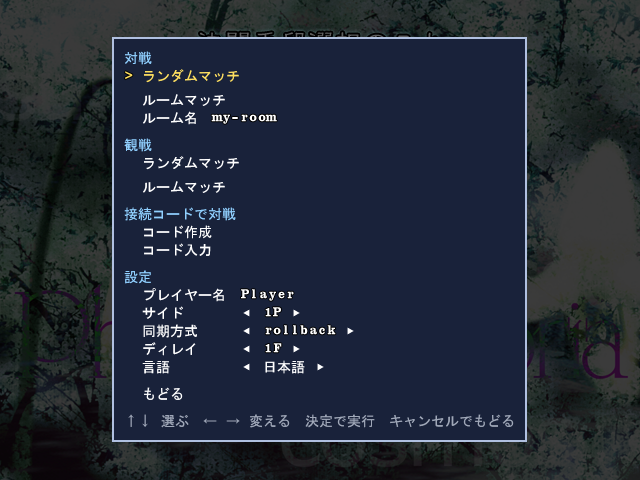
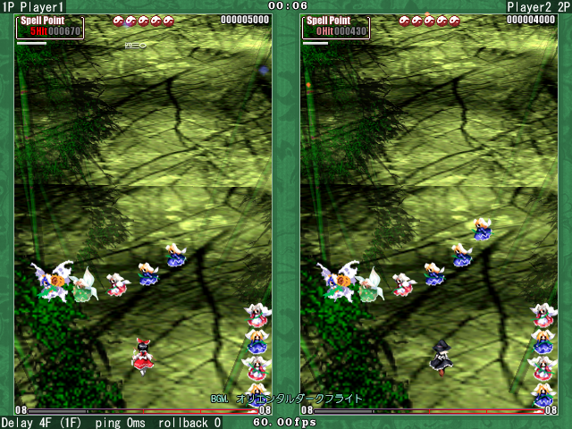
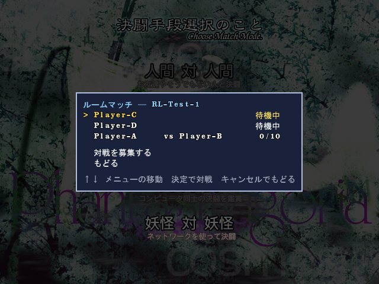
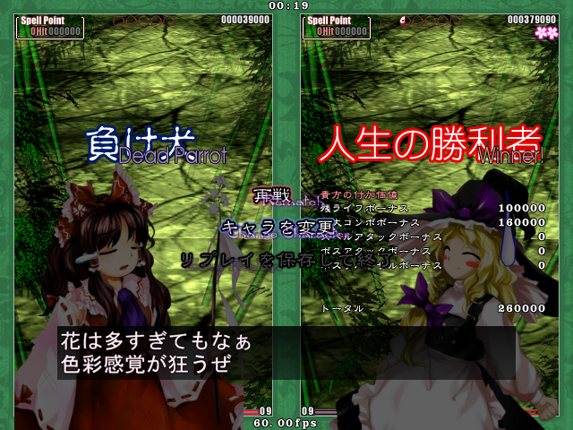
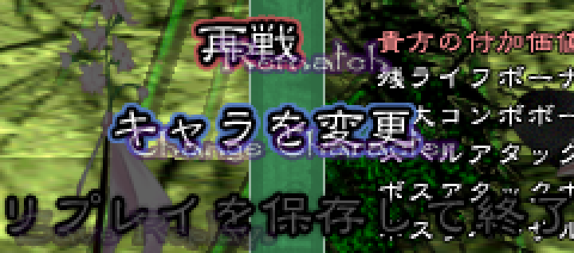
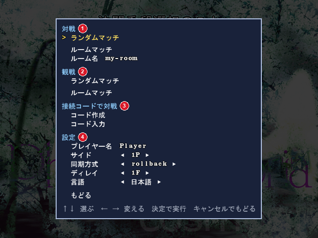
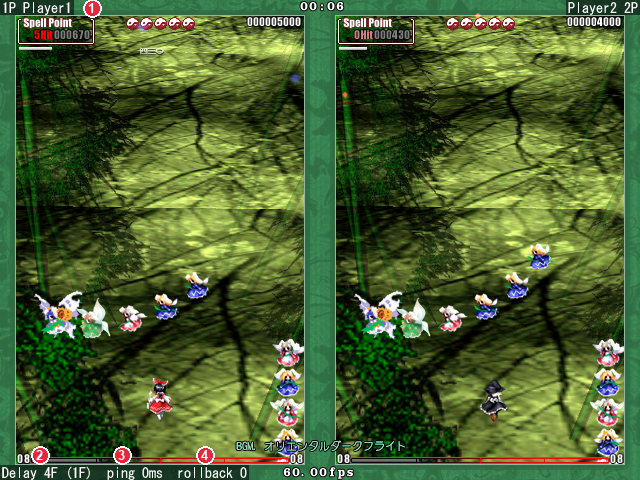

# HiganRTool

<!-- zip:skip -->
[](https://github.com/Mako-th/HiganRTool/actions/workflows/tests.yml)

[English](./README.en.md)
<!-- /zip:skip -->

東方花映塚（ver.1.50a）用の**非公式**ネット対戦ツールです。

**ZUN氏や上海アリス幻樂団とは関係ありません。自己責任で使用してください。**

Match Modeで使われていない「妖怪 対 妖怪」を間借りしてゲームの中のメニューからネット対戦・観戦ができるようにします。
adonisやJu.N.Owenと同じく2人の入力を交換してゲームを同じように進める仕組みです。
これまでの花映塚の対戦ツールには無かったロールバック方式（後述）で遅延を減らしつつ快適に遊べるようにしています。

<!-- zip:skip -->
 
<!-- /zip:skip -->


## 基本機能

- **ランダムマッチ**: ルーム名を決めず、同じタイミングでランダムマッチに潜っている人と対戦できます。
- **ルームマッチ**: 2人で同じルーム名を入力して対戦します。Ju.N.Owenのルームと同じような使い方です。
- **観戦**: ランダムマッチは一覧から、ルームマッチはルーム名を入力して一覧から選ぶと観戦できます（観戦は最大10人）。途中から入った場合は早送りで追いつきます。
- **接続コード**: ルームが使えないときは接続コードをDiscordなどで送り合って対戦できます。観戦コードを使えば観戦もできます。Ju.N.OwenのPure P2Pと同じような仕組みです。
- **LAN**: 同じLAN内の相手と対戦・観戦できます。Radmin VPN・Hamachi・ZeroTierの仮想LANでも使えます。
- **ロールバック方式**: 相手の入力が間に合わないときは予測して進行し、外れていたら戻って進め直します。回線が揺れても止まりにくく、adonisより1〜2フレーム（F）ほど低いディレイで遊べます。入力が揃うまで待つdelay方式にも切り替えられます。
- **ディレイの変更**: 試合中でも、Ctrl+数字キーでいつでも変えられます。
- **リプレイの自動保存**: マッチごとに`Replay_HiganRTool\`へ保存します。ファイル名はデフォルトが`th9_udXXXX.rpy`という形式で変更も可能です。また、対戦の情報はリプレイファイルの中に記録するのでファイルを移動しても失われません。
- **リプレイの高速・低速再生**: リプレイの再生中、Skip（Ctrl）を押している間は高速、Slow（Shift）を押している間は低速で再生できます。再生速度は`HiganRTool.ini`で指定できます。
- **ポート開放はほぼ不要**: 相手探しにはサーバーを使いますが、接続を確立した後はプレイヤー同士で直接通信を行います。ポート開放が要るのは相手がシンメトリックNAT（→「接続できないとき」を参照）のときだけであり、ルーターがUPnPに対応していればツールが自動で開閉します。
- **通信の暗号化**: 試合と観戦の通信は接続するたびに作る使い捨ての鍵で暗号化しています。
- **自動更新**: 起動するたびに新しいバージョンをチェックし、あれば更新します。更新した後は変更点を表示します。
- **キーボード2台で人間 対 人間**: Match Modeの「人間 対 人間」で、キーボード2台を1Pと2Pに分けて遊べます（→「そのほかの機能」の「キーボード2台で人間 対 人間」を参照）。


## 必要なもの

- Windows（動作確認: Windows 11）
- 東方花映塚（ver.1.50a）
- 相手と連絡を取る手段（Discordなど）


## インストールと起動

### インストール

1. [Releases](https://github.com/Mako-th/HiganRTool/releases)から最新のzipをダウンロードします。
2. 花映塚のフォルダの**外**に展開します（例: `C:\Games\HiganRTool\`）。
3. `HiganRTool.exe`を起動します。初回だけ花映塚のフォルダを選ぶ画面が出るので、`th09.exe`のあるフォルダを選んでください。
4. 花映塚が起動し、タイトル→Match Mode→「妖怪 対 妖怪」と進むと対戦用のメニューが開きます。
5. 最初に「設定」を選び「プレイヤー名」で名前を決めておきましょう。相手と観戦者に表示されます。

### 置き場所と中身

| ファイル | 中身 |
|---|---|
| HiganRTool.exe | ここから起動します |
| HiganRTool.dll | 花映塚の中で動く本体 |
| HiganRTool.ini | 設定（下の「設定」を参照） |
| HiganRTool_replay_fix.exe | v1.0.0で起こったリプレイのずれを修正するリプレイ修復ツール（下の「そのほかの機能」の「リプレイ修復ツール」を参照） |
| README.txt / README_en.txt / LICENSE.txt / THIRD_PARTY_LICENSES.txt | この説明書（日本語・英語）とライセンス |

起動するとフォルダに`logs\`（ログ）が作成されます。これは不具合があった場合などに使用します。

### 起動

2回目以降は`HiganRTool.exe`を起動するだけで花映塚が起動します。
`th09.exe`やvpatchを直接起動するとこのツールは読み込まれません。必ず`HiganRTool.exe`から起動してください。
花映塚を多重起動することはできません。また、vpatchは読み込みませんがフレーム管理はツール側が代わりに行っており、入力から画面に出るまでの時間はvpatchより短いです。

- 花映塚のフォルダを選び直したいときは`HiganRTool.ini`の`[loader]`の`game`の値を消すか、起動の引数に`--choose-game`を付けます。
- 起動できないときは黒いウィンドウに理由が出て止まります。そのメッセージを開発者に伝えてください。
- 花映塚を「管理者として実行」している場合は`HiganRTool.exe`も「管理者として実行」してください。

### 更新

起動するたびに更新の確認が入ります（最長約2秒、ネットに接続できなければそのまま起動）。
新しいバージョンがあると「更新しますか？」と出ます。「はい」「いいえ」を選ぶと下記の挙動をします。

- **はい**: 起動をやめ、exe・dll・READMEなどを置き換えて新しいバージョンで再起動します。置き換えや再起動に失敗したときは自動で元のバージョンに戻します。
  - 黒いウィンドウにダウンロードの進み具合が表示されます。
  - 新しいバージョンで最初に起動したときは`HiganRTool.ini`を新しい形に合わせて変更し、変更点を表示します。自分で変えた設定は引き継ぎます（自分で書き足したコメントは残りません）。更新が終わり、Enterを押すと花映塚を起動します。
  - 新しいバージョンにすると困る場合、更新前のバージョンに戻せます（花映塚と`HiganRTool.exe`を閉じ、新しい`HiganRTool.exe`と`HiganRTool.dll`を別の名前に変え、`HiganRTool.exe.old`と`HiganRTool.dll.old`から`.old`を取る）。`.old`は新しいバージョンで花映塚を起動できた次の起動で削除されます。
- **いいえ**: 今のバージョンで起動します。相手とバージョンが違うと接続できません。


## 対戦する

### メニュー

↑↓で選び、決定・キャンセルで操作します。パッドでも操作できます。
項目の説明は下の「画面の見方」にあります。
待っている間はメニューを閉じてほかのモードで遊んでいてかまいません。
待機をやめるときはメニューの下に出る「待機をやめる」を選びます。
「もどる」でメニューを閉じます。

### ランダムマッチ

ルーム名を決めずに、同じときにランダムマッチを選んだ人と対戦します。

1. メニューの一番上の「ランダムマッチ」を選びます。
2. 相手が見つかると通知音が鳴り、自動で接続します（→「接続確立から対戦まで」を参照）。

待っている間は画面の左上に「ランダムマッチで待機中」と出ます。
**ランダムマッチでは知らない相手にもグローバルIPアドレスが見えます。** 気になるときはルームマッチか接続コードを使ってください。
ランダムマッチは観戦の「ランダムマッチ」の一覧に載り、誰でも観戦できます（`HiganRTool.ini`で観戦を拒否することもできます。→「設定」の「観戦を断る」を参照）。

### ルームマッチ

同じルーム名を入力した2人で対戦します。

1. 相手とルーム名を決めます。ルーム名には英数字と記号が使えます（`` ` `` `;` `/`は使えません）。最大32文字までで前後の空白は取り除かれます。「w.」「q.」「r.」で始まる名前は使えません。ほかの人と重ならない名前にしてください。
2. 2人ともメニューの「ルーム名」に入力してから対戦の「ルームマッチ」を選びます。
3. そのルーム名で待機中の人や試合中の2人がいれば一覧が出ます。
   相手の行を選ぶと接続します（試合中の行を選ぶと観戦します）。
   誰もいなければそのまま待機します（一覧の「対戦を募集する」でも待機できます）。
4. 相手が来ると通知音が鳴り、自動で接続します（→「接続確立から対戦まで」を参照）。

<!-- zip:skip -->

<!-- /zip:skip -->

募集中は画面の左上に「ルーム … で待機中」と出ます。
募集中の人どうしは接続しないため、2人とも待機してしまったときは片方が「待機をやめる」を選び、もう一度「ルームマッチ」を選んで一覧の相手を選んでください。

### 接続コード

サーバーを通さずに接続する方法です。ルームのサーバーが応答しないときなどに使ってください。

1. 片方が「対戦コード作成」を選びます。コードがクリップボードにコピーされるので相手に送ります。
2. 受け取った側は届いたコードをコピーしてから「対戦コード入力」を選びます。返答コードがクリップボードにコピーされるので送り返します。
3. 最初の側は返答コードをコピーしてから「返答コード入力」を選びます。

「接続コード」は対戦コードと観戦コードをまとめた呼び名です。
コードの有効期限は30分です。
接続コードで接続したマッチは観戦コードで観戦できます（→「観戦する」の「観戦コード」を参照）。

### LAN

同じLANにいる2人で、サーバーを通さずに対戦します。
オフラインの会場や、LANケーブルでつないだ2台で使用してください。

**ホストの操作**

1. メニューのLANの「ホスト」を選びます。
2. メニューの下に自分のLANのアドレスとポートが一覧で出ます（4つ以上あるときは↑↓で残りを表示できます）。
3. 相手にそのアドレスを入力してもらうことで接続が成立します。

**クライアントの操作**

1. メニューのLANの「クライアント」を選びます。
2. ホストのアドレスを入力します。`192.168.0.2:17723`という形式でポートを省くと17723になります。
   また、前回入力したアドレスが記憶されます。
3. 接続すると通知音が鳴ります（→「接続確立から対戦まで」を参照）。

ホストに参加できるのは先着1人です。
ホストが違えば、同じLANで何ペアでも同時に遊べます（実際の環境では検証していない試験的な機能です）。

**注意点**

- ルーターを通さずに直接つないだときは、Windowsがそのネットワークを「パブリック ネットワーク」とみなすことがあります。そのときはファイアウォールの確認で「パブリック ネットワーク」も許可してください（→「困ったとき」を参照）。
- ルーターを通さず2台をLANケーブルで直接つなぐ場合、実際の環境では検証していませんが、自動で付く`169.254.x.x`のアドレスがホストの画面に出ると思われます。

**VPNの仮想LAN**

Radmin VPN・Hamachi・ZeroTierの仮想LANでも、LANとして対戦・観戦できます。
2人が同じネットワークに入ってから上と同じ手順で接続してください。
ホストの画面ではVPNのアドレスに「26.12.34.56:17723（Radmin）」のように使っているVPNの名前が付きます。
相手には、2人が使っているVPNの名前が付いたアドレスを伝えてください。
VPNのツールが中継で接続しているときはその分の遅延が増えます。
WindowsはVPNのネットワークを「パブリック ネットワーク」とみなすことがあります。そのときはファイアウォールの確認で「パブリック ネットワーク」も許可してください（→「困ったとき」を参照）。

### 接続確立から対戦まで

- 2人ともMatch Modeの「妖怪 対 妖怪」を選ぶと難易度選択に進んで対戦が始まります。ほかのモードで遊んでいるときはキリの良いところで中断するなどして「妖怪 対 妖怪」を選んでください。
- 1P / 2Pは「設定」の「サイド」で決まります。
- 切断するときはMatch Modeや難易度の画面でキャンセル→「はい」です。
- マッチが終わるとメニューを2人がそれぞれ選びます（→「マッチ終了時のメニュー」を参照）。
- 対戦が終わって接続が切れるとタイトルの「妖怪 対 妖怪」に戻ります。もう一度接続するときは「妖怪 対 妖怪」を選んでください。
- 相手からの応答が60秒無いと、ツール側で切断します（相手のゲームが固まったときも、こちらが止まったままにはなりません）。
- 相手の応答が2秒ほど止まると画面の左上に「相手の応答を待っています」と出ます。その間にEscを3秒長押しすると自分から切断できます。

### 試合中の操作

ディレイ・同期方式の変更、ステージ選択とスキップはどちらのプレイヤーが押しても反映されるので注意してください。

- **ディレイの変更**: Ctrl+数字キーでいつでもディレイを変えられます。0〜8はその値に、9はautoになります。
- **同期方式の変更**: キャラ選択の画面でCtrl+Tabを押すと同期方式を変えられます。
- **観戦コードのコピー**: 接続確立後にホストがCtrl+Cを押すとコピーできます。
コピーできたかどうかは画面の左上に数秒出ます。
- **キャラ・マップのランダム選択と会話のスキップ**: キーボードのCtrlかパッドのskipを押すとランダム選択と対戦終了後の会話のスキップができます（Ctrl+数字やCtrl+Tabを押したときもCtrlを押した扱いになります）。

### マッチ終了時のメニュー

マッチ終了時のメニューは2人がそれぞれ選びます。
選んでいる項目は1Pが赤、2Pが青の縁取りで表示されます。

<!-- zip:skip -->
 
<!-- /zip:skip -->

- 両者が決定すると進み、選択肢が異なる場合は下の項目が優先されます（「リプレイを保存して終了」>「キャラを変更」>「再戦」）。
- どちらかが「リプレイを保存して終了」を決定すると、相手の決定を待たずにその時点で接続を終了します。
  リプレイを自動で保存したマッチではゲーム側のリプレイ保存画面は出ません。
- 2人が同時に決定の状態になるまでは上下キーで決定を取り消せます。
- 遊んでいる間に新しいバージョンが公開された場合はメニューの左上に表示されます。

### 画面の見方

**メニュー**

<!-- zip:skip -->

<!-- /zip:skip -->

1. **対戦**: ランダムマッチとルームマッチが出来ます。メニューを開いたときはランダムマッチにカーソルがあります。
2. **観戦**: ランダムマッチ・ルームマッチの観戦が可能です。
3. **接続コード**: 対戦コード作成・対戦コード入力（相手のコードを待っている間は「返答コード入力」）・観戦コード入力。サーバーを通さずに接続します（予備的な機能です）。
4. **LAN**: ホスト・クライアント・観戦。同じLANの中で、サーバーを通さずに接続します。
5. **設定**: プレイヤー名・サイド・同期方式・ディレイ・言語を変更できます。メニューには「設定」の1行だけが出ており、選ぶと設定項目が表示されます。

プレイヤー名が初期設定（`HiganRTool`）の場合メニューの下に案内が出ます。
起動して最初にメニューを開いたときだけカーソルが「設定」にあるのでプレイヤー名を設定してください。
待っている間は待っている行の右に「待機中 0:42」のように待った時間が出ます。

**試合中**

<!-- zip:skip -->

<!-- /zip:skip -->

1. **プレイヤー名**: 左が1P、右が2Pです。
2. **Delay**: いまのディレイフレーム（→「仕組み」の「ディレイ」を参照）。括弧の中はpingから決めた目安で「(A)」はautoで動いていることを表します。
3. **ping**: 相手との往復の時間です。
4. **rollback**: 直近1秒で予測が外れて戻したフレーム数のいちばん大きい値、同期方式がrollbackのときだけ出ます。

キャラ選択の画面では左下に同期方式も出ます。


## 観戦する

ランダムマッチとルームマッチはそれぞれ10人まで観戦できます。
途中から入った場合はマッチの最初から早送りで追いつきます（既定は480fps、速さは`[spectate]`の`ff_fps`で変更可能です。通信速度によってはそこまで速くなりません）。
通信速度を可変にしたり観戦者どうしで中継したりすることで、観戦者がいても対戦する2人の接続には影響が及びづらい仕様にしています。
ランダムマッチとルームマッチでは、ホストが試合を直接送るのは基本的に観戦者2人までで、ほかの観戦者へはその観戦者が試合を中継します（中継できないときはホストが直接送ります）。
観戦者どうしで中継するときは、中継する観戦者と中継を受ける観戦者に、互いのグローバルIPアドレスが見えます。
中継したくないときは下の「設定」の「観戦中に中継しない」を設定してください。
最後まで観戦したマッチは観戦者にもリプレイが保存されます。
マッチの中でEscを押すとゲームのポーズが開きます（開けない間は画面の左上に「一時停止中」と出ます）。
観戦をやめるときはEscを3秒長押ししてください。ポーズの「タイトルへ戻る」でもやめられます。
観戦を拒否したい場合は「設定」の「観戦を断る」を見てください。

### ランダムマッチ

1. メニューの観戦の「ランダムマッチ」を選びます。今進行中のランダムマッチが「1Pの名前 vs 2Pの名前　観戦者の数/上限」で表示されます。
2. 観戦したいマッチを選びます（満員のマッチは灰色になります。8件を超えたときは↑↓でスクロールしてください）。
3. 2人のマッチを観戦できます。

### ルームマッチ

1. 対戦する2人からルーム名を教えてもらいます。
2. メニューの「ルーム名」に入力してから観戦の「ルームマッチ」を選びます。
3. そのルーム名で試合中の2人が一覧に出るので観戦したいマッチを選びます。

ルーム名を知っている人は誰でも観戦できます。

### 観戦コード

サーバーに接続できないときに使う方法です。

1. 2人が接続したらホストがCtrl+Cを押します。観戦コードがクリップボードにコピーされるので観戦者に送ります。
2. 観戦者は観戦コードをコピーしてからメニューの接続コードの「観戦コード入力」を選びます。

ホストは接続したときの左上の表示に「（ホスト）」と出ている側です。
観戦コードでは観戦者からホストへ直接届く必要があります。
同じLANにいるか、ホストのUPnPが使えるかをチェックしてください。

### LAN

1. 2人の接続が成立した後、観戦者はメニューのLANの「観戦」を選びます。
2. ホストのアドレスを入力すると観戦できます。


## そのほかの機能

### キーボード2台で人間 対 人間

- 起動してから2台以上のキーボードでキーを押していた場合、Match Modeで「人間 対 人間」を選択すると画面の左上に案内が出ます。
- 案内に沿って1Pと2Pがそれぞれ自分のキーボードでZ・X・Shift・↑・↓・←・→を順に押します。キーを押されたキーボードがその人のキーボードになります（複数になる場合もあります）。
  本体と別のテンキーのように2台を使う人は使う台でそれぞれ押せば両方使えます。
- 分けている間は割り当てたキーボード以外の入力（パッドを含む）は使いません。
- 試合中のポーズから戻ったときと、試合の後にキャラを変更・再戦したときは同じ割り当てのまま続きます。
  タイトルやMatch Modeの画面に戻ったときと、リプレイを保存する画面に進んだ場合はいつもの入力に戻ります。
- 案内が出ている間にパッドのボタンかEscを押すとその回は分けずに遊べます。

### リプレイ

- マッチが終わるたびに1本自動で保存します。保存先は花映塚のフォルダの`Replay_HiganRTool\<1P> vs <2P>\`です。
- 花映塚をProgram Filesなど管理者でないと書き込めないフォルダに入れている場合、Windowsがリプレイを`%LOCALAPPDATA%\VirtualStore\`の下の同じ名前のフォルダへ保存します（花映塚自身の`replay`と同じ）。
  エクスプローラーのアドレスバーに`%LOCALAPPDATA%\VirtualStore`と入力すると開けます。
  管理者として起動したときは花映塚のフォルダへ直接保存します。
- 花映塚の`replay`フォルダには書き込みません。ゲームで見るときはファイルを`replay`フォルダへコピーしてください。
- 1つのフォルダのリプレイが`th9_ud9999`まで埋まると、同じ名前に`_2`、`_3`…を付けたフォルダに続けて保存します。
- 花映塚には長いマッチのリプレイを保存すると落ちる不具合があります。このツールは保存の前に花映塚が必要な大きさを正しく見積もれるようにしているので落ちません。
- 高速・低速再生は、メニューから始めたリプレイの再生中だけ効きます。
  垂直同期を取るフルスクリーンでは画面は60fpsのまま、1回の表示の中でゲームの内部処理を複数回進めて高速再生します。
  この場合は初めてSkipを押してから効き始めるまで、最大0.1秒ほどかかります。
  `[pacing]`の`mode`が`game`のときはどちらも効きません。

### リプレイ修復ツール（HiganRTool_replay_fix.exe）

- **対象**: v1.0.0とそれより前のバージョンで保存したリプレイです。
  v1.1.0以降で保存したリプレイとこのツールで直したリプレイは「修正が不要」としてスキップします。
  HiganRToolで保存していないリプレイは直せません。
- **使い方**:
  1. `HiganRTool_replay_fix.exe`をダブルクリックします。
  2. 「リプレイを選ぶ」か「フォルダを選ぶ」で選びます。exeやウィンドウにドラッグ＆ドロップしても選べます。
     フォルダを選ぶとその中（4階層下まで）のリプレイを全部読み込みます。
  3. 1本ずつ、1Pと2Pの名前とリプレイに入っているチャージの設定（slow / charge）が出ます。「前へ」「次へ」で切り替えます。
  4. 「直した後の設定」でそのマッチで2人が実際に使った設定を選びます。
  5. 「リプレイ単体を修復」で表示中の1本を、「フォルダ全体のリプレイを同様に修復」で同じフォルダのリプレイ全部を同じ設定で直します。
  6. 終わると何件を処理したか、保存先、スキップしたリプレイが表示されます。
- **保存先**: 元のフォルダの1つ上の`fix_replay\<元のフォルダ名>\<1Pの設定>-<2Pの設定>\`に、同じファイル名で作ります。
  例: `Replay_HiganRTool\Alice vs Bob\th9_ud0008.rpy`を1P charge・2P slowで直すと`Replay_HiganRTool\fix_replay\Alice vs Bob\charge-slow\th9_ud0008.rpy`ができます。
  元のファイルは書き換えません。
  同じ名前のファイルがあるときは上書きしません。
- **設定の選び方**: 自分のPCの設定ではなく、そのマッチで2人が実際に使った設定を選びます。
  どちらか分からないときは2通りで作って両方を再生して比べてください。
  `Replay_HiganRTool`のフォルダは`<1P> vs <2P>`ごとに分かれていて同じフォルダの中は1Pと2Pの並びが同じです。
  同じ相手が設定を変えていなければそのフォルダはまとめて直せます。
- **花映塚で見る**: 直したリプレイを花映塚の`replay`フォルダへコピーしてください。
  花映塚での確認や、ずれるリプレイとの入れ換えはご自身で行ってください。
- **画面の言語**: 右上の「言語」で日本語 / Englishを切り替えられます。


## 設定

- **プレイヤー名**: 相手と観戦者に表示される名前です。試合中は画面の上の左右に出ます。
- **ルーム名**: ルームマッチ（対戦と観戦）で使う名前です。次に起動したときも使われます。
- **サイド**: おまかせ / 1P / 2P。片方がおまかせなら相手の希望に合わせます。希望がぶつかったときと2人ともおまかせのときはランダムです。
- **同期方式**: rollback（既定） / delay。2人ともrollbackのときだけrollbackになります。
- **ディレイ**: auto / 0F〜8F。autoはpingから自動で決めます（→「仕組み」の「ディレイ」を参照）。
- **言語**: 日本語 / English。初めはWindowsの表示言語に合わせます。ログは常に日本語です。

メニューで変えた設定と選んだ花映塚の場所は、決定した時点で`HiganRTool.ini`の該当の行に書き込まれます。
`HiganRTool.ini`とメニューはいつも同じ値になり、どちらかが優先されることはありません。
メニューに無い設定は`HiganRTool.ini`を直接書き換えてください。

- **遅延をさらに減らす**: `[pacing]`の`wait = active`にすると遅延の中央値がわずかに（約0.2ms）減り、かわりに処理の重さが約4倍になります。
  配信しながら遊ぶときなど、PCが重いときは既定の`passive`のままにしてください。
- **垂直同期を取る**: 既定の`[pacing]`の`vsync = off`では垂直同期を取らず、ツール側で60.000fpsを維持します。垂直同期を取るときは`on`、custom.exeの設定に従うときは`game`にします。custom.exeの設定は書き換えません。
  ウィンドウの花映塚はもともと垂直同期を取らないので変わるのはフルスクリーンだけです。
- **観戦を断る**: `[spectate]`の`enable = 0`にします。
  2人のどちらかが`0`なら観戦できません（ランダムマッチは一覧に載りません）。
- **観戦中に中継しない**: `[spectate]`の`relay = 0`にします。
  ほかの観戦者へ中継しなくなります。自分が中継を受ける側になることはあります。
- **自動更新を止める**: `[loader]`の`update_check = 0`にします。

**`HiganRTool.ini`の書き方**
- `[replay]`のような行が「カテゴリ」です。その下の`enable = 1`のような「キー = 値」の行が、そのカテゴリの設定です。
  キーは下の表にあるカテゴリの下に書いてください。
- `;`か`#`で始まる行はコメントアウトされ、使われません。
  配布の`HiganRTool.ini`には`;`を付けてコメントアウトしている行があります。使うときは行の先頭の`;`を消してください。
- 書き換えたら保存してこのツールを起動し直してください。`HiganRTool.ini`は起動したときにだけ読みます。

例: ウィンドウの大きさを1280×960にしたい（配布の`HiganRTool.ini`の最後にある行の`;`を消します）

```
[window]
width = 1280
height = 960
```

知らないキーや読み込めない値の行はその行だけ使わず、既定値で動かします。
読み込めなかった行はネット対戦のメニューの下に表示されます（全容はログに出ます）。
行の最後に空白と`;`のあとにコメントを書けます。
UTF-8以外（Shift_JIS）で保存した`HiganRTool.ini`も読み込めます。
日本語以外の文字（中国語など）を書くときは、UTF-8で保存してください。

すべての項目は下の表にあります。

| カテゴリ | キー | 意味 |
|---|---|---|
| [netplay] | name | プレイヤー名 |
| | room | ルーム名 |
| | lan_host | LANの「クライアント」「観戦」で最後に入力したホストのアドレス（`192.168.0.2`か`192.168.0.2:17723`） |
| | mode | 同期方式 `rollback`（既定）/ `delay` |
| | delay | ディレイ（遅延させるフレーム数。rollbackとdelay方式で共通） `0`〜`8` / `auto`（既定） |
| | host_seat | サイド。`1` / `2`（行が無ければ「おまかせ」） |
| | rollback_hit_se | rollbackの被弾音 `confirmed`（確定まで鳴らさない。最大130msほど遅れる。既定）/ `live`（予測の時点で鳴らす） |
| | rollback_cutin_se | rollbackのカットイン音 `confirmed`（確定まで鳴らさない。最大130msほど遅れる。既定）/ `live`（予測の時点で鳴らす） |
| | ipv6 | IPv6の使用 `on`（既定）/ `off`（使わない） |
| | stun / stun2 | グローバルアドレスの問い合わせ先、空にすると問い合わせません |
| | enable / scope / code_side / room_server / check | 通信の基本要素、変えないでください |
| | bind | 待ち受けのUDPポート（既定`auto:17723`。`auto:`は自分のアドレスを自動で選ぶ印です。ポート開放できる番号に変えて問題なく、相手と2人で揃える必要もありません） |
| | upnp | ルーターのUPnPで待ち受けのポート（`bind`）を開ける `on`（既定。待機中・試合中・中継する観戦中だけ開け、終わったら閉じる）/ `off`（使わない） |
| [pacing] | mode | フレームの進め方 `auto`（既定、ツール側で60.000fpsを維持。垂直同期を取るフルスクリーンの場合は花映塚のシステムを使う）/ `game`（花映塚のシステムを使う） |
| | wait | 60.000fpsを維持するときの待機方法 `passive`（既定、期限の手前まで休んで待つので処理が軽い）/ `active`（常に動いて待つ） |
| | vsync | 垂直同期 `off`（既定、取らない）/ `on`（取る）/ `game`（custom.exeの設定に従う） 変わるのはフルスクリーンの場合だけです |
| | replay_skip_fps | リプレイ再生中にSkip（Ctrl）を押している間のfps `1`〜`6000`（既定`240`、PCとプログラムの処理性能で頭打ちがあります） |
| | replay_slow_fps | リプレイの再生中にSlow（Shift）を押している間のfps `1`〜`1000`（既定`30`） |
| [replay] | enable | リプレイの自動保存 `1`（マッチごとに保存）/ `0`（しない） |
| | layout | 保存先のフォルダの分け方 `peer`（`<1P> vs <2P>`のフォルダ）/ `date`（日付）/ `flat`（分けない）/ `pack50`（花映塚の`replay`フォルダへそのままコピーできる名前で50本ずつ） |
| | name | 自動保存のファイル名。既定は`th9_ud{num}`。`{num}`（番号4桁）/ `{date}`（年月日。`20261028`）/ `{time}`（時分。`2313`）/ `{1Pchara}`・`{2Pchara}`（キャラ）/ `{1Pname}`・`{2Pname}`（名前。使えない文字は`-`）/ `{round}`（ラウンド数）/ `{wins}`（取ったラウンド。`2vs1`）/ `{winner}`（`1P`・`2P`。決着していないときは`none`）/ `{length}`（マッチの長さ。`3m42s`）/ `{rlengths}`（ラウンドごとの長さ。`1m05s-1m22s`）/ `{rlifes}`（ラウンドごとの決着のライフ。`10vs0-0vs3`）/ `{sync}`（`rollback`・`delay`）/ `{delay}`（`2F`）/ `{ping}`（`33ms`）/ `{side}`（自分のサイド）/ `{result}`（`win`・`lose`・`draw`）が使え、それ以外の文字はそのまま使います。使えない文字（`\ / : * ? " < >`・縦線・制御文字）は`-`に置き換えます。名前が長すぎるときは末尾を切り捨てて保存します（目安は約80文字。上限はログに出力します）。例: `th9_ud{date}-{time}_{1Pchara}VS{2Pchara}_{round}R_{winner}win`。 |
| [spectate] | enable | 観戦の受け付け `1`（既定、受け付ける）/ `0`（拒否、どちらかが`0`なら観戦できません） |
| | relay | 観戦中の中継 `1`（既定、ほかの観戦者へ中継する）/ `0`（中継しない） ランダムマッチとルームマッチの観戦だけで使います |
| | ff_fps | 途中から観戦したときの早送りのfps `120`〜`6000`（既定`480`、通信速度によってはそこまで速くなりません） |
| [window] | width / height | ウィンドウの中身の画素数 |
| | x / y | ウィンドウの左上の位置（2つとも書いたときのみ機能します） |
| | titlebar | 枠とタイトルバー `1`（出す）/ `0`（消す） |
| | alwaysontop | 常に最前面 `1`（有効）/ `0`（無効） |
| [pad] | pov | パッドの十字キーを方向として読むか（花映塚が読まない型のパッド用） `1`（既定、読む）/ `0`（読まない）/ `always`（診断用） |
| [input] | split_keyboards | 「人間 対 人間」でキーボード2台を1Pと2Pに分ける `1`（既定、分ける）/ `0`（分けない） |
| [ui] | lang | このツールの画面の言語 `auto`（Windowsの表示言語）/ `ja` / `en` |
| | status_side | 試合中の通信状態とディレイの表示位置、観戦時は左下固定 `1p`（既定、左下）/ `2p`（右下）/ `self`（自分が1Pなら左下、2Pなら右下）/ `opponent`（自分が1Pなら右下、2Pなら左下） |
| [log] | detail | ログの量 `0`（既定、簡潔）/ `1`（詳細、不具合があった際に使用します） |
| [loader] | game | 花映塚の`th09.exe`の場所（空のときはフォルダを選ぶウィンドウを出します） |
| | update_check | 起動前の更新の確認と遊んでいる間の新しいバージョンの表示 `1`（既定、有効）/ `0`（無効） |

`[window]`を書かなければ今までの通り既定サイズのウィンドウで起動します。フルスクリーンでは無効です。


## 仕組み

### ディレイ（Delay）

- ディレイ N（画面では「Delay NF」）は、自分の入力をNフレーム（N × 16.7ms）遅らせて2人が同じフレームで対戦できるようにする処理です。
- autoはpingから決めます。delay方式では往復約33msごとに1F、rollbackでは往復約67msごとに1Fです（rollbackは片道の半分のフレーム数）。pingが小さく安定しているときは0Fです。マッチの最初とCtrl+9を押したときだけ見直し、途中では変わりません。
- マッチごとに揺らぎがないよう、上げるのは往復が境目を5ms超えたとき、下げるのは2マッチ続けて低かったときだけです（Ctrl+9を押したときはすぐ変えます）。

### rollback（既定）

- 相手の入力がまだ届いていないフレームは「相手は直前と同じ入力」と予測して進め、本物が届いて違っていたらそのフレームまで戻って進め直します。そのためdelay方式より低いディレイでも止まらずに遊べます。
- 予測が外れたときは弾や相手が飛んで見えることがあります。
- 2人のゲームの乱数とライフを定期的に比べ、同期ズレが起こったらマッチを止めて通知音を鳴らします。

### delay方式

- 相手の入力が届くまで待つ方式です（adonisと同じ）。待っている間も画面は止めずに描きます。

### 通信

- 試合の通信はサーバーを通さず、2人のPCの間で直接（UDP）行います。通常ルーターのポート開放は要りません。
- 相手がシンメトリックNATのときだけこちらのポートが開いている必要があります。ルーターがUPnPに対応していればツール側で自動で開けます（→「接続できないとき」を参照）。
- サーバーを使うのは、ルームで相手を探すときと外から見た自分のアドレスを問い合わせる（STUN）ときだけです。

### ツール側で花映塚に対して行うこと

- 花映塚を止めた状態で起動してDLLを読み込ませ、メモリの中の決まった場所だけを書き換えます。書き換える前にそこがver.1.50aの中身どおりかをチェックし、違えば何も書き込みません。
- 花映塚のフォルダのファイル（exe・設定・セーブ・replay）は書き換えません。書き込むのは`Replay_HiganRTool`の中だけです。
  ネット対戦の間もP・Homeでスクリーンショットを撮れます（保存するのは花映塚自身で、いつもと同じ`snapshot`のフォルダです）。
  自分が押しても相手のPCでは撮られません。

### 安全性

- **なりすまし**: 試合の通信には全部、接続ごとの秘密の鍵で印（認証タグ）を付けています。接続コードを知らない人が偽の入力や切断を送っても中を読まずに捨てます。
- **中身**: 試合と観戦の通信の中身（入力と名前）は、接続するたびに使い捨ての鍵を作って暗号化しています。ルームのサーバーを動かしている開発者にも読めません。
- **相手に見えるもの**: グローバルIPアドレス（2人の対戦では互いのもの、観戦者にはホストのもの、観戦者どうしで中継するときは中継する観戦者と中継を受ける観戦者にもお互いのもの）。ランダムマッチは一覧から誰でも観戦できるので知らない観戦者にもホストのアドレスが見えます。接続コードにも入っているので信頼できる相手とだけ使い、接続コードやログを知らない人に渡さないでください。
- **ルームのサーバー**: 開発者がCloudflareで動かしています。ルーム名と接続コードを暗号化した通信（HTTPS）で受け取って相手に渡すだけで記録は取っていません。ただし、接続コードがサーバーを通るのでサーバーが偽のコードを渡して間に割り込むことは仕組みの上では防げません。気になるときは接続コードを手で送り合ってください。
- **UPnP**: 待機中・試合中・ほかの観戦者へ中継する観戦中だけツール側から家のルーターに待ち受けのポート（`bind`）を開けるよう頼みます（頼む先は家のルーターだけです）。
  - 終わったら閉じ、閉じ損ねても1時間で切れます。
  - 期限つきを受け付けないルーターでは期限なしで頼みます。そのときにツールが落ちるとルーターに「HiganRTool」の名前の割り当てが残りますが、ツールが次の起動時に引き継いで次回終了時に消します。ルーターの設定画面から手で消してもかまいません。
  - 開いている間はそのポートに外から届きますが、認証タグの合わない通信は捨てます（→「なりすまし」を参照）。使わないときは`HiganRTool.ini`で`upnp = off`です。
- **外への問い合わせ**: 起動するたびに更新の確認を1回行います（ルームのサーバーと配布元のGitHub）。接続するときにはSTUN（CloudflareとGoogle）へ1回ずつ問い合わせ、接続するまでは15秒ごとに聞き直します（2人とも観戦を許可した試合ではホストが試合中も聞き直します）。それ以外でメニューを開かずに遊ぶだけなら通信は行いません。
- **更新**: 更新ファイルのハッシュ一覧には開発者の署名が付いています。署名が合わない一覧・今より古いバージョン・ハッシュ（SHA-256）が一覧と違うファイルは使いません。


## 困ったとき

- 不具合は開発者に伝えてください。
  連絡先は、GitHubのIssues・Twitter（@Sinus_lunicus_ へ直接リプライ）・Discord（makocchan. へ直接）です。
- **接続できない**: 左上の警告の最後の行の番号を下の「接続できないとき」で見てください。
- **「相手とHiganRToolのバージョンが違います」**: 2人とも同じzipを使ってください。
- **「同期がずれたため、試合を終了しました。」**: Escでメニューに戻れます。2人ともzipにした`logs`フォルダを添えて開発者に伝えてください。
- **ファイアウォールの確認が`th09.exe`について出た**: 「プライベート ネットワーク」にチェックして「アクセスを許可する」を押します。

### 接続できないとき

接続できないと左上に原因と番号が出ます。

**シンメトリックNAT**は通信の相手ごとに外側のポートを変えるルーターのことです（大学・会社のネットワーク、一部の携帯回線に多い）。
この型のルーターはこちらからポートを明示的に開けることが出来ず、相手のポートが開いていないと接続できません。
2人ともIPv6が使える回線ならNATの型に関係なく接続できます（`[netplay]`の`ipv6`は既定で`on`です）。

1. **原因が分からず、相手からのUDPパケットが届かない**: 下の「ログ」の手順で詳しいログを取ってもう一度試し、2人ともzipにした`logs`フォルダを添えて開発者に送ってください。ネットワークがUDPを通さないときもこの表示になります。
2. **相手がシンメトリックNATで、こちらのUPnPが使えない**: こちらのポートを開けます。どちらか1つをしてください。
   - （a）ルーターの設定画面でUPnPをオンにする（オンにすると家の中のほかのアプリもポートを開けられるようになります）。
   - （b）ルーターでUDPのポート開放（ポートフォワーディング）をして、`HiganRTool.ini`の`bind`をその番号にする。例: `bind = auto:17723`なら、UDP 17723をこのPCへ向けます。使い終わったら閉じてかまいません。
3. **こちらがシンメトリックNAT**: こちら側では直せません。相手に2の（a）か（b）をしてもらってください。相手もシンメトリックNATなら接続できません（4と同じです）。
4. **2人ともシンメトリックNAT**: IPv4では直接接続する方法がありません。2人ともIPv6が使える回線なら接続できます。
   使えないときは、どちらかが別のネットワーク（家の回線など）から接続するか、2人で仮想LANに入ってLANで対戦してください（→「LAN」を参照）。
5. **相手から届いているのに接続できない**: 片方の接続コードが古いと片方向にしか届かないことがあります。2人とも「待機をやめる」を選び、片方が新しいコードを作ってすぐ相手に送ってください（ルームマッチ・ランダムマッチなら、待機をやめてから「接続コード」の「対戦コード作成」を選びます）。それでも接続できなければ1と同じようにログを送ってください。

### ログ

- `logs`フォルダに日ごとに1つのファイル（`dll_YYYYMMDD.log`）で残ります。同じ日に何度起動しても同じファイルに書き足し、起動のたびに「==== 起動 …」の区切りの行が入ります。3日より前のものは自動で消えます。
- 開発者に送るときは`logs`フォルダをzipにして送ってください。
- もっと詳しい記録を頼まれたときだけ`HiganRTool.ini`の`[log]`の`detail = 0`を`detail = 1`に変え、もう一度不具合が出る状況を再現し、終了後同じように`logs`フォルダをzipにして送ってください。
- ログには名前・Windowsのユーザー名・IPアドレスそのものは書きません（IPは「外」「家の中」などの種類とポート番号だけです）。それでも送るのは不具合の報告（連絡先は「困ったとき」にあります）にとどめ、誰でも見られる場所にそのまま貼るのは控えてください。

### 現在の制約

- 対応しているのはver.1.50aだけです。
- 2人ともシンメトリックNATのとき、またUDPが通らない回線では接続できません。中継サーバーが必要になるので対応は未定です。
- 中国本土からはVPNを使わないとルームのサーバー（ランダムマッチ・ルームマッチ・観戦の一覧）に接続できないことがあります。接続コード・LAN・観戦コードはサーバーを使わないので使えます。
  離れた相手ともRadmin VPN・Hamachi・ZeroTierの仮想LANに2人で入ればLANで対戦できます（→「LAN」を参照）。
- Linux（Wine）ではDLLの読み込みを待つところで時間切れになることがあります。`wineserver -k`を実行してから起動し直してください。
- ほかの花映塚用のツール（対戦ツール・練習ツール）とは同時に使えません（同じ場所を書き換えてぶつかります）。
- キーボード2台の割り当てでは、Parsecなどのリモート操作ツールやスクリーンキーボードが入力したキーをまとめて1台のキーボードとして扱います。
- `HiganRTool.ini`の`[replay]`の`name`は、保存先のフォルダが長すぎて名前を8文字も残せないときは従来の`th9_udXXXX.rpy`の名前で保存します（→「設定」の`name`を参照）。
- v1.0.0で2人のチャージの設定（slow / charge）が違うマッチのリプレイを保存・再生すると再生した際にずれます。
  同期方式（rollback / delay）は関係なく、後から修復が出来ます。v1.1.0からはずれません。
  v1.0.0で保存したリプレイの直し方は、上の「そのほかの機能」の「リプレイ修復ツール」を見てください。


<!-- zip:skip -->
## 変更履歴

バージョンごとの変更点は[CHANGELOG.md](CHANGELOG.md)にあります。
<!-- /zip:skip -->


## AIの使用について

このツールのコードはAI（Claude）が書いています。
技術者向けの資料（GitHubのTECHNICAL.md）もAIが書いたものですが、これは私自身や外部の技術者が仕様を確認・理解できるように書いています。
オープンソースにしているのも仕様を公開するためです。

何を作り・どう設計し・何を優先するか（遅延の最小化やセキュリティの仕様など）は、私が決めています。
また、実装の途中で出てきた判断（挙動・画面に出す文言・操作方法・遅延の扱いなど）も、その都度私が決めています。
これに加え、花映塚本体を用いたテストの際は私自身と友人等で実際に対戦を行い、ログを確認して何を修正すべきか決めています。

adonisやJu.N.Owenなどのネット対戦ツールは仕組みを参考にさせていただきましたが、コードのコピーはしていません。

私自身コンピューターの基礎的な知識は持っていますが、ロールバックの標準的な仕様や対戦ゲームにおけるネット通信の仕様、プロトコルなどは技術者向けの資料やWebでの検索、友人のアドバイスなどで勉強しながら進めているため、理解や実装が十分でないところもあると思います。
ライセンスのとおり無保証ではありますが、このツールは私が責任を持ち、出来る範囲で継続して管理していく所存です。
何卒よろしくお願いいたします。


<!-- zip:skip -->
## 開発者向け

仕様（同期・通信・接続・ルームのサーバー・ログ）の解説は[TECHNICAL.md](TECHNICAL.md)にあります。

### ビルド

前提: [Rust](https://rustup.rs/)（`rustup target add i686-pc-windows-msvc`）とVisual Studio Build Tools（リンカとして使います）。
花映塚は32bitなので、32bit向けにビルドします（`.cargo/config.toml`で指定済みです）。

```
cargo build --release
```

`target\i686-pc-windows-msvc\release\`に`higanrtool_loader.exe`（起動用）と`higanrtool.dll`（本体）ができます。
それぞれ`HiganRTool.exe`と`HiganRTool.dll`に名前を変えて、同じフォルダに置いてください。

- 自分でビルドしたものは配布しているzipとは接続できません（接続の前にビルドの番号を比べています）。自分でビルドしたもの同士は接続できます。
- ルームのサーバー（`src/server`）はCloudflare Workersで動いています。
- このリポジトリではpushとプルリクエストのたびにGitHub Actionsでテストを回しています（Rustのテスト・リリースのビルド・サーバーのテスト）。
  実機の花映塚を使う検証など一部のテストは開発用の環境だけで回しています（それらが読み込むデータはこのリポジトリに入っていません）。
- 依存パッケージ（Rustのクレート・サーバーのnpmパッケージ・GitHub Actions）の更新はDependabotで週に1回チェックし、テストが通るのを検証してから取り込んでいます。
<!-- /zip:skip -->


## ライセンス

<!-- zip:skip -->
[GPL-3.0](./LICENSE)
<!-- /zip:skip -->
<!-- zip:only
GPL-3.0ライセンス（上海アリス幻樂団への例外つき。`LICENSE.txt`）。
-->
上海アリス幻樂団はGPLの条件に縛られずにこのソフトウェアを使い・改変し・再配布できます。
<!-- zip:only
同梱しているほかのソフトウェアのライセンスは`THIRD_PARTY_LICENSES.txt`にあります。
-->


<!-- zip:skip -->
## 作者と配布元

Mako-th

<https://github.com/Mako-th/HiganRTool>
<!-- /zip:skip -->
