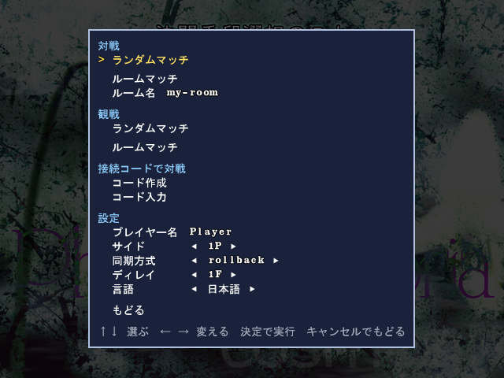
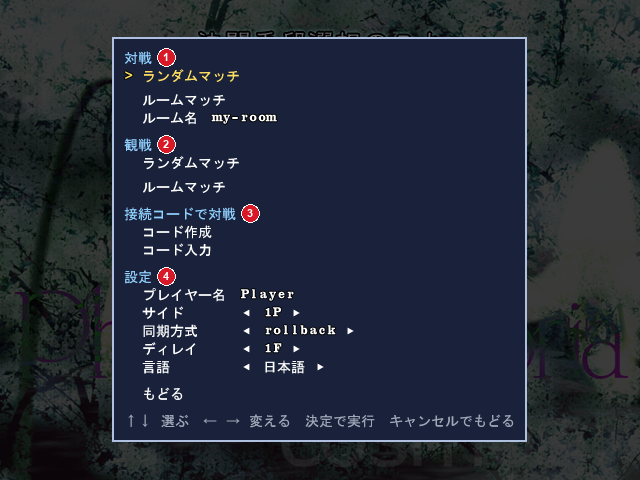

# HiganRTool

[English](./README.en.md)

東方花映塚（ver.1.50a）用の**非公式**ネット対戦ツールです。

**ZUN氏・上海アリス幻樂団とは関係ありません。自己責任で使用してください。**

Match Modeで使われていない「妖怪 対 妖怪」を間借りして、ゲームの中のメニューからネット対戦・観戦ができるようにします。
adonisやJu.N.Owenと同じく、2人の入力を交換してゲームを同じように進める仕組みです。
さらに、これまでの花映塚のツールには無かったロールバック方式（後述）で、遅延を減らしつつ快適に遊べるようにしています。

 


## 特徴

- **ランダムマッチ**: ルーム名を決めずに、同じ時間でランダムマッチに潜っている人と対戦します。
- **ルームマッチ**: 2人で同じルーム名を入力して対戦します。Ju.N.Owenのルームと同じような使い方です。
- **観戦**: ランダムマッチは一覧から選んで、ルームマッチはルーム名を入力して、観戦が行えます。サーバーを使えないときは、ホストからもらう観戦コードでも観戦できます。最大人数は10人。途中から入っても、マッチの最初から早送りで追いつきます。
- **接続コード**: ルームが使えないときは、接続コードをDiscordなどで送り合って対戦できます。Ju.N.OwenのPure P2Pと同じような仕組みです。
- **ロールバック方式**: 相手の入力が間に合わないときは予測して進め、外れていたら戻って進め直します。回線が揺れても止まりにくく、adonisより1〜2Fほど低いディレイで遊べます。adonisと同じ、相手の入力を待つdelay方式にも切り替えられます。
- **ディレイの変更**: 試合中でも、Ctrl＋数字キーでいつでも変えられます。
- **リプレイの自動保存**: マッチごとに`Replay_HiganRTool\`へ保存します。ファイル名は最初から`th9_udXXXX.rpy`の形です。対戦の情報はリプレイファイルの中に記録するので、ファイルを移動しても失われません。
- **ポート開放はほぼ不要**: 相手探しにはサーバーを使いますが、試合の通信はプレイヤー同士のPCで直接（UDP）行います。ポート開放が要るのは相手がシンメトリックNATのときだけで、ルーターがUPnPに対応していれば自動で開けます。
- **通信の暗号化**: 試合と観戦の通信は、つなぐたびに作る使い捨ての鍵で暗号化しています。
- **自動アップデート**: 起動するたびに新しいバージョンを確かめ、あれば更新します。更新した後は変更点を表示します。変えた設定は引き継ぎます。


## 必要なもの

- Windows（動作確認：Windows 11）
- 東方花映塚（ver.1.50a）
- 相手と連絡を取る手段（Discordなど）


## インストール

1. [Releases](https://github.com/Mako-th/HiganRTool/releases)から最新のzipをダウンロードします。
2. 花映塚のフォルダの**外**に展開します（例: `C:\Games\HiganRTool\`）。
3. `HiganRTool.exe`を起動します。初回だけ花映塚のフォルダを選ぶ画面が出るので、`th09.exe`のあるフォルダを選んでください。
4. 花映塚が起動したら、タイトル → Match Mode → 「妖怪 対 妖怪」 と進むと、対戦用のメニューが開きます。
5. 最初に、メニューの「プレイヤー名」で名前を決めておきましょう。相手と観戦者に表示されます。

2回目からは`HiganRTool.exe`を起動するだけです。
花映塚がもう起動しているときに`HiganRTool.exe`を起動すると、花映塚を2つ起動せずに終了します。
`th09.exe`やvpatchを直接起動すると、このツールは読み込まれません。必ず`HiganRTool.exe`から起動してください。
vpatchは読み込みませんが、フレームの管理はこのツールが代わりに行っており、入力から画面に出るまでの時間はvpatchより短いです。


## 使い方

メニューは タイトル → Match Mode → 「妖怪 対 妖怪」 で開きます。
↑↓で選び、決定・キャンセルで操作します。パッドでも操作できます。
画面の言語はWindowsの表示言語に合わせます（日本語と英語）。変えるときはメニューの「言語」で選びます。

### ランダムマッチ

ルーム名を決めずに、同じときにランダムマッチを選んだ人と対戦します。

1. メニューの一番上の「ランダムマッチ」を選びます。
2. 相手が見つかると通知音が鳴り、自動でつながります。
3. 2人とも「妖怪 対 妖怪」を選ぶと、難易度選択に進んで対戦が始まります。

待っている間は、メニューを閉じてほかのモードで遊んでいてかまいません。
待機をやめるときは、メニューの「待機をやめる」を選びます。
接続が成立するのは、同じバージョンのHiganRToolを使っている人どうしだけです。
**ランダムマッチでは、知らない相手にもグローバルIPアドレスが見えます。** 気になるときは、ルームマッチか接続コードを使ってください。
ランダムマッチは、観戦の「ランダムマッチ」の一覧に載り、誰でも観戦できます。
一覧に載せたくないときは、`HiganRTool.ini`の`[spectate]`を`enable = 0`にします。

### ルームマッチ（知り合いと遊ぶとき）

同じルーム名を入力した2人で対戦します。

1. 相手とルーム名を決めます。ルーム名には英数字と`-` `_` `@`が使用可能で、最大32文字です。ほかの人と重ならない名前にしてください。
2. 2人ともメニューの「ルーム名」に入力してから、対戦の「ルームマッチ」を選びます。
3. 相手がルームに来ると通知音が鳴り、自動でつながります。
4. 2人とも「妖怪 対 妖怪」を選ぶと、難易度選択に進んで対戦が始まります。

待っている間は、メニューを閉じてほかのモードで遊んでいてかまいません。
通知音が鳴ったら、キリの良いところで「妖怪 対 妖怪」を選んでください。
待機をやめるときは、メニューの「待機をやめる」を選びます。
同じルームには2人までしか入れません。

### 接続コード

サーバーを通さずにつなぐ方法です。ルームのサーバーが応答しないときなどに使ってください。

1. 片方が「対戦コード作成」を選びます。コードがクリップボードにコピーされるので、相手に送ります。
2. 受け取った側は、そのコードをコピーしてから「対戦コード入力」を選びます。返答コードがクリップボードにコピーされるので、送り返します。
3. 最初の側は、返答コードをコピーしてから「返答コード入力」を選びます。

「接続コード」は、対戦コードと観戦コードをまとめた呼び名です。
コードの有効期限は30分です。
接続コードでつないだマッチは、観戦コードで観戦できます（→「観戦」）。

### LAN

同じLANにいる2人で、サーバーを通さずに対戦します。
オフラインの会場や、LANケーブルでつないだ2台で使えます。
STUNやUPnPなど、インターネット向けの仕組みは使いません。

**ホストになる**

1. メニューのLANの「ホスト」を選びます。
2. メニューの下に、自分のLANのアドレスとポートが出ます（有線とWi-Fiの両方があれば両方）。
3. 相手に、そのアドレスを伝えます。

**クライアントになる**

1. 相手が、メニューのLANの「クライアント」を選びます。
2. ホストのアドレスを入力します。`192.168.0.2:17723`の形で、ポートを省くと17723です。前回入力したアドレスが初めに入っています。
3. 接続すると通知音が鳴ります。2人とも「妖怪 対 妖怪」を選ぶと、難易度選択に進んで対戦が始まります。

待っている間は、メニューを閉じてほかのモードで遊んでいてかまいません。
待機をやめるときは、メニューの「待機をやめる」を選びます。
参加できるのは先着1人です。
ホストが違えば、同じLANで何組でも同時に遊べます（実物では確かめていません）。

**LANで観戦する**

1. 対戦がつながった後に、観戦する人がメニューのLANの「観戦」を選びます。
2. ホストのアドレスを入力します。観戦コードのやりとりは要りません。

観戦を受け付けるのは、ホストの`HiganRTool.ini`で`[spectate]`が`enable = 1`のときだけです。
対戦がまだ始まっていないと、断られます。

**LANを使うとき**

- 初めて使うとき、Windowsのファイアウォールが`th09.exe`について確認を出すことがあります（出方は実物では確かめていません）。出たら「プライベート ネットワーク」を許可してください。ルーターを通さずに直接つないだときなどは、Windowsがそのネットワークを「パブリック ネットワーク」とみなすことがあり、そのときは「パブリック ネットワーク」の許可も要ります。
- ホストの待ち受けのポートは、`HiganRTool.ini`の`bind`のポートです（既定は17723）。
- 最後に入力したアドレスは、`[netplay]`の`lan_host`に書き込まれます。
- ルーターを通さずに2台をLANケーブルで直接つなぐ場合は、実物では確かめていません。自動で付く`169.254.x.x`のアドレスがホストの画面に出るはずです。

### 観戦

ランダムマッチとルームマッチを、それぞれ10人まで観戦できます。
最後まで観戦したマッチは、観戦した側にもリプレイが保存されます。
観戦をやめるときはEscを押します。

**ランダムマッチを観戦する**

1. メニューの観戦の「ランダムマッチ」を選びます。今進行中のランダムマッチが、「1Pの名前 vs 2Pの名前　観戦者の数/上限」で並びます。
2. 観戦したいマッチを選びます。満員のマッチは灰色で、選べません。8件を超えるときは、↑↓でスクロールします。
3. 2人のマッチが映ります。途中から入っても、マッチの最初から早送りで追いつきます。

一覧に載るのは、両方のプレイヤーが`HiganRTool.ini`の`[spectate]`を`enable = 1`にしているランダムマッチだけです（既定は`1`です）。

**ルームマッチを観戦する**

1. 対戦する2人からルーム名を教えてもらいます。
2. メニューの「ルーム名」に入力してから、観戦の「ルームマッチ」を選びます。
3. 2人のマッチが始まると自動で映ります。途中から入っても、マッチの最初から早送りで追いつきます。

**観戦コードで観戦する**

サーバーにつながらないときや、LANケーブルでつないだ会場で使う方法です。
接続コードでつないだマッチも、この方法で観戦できます。

1. 対戦がつながったら、ホストがCtrl＋Cを押します。観戦コードがクリップボードにコピーされるので、観戦する人に送ります。
2. 観戦する人は、観戦コードをコピーしてから、メニューの接続コードの「観戦コード入力」を選びます。

ホストは、接続したときの左上の表示に「（ホスト）」と出ている側です。
観戦コードの有効期限は30分です。
ホストのポートに外から届かないと接続できません。
同じLANにいるか、ホストのUPnPが使えるかを確かめてください。
観戦コードは`HiganRTool.ini`の`[spectate]`を`enable = 0`にしているホストでは使えません。

### 画面の見方

**メニュー**



1. **対戦**: ランダムマッチ（ルーム名を決めずに対戦）とルームマッチ（ルーム名を決めて対戦）。メニューを開いたときは、ランダムマッチにカーソルがあります。
2. **観戦**: ランダムマッチ（一覧から選んで観戦）・ルームマッチ（ルーム名を入力して観戦）。
3. **接続コード**: 対戦コード作成・対戦コード入力・観戦コード入力。サーバーを通さずに接続します（予備）。
4. **LAN**: ホスト・クライアント・観戦。同じLANの中で、サーバーを通さずに接続します。
5. **設定**: プレイヤー名・サイド・同期方式・ディレイ・言語を変えます。1つ下の画面が開きます。

プレイヤー名が初めのまま（`HiganRTool`）の間は、メニューの下に案内が出ます。
最初にメニューを開いたときだけ、カーソルは「設定」にあります。
待っている間は、待っている行の右に「待機中 0:42」のように、待った時間が出ます。

**試合中**


1. **プレイヤー名**: 左が1P、右が2Pです。
2. **Delay**: いまのディレイ（自分の入力を何フレーム遅らせて使うか。adonisのLatencyと同じ）。括弧の中はpingから決めた目安で、(A)はautoで動いていることを表します。
3. **ping**: 相手との往復の時間です。
4. **rollback**: 直近1秒で、予測が外れて戻したフレーム数のいちばん大きい値。同期方式がrollbackのときだけ出ます。

キャラ選択の画面では、左下に同期方式も出ます。
ルームや接続コードで待っている間は、画面の左上に待機中の表示が出ます。

### 試合中の操作

- **ディレイを変える**: Ctrl＋数字キー（キーボードの上の段）。0〜8はその値、9はautoです。2人とも、いつでも変えられます。
- **同期方式を変える**: キャラ選択の画面でCtrl＋Tab。2人とも変えられます。
- **観戦コードをコピーする**: Ctrl＋C。対戦がつながった後に、ホストが押します。コピーできたかどうかが、画面の左上に数秒出ます。
- **キャラ・マップのランダム選択と会話のスキップ**: Ctrlか、パッドのスキップボタン（ゲームと同じ）。Ctrl＋数字・Ctrl＋Tabを押したときも、ランダムが回り、会話が飛びます。どちらか1人のCtrlで、2人とも会話が飛びます。

### 対戦の終わり

- マッチの終わりに「リプレイを保存して終了」を選ぶと、接続を終えます（リプレイは保存済みです）。
- 対戦が終わって接続が切れると、タイトルの「妖怪 対 妖怪」に戻ります。もう一度つなぐときは、そこから選んでください。
- 相手からの応答が60秒無いと切断します（相手のゲームが固まったときも、こちらが止まったままにはなりません）。

### 設定

- **プレイヤー名**: 相手と観戦者に表示される名前です。試合中は画面の上の左右に出ます。
- **ルーム名**: ルームマッチ（対戦と観戦）で使う名前です。次に起動したときも使われます。
- **サイド**: おまかせ / 1P / 2P。希望がぶつかったときは、先にルームに入った側（接続コードなら作った側）が優先です。片方がおまかせなら、もう片方の希望に合わせます。2人ともおまかせならランダムです。
- **同期方式**: rollback（既定） / delay。2人ともrollbackのときだけrollbackになります。
- **ディレイ**: auto / 0F〜8F。autoはpingから自動で決めます。rollbackでは、同じpingでもdelay方式より低めの値を選びます。pingが小さく安定しているときは0Fです。
- **言語**: 日本語 / English。

メニューで変えた設定と選んだ花映塚の場所は、決めた時点でツールのフォルダの`HiganRTool.ini`の該当の行に書き込まれます。メニューに無い設定は、`HiganRTool.ini`を手で書き換えてください。
読めない行があっても、その行だけ使わず、既定値で動かします。
読めなかった行は、メニューの下に表示されます。

- **ウィンドウの大きさ**: `[window]`の`width` / `height`で、起動したときのウィンドウの大きさを指定できます。
- **処理を軽くする**: `[pacing]`に`auto_window = b-hybrid`と書くと、処理の重さが約4分の1になります。かわりに遅延がわずかに（約0.2ms）増えます。
- **観戦を断る**: 2人とも`[spectate]`の`enable = 0`にします。ランダムマッチも一覧に載らなくなります。
- **自動アップデートを止める**: `[loader]`の`update_check = 0`にします。

すべての項目は、zipの中の`README.txt`にあります。


## 補足

- 2人とも同じバージョンを使ってください。バージョンが違うとつながりません。
- 花映塚のフォルダのファイル（exe・設定・セーブ・replay）は書き換えません。書き込むのは`Replay_HiganRTool`の中だけです。
  ネット対戦の間も、P・Homeで自分のPCにだけスクリーンショットを撮れます（保存するのは花映塚自身で、いつもと同じ`snapshot`のフォルダです）。
  相手のPCには撮らせません。
- メモリを書き換える前に、花映塚がver.1.50aであることを確かめます。違えば何も書き換えません。
- 相手と観戦者には、グローバルIPアドレスが見えます。信頼できる相手とだけ使用してください。ランダムマッチは一覧から誰でも観戦できるので、ホストのIPアドレスは知らない観戦者にも見えます。
- ルームのサーバーは、ルーム名と接続コードを相手に渡すだけで、記録しません。試合の中身は暗号化しているので、サーバーからも読めません。
- 待機中と対戦中は、相手がシンメトリックNATでもつながるように、ルーターにUPnPでポートを開けるよう頼みます。終わったら閉じます。使わないときは`HiganRTool.ini`の`upnp = off`にしてください。
- ログはツールのフォルダの`logs`に、日ごとに1ファイル（`dll_YYYYMMDD.log`）で残ります。3日より前のものは自動で消えます。名前・Windowsのユーザー名・IPアドレスは記録しません。
- 不具合の報告は、GitHubのIssuesで受け付けています。
  Twitter: @Sinus_lunicus_ へ直接リプライしてくださっても、Discord: makocchan. へ直接送ってくださっても大丈夫です。
- 起動のときに落ちる・ウィンドウが一瞬で閉じるときは、`logs`の`loader_YYYYMMDD.log`（起動の手順の記録）も添えて報告してください。3日より前のものは自動で消えます。
- 不具合を報告するときなど、詳しいログが要るときは、`HiganRTool.ini`の`[log]`の`detail = 0`を`1`に変えてください。


## 変更履歴

バージョンごとの変更点は[CHANGELOG.md](CHANGELOG.md)にあります。


## 現在の制約

- 対応しているのはver.1.50aだけです。
- 2人ともシンメトリックNATのとき、またUDPが通らない回線ではつながりません。中継サーバーが必要になるので対応は未定です。
- 中国本土からは、VPNを使わないとルームのサーバー（ランダムマッチ・ルームマッチ・観戦の一覧）につながらないことがあります。接続コード・LAN・観戦コードはサーバーを使わないので使えます。
- Linux（Wine）で、DLLの読み込みを待つところで時間切れになることがあります。`wineserver -k`を実行してから起動し直してください。
- ほかの花映塚用のツール（対戦ツール・練習ツール）とは同時に使えません。
- 花映塚を起動してDLLを読み込ませる動きと、アップデートでファイルを置き換える動きが、セキュリティソフトに警告されることがあります。
- リプレイは1つのフォルダに9999個まで保存されます。超えると保存されないので、古いものを移すか消してください。
- v1.0.0で自動保存したリプレイは、2人のチャージの設定（slow / charge）が違うマッチだと、花映塚で再生するとずれます。
  同期方式（rollback / delay）には関係ありません。
  対戦そのものは正しい設定で進んでいて、ずれるのはリプレイの再生だけです。
  v1.1.0から、正しい設定で保存します。
  v1.0.0で保存したリプレイは、zipに入っている`HiganRTool_replay_fix.exe`で、2人の設定を選んで直せます。
  直したものは、元のフォルダの1つ上の`fix_replay\<元のフォルダ名>\<1Pの設定>-<2Pの設定>\`にできます（元のファイルは書き換えません）。
  使い方は、zipの中の`README.txt`の「リプレイを直す道具」にあります。


## 開発者向け

仕組み（同期・通信・接続・ルームのサーバー・ログ）の説明は[TECHNICAL.md](TECHNICAL.md)にあります。

### ビルド

前提: [Rust](https://rustup.rs/)（`rustup target add i686-pc-windows-msvc`）とVisual Studio Build Tools（リンカとして使います）。
花映塚は32bitなので、32bit向けにビルドします（`.cargo/config.toml`で指定済みです）。

```
cargo build --release
```

`target\i686-pc-windows-msvc\release\`に`higanrtool_loader.exe`（起動用）と`higanrtool.dll`（本体）ができます。
それぞれ`HiganRTool.exe`と`HiganRTool.dll`に名前を変えて、同じフォルダに置いてください。

- 自分でビルドしたものは、配布しているzipとはつながりません（つなぐ前にビルドの番号を比べています）。自分でビルドしたもの同士はつながります。
- ルームのサーバー（`src/server`）はCloudflare Workersで動いています。
- ソースの中の検査は、開発用の環境で回しています（検査が読み込むデータの一部は、このリポジトリに入っていません）。


## ライセンス

[GPL-3.0](./LICENSE)（バージョン3以降）。
上海アリス幻樂団は、GPLの条件に縛られずにこのソフトウェアを使い・改変し・再配布できます。


## 作者と配布元

Mako-th

<https://github.com/Mako-th/HiganRTool>
