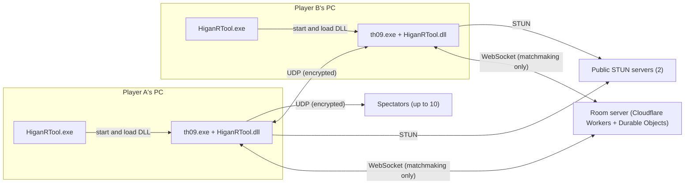
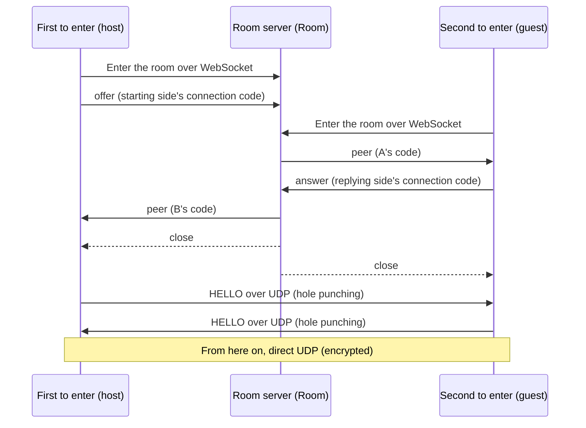

# HiganRTool technical notes

[日本語](./TECHNICAL.md) ・ [README](./README.en.md)

This document explains how HiganRTool works, for people involved in developing the tool, engineers, and anyone concerned about security.
For how to play, see the [README](./README.en.md).
Values (limits, timeouts and so on) are taken from constants in the source in this repository.
If this document and the source disagree, treat the source as correct.

## Contents

1. [Overview](#1-overview)
2. [Hooking into the game](#2-hooking-into-the-game)
3. [Synchronization](#3-synchronization)
4. [Networking](#4-networking)
5. [Connecting](#5-connecting)
6. [Room server](#6-room-server)
7. [Spectating](#7-spectating)
8. [Replays](#8-replays)
9. [Automatic updates](#9-automatic-updates)
10. [Logs and personal data](#10-logs-and-personal-data)
11. [Building and testing](#11-building-and-testing)
12. [Prior work](#12-prior-work)


## 1. Overview

The tool is a Rust workspace (`Cargo.toml`) plus a server written in TypeScript.
The game is 32-bit, so every Rust part is built for `i686-pc-windows-msvc` (static CRT).

- **Loader** (`src/loader`, `HiganRTool.exe`): Starts the game suspended, makes it load the DLL, and then lets it run. Before that, it checks for updates.
- **DLL** (`src/dll`, `HiganRTool.dll`): The main part, running inside the game process. It handles hooks, reading and writing game memory, drawing, sending and receiving UDP, and talking to the room server.
- **Core** (`src/core`): Protocol encoding and decoding, the connection state machine, the lockstep and rollback state machines, connection codes, replay parsing, and so on. It does not depend on Win32, and `#![forbid(unsafe_code)]` forbids `unsafe`. Every byte that arrives from the network is parsed here.
- **Room server** (`src/server`): A small server on Cloudflare Workers and Durable Objects. It only relays connection codes, runs the random-match queue and the spectator list, and redirects update downloads.
- **Fake opponent** (`src/peer_sim`, `peer_sim.exe`): A test opponent that speaks the protocol without the game. It is not shipped.
- **Manifest signing tool** (`src/manifest_sign`): Used by the distributor to sign the update manifest. It is not shipped.
- **Replay fix tool** (`HiganRTool_replay_fix.exe`): Fixes the header of replays saved by v1.0.0 when the two players used different charge settings. It never changes the original files.

`unsafe` is confined to the layers of the DLL and loader that touch Win32, hooks and game memory, and each use has a `// SAFETY:` comment explaining why it is sound.



Match traffic goes directly between the two players' PCs over UDP.
The room server is used only until the players find each other; match traffic never passes through it.


## 2. Hooking into the game

### 2-1. Launch and injection

The loader works in this order (`src/loader/src/launch.rs`):

1. Check that the DLL exists.
2. Read the `th09.exe` file and check that it is ver.1.50a (2-2).
3. Call `CreateProcessW` with `CREATE_SUSPENDED`, creating the game process with its main thread stopped.
4. Write the DLL's absolute path into the game process with `VirtualAllocEx` and `WriteProcessMemory`.
5. Make the game call `LoadLibraryW` through `CreateRemoteThread`, and wait for it to finish (up to 60 seconds; after 10 seconds it tells you that security software may be checking it).
6. Free the memory and let the game run with `ResumeThread`.

If any step fails, the loader kills the game, which has not run a single instruction yet, with `TerminateProcess`.
This prevents a game without the tool from starting and being mistaken for one with it.

The DLL's `DllMain` runs under the loader lock, so it does no heavy work.
It refuses a second load with a per-process named mutex, replaces the window-creation call (the one hook that must be in place before the game's main thread runs), starts one thread of its own, and returns.
That thread verifies and installs all other hooks.

### 2-2. Version check

Both the loader and the DLL check that the `th09.exe` file is ver.1.50a, by comparing values in the executable's header and the bytes at the program's entry point (`src/core/src/pe.rs`).
If any of them differs, the loader does not start the game and the DLL writes nothing to memory.
Other versions of the game are not supported.

### 2-3. Hook sites

Hook sites are kept in one table with the location, the expected bytes and the instruction boundaries (`src/dll/src/th09_addr.rs`).
Before writing, the tool compares the current bytes at that location with the expected bytes, and writes nothing to a site that does not match.
If another tool has already patched a site, that site is left alone instead of being broken.

There are mainly two kinds of patch:

- **Call target replacement**: Rewrites only the 4-byte target of an instruction that calls a game function, so that it calls a function of the tool instead. No trampoline is needed.
- **Inline detour**: Used only on runs of 5 bytes or more that contain no relative jumps or calls.

To write, the tool suspends every other thread, checks that no thread's EIP lies inside the range being rewritten, re-reads the bytes while the threads are still suspended, and writes only if they still match.
If some EIP is inside the range, it resumes everything, waits briefly and tries again (up to 50 times).
After writing, it restores the page protection and flushes the instruction cache.

The main sites are:

| Location | How it is patched | How it is used |
|---|---|---|
| The call to the routine that reads input every frame | Call target replacement | Input replacement and waiting for the opponent (2-4, 3-2) |
| The exit that skips the game update and only draws | Verified only (not rewritten) | Return point when the opponent's input does not arrive in time (3-2) |
| The call to the routine that waits for the time at the start of a frame | Call target replacement | Frame pacing (3-7) |
| The call to the routine that updates the game state within a frame | Call target replacement | Runs the update several times for rollback re-simulation and spectator fast-forward (3-3, 7) |
| Just before the end of drawing (`EndScene`) | Inline detour | Draws the tool's text and menus |
| The call to the routine that starts a match | Call target replacement | Detects the start of a match |
| Just after a replay is saved and its file is closed | Inline detour | Detects that a replay was saved (8) |
| The call that creates the window (`CreateWindowExA`) | Call replacement (inside `DllMain`) | Applies the size and position from `[window]` |

### 2-4. Input replacement

The game keeps input in three parts: 1P, 2P, and the two combined.
HiganRTool uses the same building blocks as the game's own built-in netplay.

1. It has the game's own input-reading function read the local input as 1P. The value follows the 1P key configuration.
   When the 1P input device is a gamepad, input from the keyboard's FULL layout is added.
   If the 2P input device is also a gamepad, that gamepad's input is mixed in as well.
2. Only the bits for Z, X, Shift, Esc and the directions are sent. The opponent's bits also take effect on your side, so keys such as the screenshot key are not sent.
3. It orders the two values by seat and lets the game's own input-building function produce all three parts. The previous value, press and release edges, and key repeat are produced by the game itself, so the rules are exactly those of the unmodified game.

The local input is read at the same point as in the unmodified game (the start of the input update), so reading input adds no delay.

### 2-5. Where the tool writes

The tool does not modify files in the game folder (exe, settings, save data, `replay\`).
The only place it writes inside the game folder is `Replay_HiganRTool\` (8).
Settings (`HiganRTool.ini`), logs and similar files go in the tool's own folder.

### 2-6. Rules for code on the game thread

Keeping latency as low as possible comes first, so code that runs on the game thread follows these rules:

- It does not allocate on the heap (only fixed-size arrays and ring buffers; `src/core/tests/alloc_check.rs` checks this).
- It does no blocking work such as file I/O. Log lines are pushed to a ring buffer and written by another thread.
- It does not panic. Each hook entry is wrapped in `catch_unwind`; if it ever panics, that entry passes straight through to the original code from then on, and the game keeps running as if unmodified.


## 3. Synchronization

The tool relies on the game being deterministic: if both players run the game with the same sequence of inputs, they get the same result.
It never sends the screen or game state; it exchanges inputs only.

### 3-1. Frame numbers

- **capture_frame**: The frame at which the local input was read.
- **delay**: The input delay in frames.
- **apply_frame** = capture_frame + delay: The frame at which both players use that input.

Right after the start, apply_frames 0 to delay−1 run with input 0 on both sides.
A **seg** (segment) is a number that increases each time the game enters the match scene (including rematches).
Frame numbers restart from 0 in each seg.

### 3-2. Delay netcode

This is the same approach as adonis: wait until the opponent's input arrives.

- The local input is sent over UDP as soon as it is read.
- If the opponent's input is missing, the game thread waits up to 16 ms, woken by receive events. While waiting it resends unacknowledged input every 4 ms.
- If nothing arrives within 16 ms, that frame does not advance the game update and only draws (the hook returns to the exit that skips the game update). This is the same exit the game's built-in netplay uses when it waits. Drawing and window message handling keep running, so the waiting indicator and cancel still work.
- At the start of the frame (before reading local input) it also waits up to 16 ms for the opponent's input. Because the two PCs' frames are out of phase, the side that runs ahead used to wait after reading its input; this moves that wait to before the input is read (`[netplay] head_wait`).

### 3-3. Rollback netcode

Frames whose opponent input has not arrived are run on a prediction, then rolled back and re-simulated when the real input arrives.
Rollback is used only when both players choose it; if either chooses delay, the delay netcode is used.

- **D**: The delay (input delay) under rollback. It is set the same way as for the delay netcode (3-4). apply_frame = capture_frame + D, as in the delay netcode.
- **Prediction**: Repeat the opponent's last confirmed input.
- **F** (confirmed frontier): The frame after the last frame for which both players' real inputs are known.
- **R** (prediction limit): When N − F (the gap between the current frame and the frontier) reaches R, the game waits as in the delay netcode (default 8, range 1–16). R is a local setting and is not sent over the network.

Only one state snapshot is kept: the state at the start of F.
After `Present`, if the opponent's input has arrived, the tool restores the snapshot → updates with confirmed input up to F' → takes a new snapshot → updates with predicted input up to the current frame.
Because re-simulation happens after `Present`, it adds no time between reading input and `Present`.

- **What is snapshotted**: The game's global variable ranges and the regions for players, bullets, enemies, effects and so on.
- **Rolling back allocations**: During a match, the game thread's allocations are redirected to a single region reserved by the DLL (16 MiB by default; `src/core/src/arena.rs`). The allocator state is snapshotted together with it, so restoring also rolls back allocations and frees, and the same sequence of allocations returns the same addresses.
- **Scene boundaries**: If a scene change or similar happens while running on prediction, the game waits until F catches up. Prediction never crosses a scene boundary.
- **Time sync**: From two numbers carried in the opponent's INPUT, each side estimates how many frames it is ahead. Only the side that is ahead inserts render-only frames, at most one every 3 frames, to even things out.
- **Sound effects**: A sound effect that first occurs during re-simulation is played once, after the re-simulation. By default, hit sounds are held until they are confirmed (`rollback_hit_se`).

### 3-4. Delay and auto

The delay can be set to `auto` or to 0 to 8 frames.
For both netcodes, the initial value comes from the "Delay" item in the menu or from `[netplay] delay` in `HiganRTool.ini` (`auto` or `0` to `8`; the default is `auto`).
Both players can change it with Ctrl + a number key, even during a match (9 is auto).
A change by the guest is a request to the host.
The host puts a schedule, "from this frame, the delay is x", into INPUT, and both players switch at that same frame.
Because the switch is tied to a frame number rather than to the moment of the key press, network latency cannot make the two input sequences diverge.

Auto picks a recommended value from the round-trip time (RTT):

- **Recommended value**: Based on the one-way time (RTT ÷ 2) divided by one frame (1000 ÷ 60 ms), clamped to 1–8.
  - Delay mode: the one-way frames rounded up (⌈RTT × 3 ÷ 100⌉). Anything lower makes every frame wait for the opponent's input.
  - Rollback: half of the one-way frames, rounded to the nearest (an exact half goes down). Prediction covers the other half. 30 ms RTT gives 1, 150 ms gives 2, 280 ms gives 4, 400 ms gives 6.
- **RTT**: The median of the last 8 PING/PONG exchanges, sent once per second. PONG is answered by the receive thread, so the length of a game frame is not included.
- **Re-evaluation**: Only when 9 is pressed, when the guest asks for auto, and at the start of each seg; it does not follow the RTT during a match. So that an RTT sitting on a boundary does not flip the value every match, the value goes up only if "RTT − 5 ms" still gives a higher recommendation, and goes down only after two lower recommendations in a row.

### 3-5. Synchronizing the selection screens

In menus such as character select, the two players exchange their menu inputs and both operate the same screens.
Only the key presses that move to another screen are ordered by the host and handed to both players (STEP_REQ and STEP).
The final choices (character, color, map, random seed and so on) are exchanged and checked with SELECT.
When both players select "妖怪 対 妖怪" in Match Mode, the match is set (READY).

### 3-6. Sync check (CHECK)

At frame 0 of each seg and every 30 frames after that, both players send and compare these values (`src/core/src/check.rs`):

- The RNG state and the number of RNG draws
- Both players' lives

Under rollback, only confirmed frames are compared.
If any value differs, the tool sends BYE (reason: desync), ends the connection, stops the match and asks on screen for the logs.
Continuing after a mismatch would only show the two players two different matches.

### 3-7. Frame pacing

HiganRTool takes over vpatch's job (frame pacing).
It replaces the call to the routine that waits for the time at the start of a frame, and waits there in place of the game's own clock.

- **Windowed**: Ticks a 60.000 fps grid in integer `QueryPerformanceCounter` units. Each deadline is computed as "base + ⌊j × QPF ÷ 60⌋", so rounding errors do not accumulate. A late frame is not made up for; the phase of the grid is kept. A frame starts at the moment of its deadline, and there is no wait before `Present`. The default (`b-spin`) spins until the deadline. With `[pacing] auto_window = b-hybrid`, it sleeps until just before the deadline, which lowers CPU usage (at the cost of slightly more latency).
- **Fullscreen**: Leaves it to the game's own clock and vsync.

The display mode is read every frame.
Do not use vpatch together with the tool (both patch the same site).

### 3-8. Latency policy

Minimizing input latency takes priority over everything else.

- Input is read just before the game reads it, and sent immediately.
- Waiting for the opponent is driven by receive events, not by polling at a fixed interval.
- Every packet carries all recent unacknowledged input, so a single lost packet is filled in without waiting for a resend.
- There is no DTLS, SCTP or WebRTC in between; the tool's own encryption runs directly on plain UDP (its cost is on the order of microseconds per packet).
- Work for the room server, spectators and replays is done off the game thread.


## 4. Networking

### 4-1. Packet layout

A UDP datagram is at most 1200 bytes (to stay under the path MTU).
Byte order is little-endian.
Every packet starts with a 12-byte header:

| Offset | Size | Content |
|---:|---:|---|
| 0 | 4 | magic `"HGRT"` |
| 4 | 1 | Protocol version (currently 8) |
| 5 | 1 | Type |
| 6 | 2 | Reserved (0) |
| 8 | 4 | session_id (random number chosen by the side that starts the connection) |

UDP guarantees neither order nor delivery, so acknowledgement and resending are handled per message type.
Each type has a fixed body length, and packets of the wrong length are dropped.

### 4-2. Types

| Value | Name | Direction | Content |
|---:|---|---|---|
| 1 | HELLO | Both | Starts the connection. Name, preferred netcode, random number that decides the roles, seat preference, whether spectators are accepted, build number, ephemeral public key |
| 2 | HELLO_ACK | Both | Reply to HELLO, including the public key |
| 10 | AGREE | Host → guest | Seats, netcode and delay (or D) decided by the host |
| 3 | INPUT | Both | seg, ack (the next apply_frame needed from the peer), first apply_frame, inputs (up to 32), delay change schedule |
| 4 | CHECK | Both | Sync check (3-6) |
| 8 / 9 | PING / PONG | Both | Liveness and RTT measurement (once per second) |
| 11 | SELECT | Both | Selection results |
| 16 | MENU | Both | Input on the selection screens, and cursor positions |
| 17 / 18 | STEP_REQ / STEP | Both | Request for a screen-changing key press, and the order decided by the host |
| 20 | READY | Both | "妖怪 対 妖怪" has been selected |
| 21 | HOST_STATE | Host → guest | Display-only values (such as whether auto is on) |
| 15 | BYE | Both | End (finished, disconnected, desync, cancelled) |
| 13 | SPECTATE_JOIN | Spectator → host | Request to spectate. Name, build number, public key |
| 14 | SPECTATE_STREAM | Host → spectator | Spectator records (up to 16) |
| 19 | SPECTATE_ACK | Spectator → host | What was received (end of the contiguous range, plus a 63-bit map after it) |

The side whose HELLO carries the larger random number becomes the host.
The host decides the content of AGREE, the order of screen changes and the delay schedule.
The host is also the one that streams to spectators (7).
Liveness is checked with PING/PONG once per second; if nothing arrives for 60 seconds, the connection is treated as lost.

### 4-3. Encryption and authentication

The tool does not implement its own cryptography; it uses packages from RustCrypto and `x25519-dalek` (`src/core/src/auth.rs`, `src/core/src/seal.rs`).

The side that starts the connection draws a 16-byte secret and passes it to the peer inside the connection code (5-1).
A per-connection key K is derived from the secret.
The key-exchange packets (HELLO, HELLO_ACK, SPECTATE_JOIN) are not encrypted; they carry an HMAC tag made with K at the end.
Without the secret, nobody can create or modify these packets.
Every other packet is encrypted with ephemeral X25519 keys.

```
K        = HMAC-SHA256(key = secret, msg = "HGRT v0 auth" || session_id)
tag      = first 16 bytes of HMAC-SHA256(K, header || body)        (HELLO, HELLO_ACK, SPECTATE_JOIN)

shared   = X25519(own private key, peer public key)
64 bytes = HKDF-SHA256(ikm = shared, salt = K,
                       info = "HGRT v5 keys" || session_id || first public key || second public key)
           first 32 bytes = key for "first → second", last 32 bytes = key for "second → first"
packet   = header (12 bytes) || nonce field (8 bytes) || encrypted body || tag (16 bytes)   (ChaCha20-Poly1305; the header is associated data)
nonce    = 4 zero bytes || sender id (1 byte) || sequence number (7 bytes)
```

`||` means concatenation; session_id and the sequence number are little-endian.

- **Ephemeral keys**: A new X25519 private key is generated from the OS random number generator for each connection, and the public keys are exchanged in HELLO / HELLO_ACK. "First" is the side with the larger HELLO random number for a match, and the host for spectating.
- **No nonce reuse**: The sender id is fixed per sending thread, and each sender's sequence number counts up from 0 and is never reset, so the same nonce is never used twice with the same key.
- **Weak public keys**: If a public key would make the shared value zero, no keys are derived.

Because the keys are ephemeral, recorded traffic cannot be decrypted even if the secret or the connection code leaks later (forward secrecy).
Spectating uses the same scheme, with separate keys for each spectator.

**What this does not protect against**:

- Someone who has seen the starting side's connection code (which contains the secret) and can get onto the network path can mount a man-in-the-middle attack by substituting public keys. In room matches the code passes through the room server, so the same applies to whoever operates the server. Someone who has seen the code still cannot decrypt traffic that was recorded earlier.
- HELLO, HELLO_ACK and SPECTATE_JOIN are not encrypted, so names, build numbers and public keys can be read on the path. The content of a connection code (name, candidate IP addresses and ports) is not encrypted either; it is only base64url-encoded.
- Because players connect directly, your opponent and spectators can see your global IP address.

### 4-4. Version and build number

- **Protocol version** (currently 8; `wire::PROTO_VER`): Carried in the header, in HELLO and at the start of the connection code. A peer with a different version is refused before connecting, as "the peer's version is different", after its tag has been verified. There is no backward compatibility.
- **Build number** (`update::BUILD_NUMBER`): An increasing number assigned to each released zip. It is carried in connection codes, HELLO and SPECTATE_JOIN, and a mismatch is refused before a single packet is encrypted. Synchronization depends on both players running the same code, so different builds never connect. Your own builds (number 0) connect only with other number-0 builds.


## 5. Connecting

### 5-1. Connection codes

A connection code is a string that carries everything needed to connect (`src/core/src/code.rs`).
In room matches the room server passes it along; with the connection code method, the players copy and send it to each other.

- **Starting side's code**: Version, build number, kind, session_id, expiry, name, **16-byte secret**, network type flags, and candidate addresses (up to 8). It ends with the first 4 bytes of a SHA-256 checksum to catch copy errors.
- **Replying side's code**: Has no secret and ends with the first 16 bytes of `HMAC-SHA256(K, body)`. A third party who does not know the secret cannot forge a reply code to substitute the candidates.
- **Spectating code**: Same layout as the starting side's code, with a secret drawn separately from the match and the host's spectating public key. A spectator's reply has the same layout as a replying side's code.

The text is base64url (without `=`). Codes expire after 30 minutes (5 minutes for a spectator's reply).
They are read in the order "characters → length → version → kind → checksum or tag → build number → content → expiry", so that copy errors, version mismatches and expired codes are not confused with one another.

### 5-2. Candidate addresses and STUN

A connection code lists the addresses where you might be reachable (candidates):

- **IPv6**: The address, if the OS's default source address is a globally routable IPv6 address (2000::/3).
- **LAN**: The address of the receiving socket.
- **External IPv4**: The address seen by a STUN Binding Request.

They are tried in the order IPv6 → LAN → external IPv4.
The shipped settings use two STUN servers (public STUN servers from Cloudflare and Google).
The second one is used only to detect a NAT that changes the external port per destination (symmetric NAT), by querying from the same port and comparing the port seen by the two servers.
The result goes into the code's network type flags and is used to choose the message shown when a connection fails.

### 5-3. UPnP

While waiting and during a match, the tool asks the home router through UPnP (IGD) for a UDP port mapping for the receiving port (`src/core/src/upnp.rs`, `src/dll/src/upnp.rs`).

- It discovers the router with SSDP and sends `AddPortMapping` to WANIPConnection or WANPPPConnection. The lease is one hour, and the mapping is removed with `DeletePortMapping` when done.
- It only reads `http://` URLs that point to an IPv4 address inside the LAN. Even if a device's reply points to an outside address, nothing is sent outside.
- The mapped port is added as a candidate only if the router's external address matches the address seen by STUN (otherwise it assumes double NAT and removes the mapping).
- You can turn it off with `upnp = off` in `HiganRTool.ini`.

### 5-4. Hole punching

Both players send HELLO to every candidate of the other every 20 ms.
A NAT lets in replies from addresses it has sent to, so when both sides send at the same time, a path opens.
The first path that gets a reply is used; if nothing connects within 10 seconds, the procedure is restarted and keeps going.

### 5-5. Pairs that cannot connect

- Both players are behind symmetric NATs, and neither can open a port (no UPnP).
- A network that does not pass UDP.

There is no relay server (such as TURN).
A relay would add latency and make a server carry match traffic.


## 6. Room server

### 6-1. Endpoints

Clients connect with WebSocket over HTTPS (`wss://`).
Room matches, random matches and the spectator list all run on Durable Objects.

| Path | Durable Object | Purpose |
|---|---|---|
| `/v0/rooms/<room name>` | `Room` (one per room name) | Relays connection codes between two players |
| `/v0/random/<build number>` | `RandomQueue` (one per build number) | Random-match queue |
| `/v0/watch/<build number>/post` / `view` | `WatchList` (one per build number) | List of random matches in progress (posting side / viewing side) |
| `/update/manifest`, `/update/files/<name>` | None | 302 redirect to the update manifest and files |

Connection counting uses a separate `ConnectLimiter` (one per IP).

### 6-2. Room match

A room holds at most two people.
The first to enter becomes the host and the second becomes the guest.



The room's host / guest (the side that makes the code / the side that replies) is not the same thing as the match's host / guest (decided by the HELLO random numbers).

- **Room names**: 1 to 32 characters. The client accepts only ASCII letters and digits and `-` `_` `@`. The server applies NFKC, trims surrounding whitespace and lowercases the name before looking up the room, so names that differ only in case are the same room.
- **Timeouts**: 10 minutes from when the first person enters. Once the guest has arrived, the answer must come within 1 minute. When a room expires, the client enters again automatically.
- **Keepalive**: The client sends a ping every 30 seconds. The server answers it automatically without waking the Durable Object.

### 6-3. Random match

- There is one queue per build number, so players on different builds are never paired.
- Players are paired two at a time in order of arrival. Each pair gets a new room name (`q.` + 120 random bits as 30 hex digits), sent to both, and the queue connection is closed.
- The two players then enter that room as in 6-2, and from there it works like a room match. An assigned room expires after 1 minute.
- The client cannot type `.`, so assigned room names never collide with names typed by people, and they cannot be guessed.
- A player can stay in the queue for 10 minutes; after that, the client re-enters automatically.

### 6-4. Spectator list

This is the list of random matches in progress.

- The list is posted by the match host of a random match, and only when both players have `[spectate] enable = 1`. The guest's setting reaches the host as one bit in the first packet of the connection (HELLO).
- The host sends the assigned room name, both names, the netcode, the delay, and the number and limit of spectators.
- The server checks the format of the assigned room name and derives the spectating room name itself (`w.` + the first 8 bytes of the SHA-256 of the assigned room name, in hex). The server does not keep the assigned room name and never lists it. Arbitrary spectating room names cannot be posted, so spectating rooms for room matches never appear in the list.
- When the posting side's connection closes, the entry is removed.
- The list holds up to 100 entries in total and up to 2 per IP address (per /64 for IPv6).
- Viewers receive the whole list when they open it and the whole list again whenever it changes (at most once per second).

### 6-5. What the server does not record

- State is kept only in values attached to WebSocket connections (attachments); nothing is written to storage except timeout alarms. A connection code disappears when its connection closes.
- The Worker code writes nothing to the logs (no room names, connection codes or IP addresses). The only exception is one fixed line when the connection counter itself fails.
- The connection counter keys on the IPv4 address or the IPv6 /64 and keeps only the times of connections in the last 60 seconds. It is deleted 60 seconds after the last connection.
- List entries (names and so on) are kept only while the posting side stays connected.

Match traffic does not go through the server and is encrypted, so the server cannot read the match (see also "What this does not protect against" in 4-3).

### 6-6. Rate limits

Each IP address (IPv6 /64) can connect up to 30 times per 60 seconds (counted over a sliding window).
Beyond that the server returns 429 with `Retry-After: 60`.
Before that, a coarse limit of 120 per 60 seconds is applied with Cloudflare rate limiting (so that abuse cannot use up the Durable Object request quota).
A message is limited to 2048 bytes and a connection code to 1024 characters; anything larger is closed without being read.


## 7. Spectating

- **Spectators connect only to the host**: Spectators connect only to the match host, adding no traffic to the guest or between the two players. The host's upload is about 3 KB/s per spectator (an estimate). Spectator traffic is sent by the host's receive thread; the game thread only writes once to a ring buffer.
- **Limit**: 10 spectators.
- **How to join**: For a room match, the host keeps re-entering a spectating room (`w.` + the first 8 bytes of the SHA-256 of the room name, in hex) as the host, leaving a spectating code there. A spectator enters the same room as the guest, receives the code and sends back a reply. The host sends short packets to the spectator's candidates to open a path, then accepts the spectator's SPECTATE_JOIN. For a random match, the spectator enters the same spectating room from the list in 6-4.
- **Stream**: The host puts everything that has been decided (selection screen input, selection results, match input, names, the end) into "records" with a single sequence number, and sends them. The spectator reports what it has received, and the host resends only the missing records (the resend interval is based on the RTT).
- **Margin**: A spectator starts playing once 3 frames of records have built up (so it is shown about 50 ms behind the host). This delay applies only to spectators, never to the two players.
- **Catching up**: A spectator who joins mid-match receives everything from the start of the current seg. Time spent on the selection screens is skipped, and while more than 6 frames of match input are queued, the game update is run up to 16 extra times per drawn frame to fast-forward (using at most 8 ms extra per drawn frame). Normal speed resumes at 3 frames or fewer.
- **Refusing**: In a random match, if either player has `[spectate] enable = 0`, the match is not posted to the list. In a room match, if the host has `enable = 0`, it does not enter the spectating room. The match host is decided at random, so to refuse spectators in a room match, both players set `enable = 0`.

Matches connected with connection codes cannot be spectated through a room, because there is no room name to derive a spectating room from.
Instead, the host copies a watch code with Ctrl + C, and the spectator pastes it with "Paste watch code". The spectator then connects directly to the host without going through the room server.
A watch code expires after 30 minutes, and the spectator cannot connect unless the host's port can be reached from outside.


## 8. Replays

### 8-1. Automatic saving

After a match ends and input exchange has finished, the tool directly calls the game's own replay-saving function once, with a different destination path.
The replay format, checksum and compression are produced by the game itself, so the file plays back like any other replay.

- **Location**: `<game folder>\Replay_HiganRTool\`. The layout is chosen with `[replay] layout` (`peer` = a "1P vs 2P" folder, `date`, `flat`, `pack50`).
- **File name**: `th9_udXXXX.rpy`, up to 9999 per folder.
- Before player names are used as folder names, `\ / : * ? " < > |`, control characters and characters missing from Shift-JIS are replaced, and reserved names (`CON`, `NUL` and so on) are avoided.
- Spectators also save the matches they watched to the end.

### 8-2. The `HGRT` mark

The tool detects that the save has finished at the site just after the file is closed (2-3), and another thread appends one USER chunk to the end of the same file (`src/core/src/replay.rs`).
Its content is, in order: `USER`, total length (u32), tag `HGRT`, body, NUL.
USER chunks are outside the game's checksum, so the game reads the file as usual.
A file that already has an `HGRT` chunk is left alone, and a file whose USER chunks are malformed is not touched.

The body is tab-separated ASCII, starting with `HIGANR` and the mark version (1).
Names and similar values are written as percent-encoded UTF-8.
Readers skip keys they do not know.

| Key | Content |
|---|---|
| `peer` / `self` / `side` | Opponent's name, own name, own seat (1 or 2) |
| `lat` / `ping` | Delay, RTT (ms) |
| `result` | `win` / `lose` / `draw` / `abort` |
| `at` | Local time |
| `sync` | `rollback` or `delay` |
| `build` | HiganRTool build number |
| `start` | Match start time (UTC UNIX seconds) |
| `n` | Which match this is within the connection |
| `net` | RTT median and maximum, stall count, number of re-simulations, number of frames re-simulated |
| `r1`–`r16` | Per round: frames, winner, lives, C2 and C3 counts, boss attack counts, reversal counts, scores |
| `rx` | Number of rounds beyond the limit that could not be recorded |
| `charge` | The charge settings of 1P and 2P used in the match (`0` = slow / `1` = charge). The same values are written into the replay header |
| `role` / `p1` / `p2` | Only when saved by a spectator: `watch` and both names |

IP addresses, ports, connection codes, room names and connection IDs are never written (the keys come from a closed list).


## 9. Automatic updates

In released builds, the loader checks for a new version before starting the game (`src/core/src/update.rs`, `src/loader/src/update.rs`).

1. It fetches the manifest from the room server's `/update/manifest`. The server only redirects with 302 to the distribution location (the latest GitHub Release).
2. It verifies the Ed25519 signature on the manifest's last line with the public key built into the exe. The signature covers the body with a fixed string (`"HiganRTool update manifest v1\n"`) in front, so signatures made for other purposes cannot be reused. The body is read only after the signature checks out.
3. If the version is newer, it asks in a window whether to update.
4. On "Yes", it downloads every file and checks that each size and SHA-256 matches the manifest.
5. It writes each file to `<name>.new`, reads it back, then replaces the files one by one: "current file → `.old`", "`.new` → real name". If a step fails, it undoes the steps in reverse order. Its own exe is replaced last, and the new exe is started again with the same arguments.

- The check gives up after about 2 seconds in total. Even without network access, the game start is not delayed any longer than that. A network failure means "start without checking", and no window is shown.
- The manifest is limited to 8 KiB and each file to 64 MiB.
- File names that can be replaced follow fixed rules (only ASCII letters, digits and `.` `_` `-`; up to 64 characters; no `..`; not a user file such as `HiganRTool.ini`, not the logs, not `th09.exe`, not a Windows reserved name). A name outside these rules is not used even if a signed manifest lists it.
- `.old` files are deleted on the next start after the new version has successfully started the game.
- The check is skipped for your own builds (build number 0), for an exe placed inside the game folder, with `[loader] update_check = 0`, and in a few other cases.
- The private key is not in this repository.


## 10. Logs and personal data

### 10-1. Logs

- Logs are written to `logs\` in the tool's folder, one file per day (`dll_YYYYMMDD.log`).
- Released builds delete logs older than 3 days on each start.
- The default (`[log] detail = 0`) is brief: start-up, connections, match milestones, errors and a final summary only.
- With `detail = 1`, the tool also writes detailed progress and per-frame CSV files (`_net_frames.csv.gz`, `_pacing.csv.gz`). Use it only when investigating a problem.

### 10-2. What is kept out of the logs

Just before writing, every log line goes through a scrubbing step (`src/core/src/log_scrub.rs`).
Being careful at each call site cannot catch things mixed into OS error messages, which is why it is done at the single exit.

- The name of the Windows user folder → `<user>`
- Paths of the tool and game folders → fixed placeholders
- IP addresses → the kind of address (same PC, home network, outside) and the port
- Long strings shaped like connection codes → hidden

Player names and room names are never written to the logs in the first place.

### 10-3. What others can see

- **Opponent and spectators**: Your global IP address, player name and build number.
- **Random match**: Strangers can see your IP address. Anyone can watch a match from the list when both players accept spectators, so the host's IP address is visible to unknown spectators too.
- **Room server**: Room names, connection codes (including the name, candidate addresses and the secret) and the connecting IP address. The server does not store them (6-5).


## 11. Building and testing

```
rustup target add i686-pc-windows-msvc
cargo build --release
```

This produces `higanrtool_loader.exe` and `higanrtool.dll` in `target\i686-pc-windows-msvc\release\`.
Rename them to `HiganRTool.exe` and `HiganRTool.dll` and put them in the same folder.
Visual Studio Build Tools is used as the linker.
The target and the static CRT are set in `.cargo/config.toml`.

- Released zips are built by a separate procedure that embeds the build number and enables the `dist` feature (which turns on automatic updates, embeds the shipped settings file, and strips the reverse-engineering source notes).
- Your own builds get build number 0 and cannot connect to the released zip. Number-0 builds can connect to each other.
- This public repository only guarantees that the code builds. The tests in the source are run in the development environment (some data they read is not in this repository).
- The development environment runs core unit tests, a two-peer network model, matches against the fake opponent (`peer_sim`), DLL tests that do not use the game, server tests (vitest), and a check that release build outputs are `pei-i386`.


## 12. Prior work

All code was written from scratch.
The following were used only as references for how things work (no code was copied):

- **adonis**: The existing netplay tool for this game. Where to take input, the idea of input delay, and how automatic saving behaves. There is no compatibility with it.
- **Ju.N.Owen**: The netplay tool for Touhou 19. How rooms and connection codes are used, and the in-game menu.
- **thprac**: Starting the game suspended and loading a DLL into it, and adding a mark to a replay's USER chunk.
- **giuroll**: The idea of tracking allocations so that rollback can undo them.
- **vpatch**: The job of frame pacing. Only for comparing and measuring latency, the tool also has a mode that re-implements vpatch's waiting in its own words (not used by default).
- **Hooking tools such as MinHook**: Suspending all threads and checking EIP before writing.

The packages used and their licenses are listed in `THIRD_PARTY_LICENSES.txt` in the released zip.
For cryptography it uses RustCrypto (`hmac`, `sha2`, `hkdf`, `chacha20poly1305`), `x25519-dalek` and `ed25519-dalek`.
