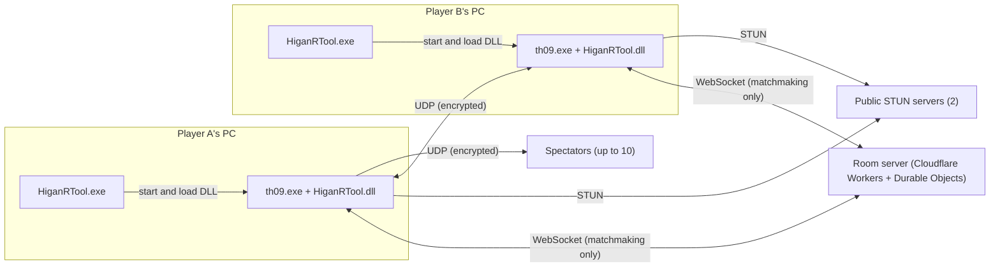
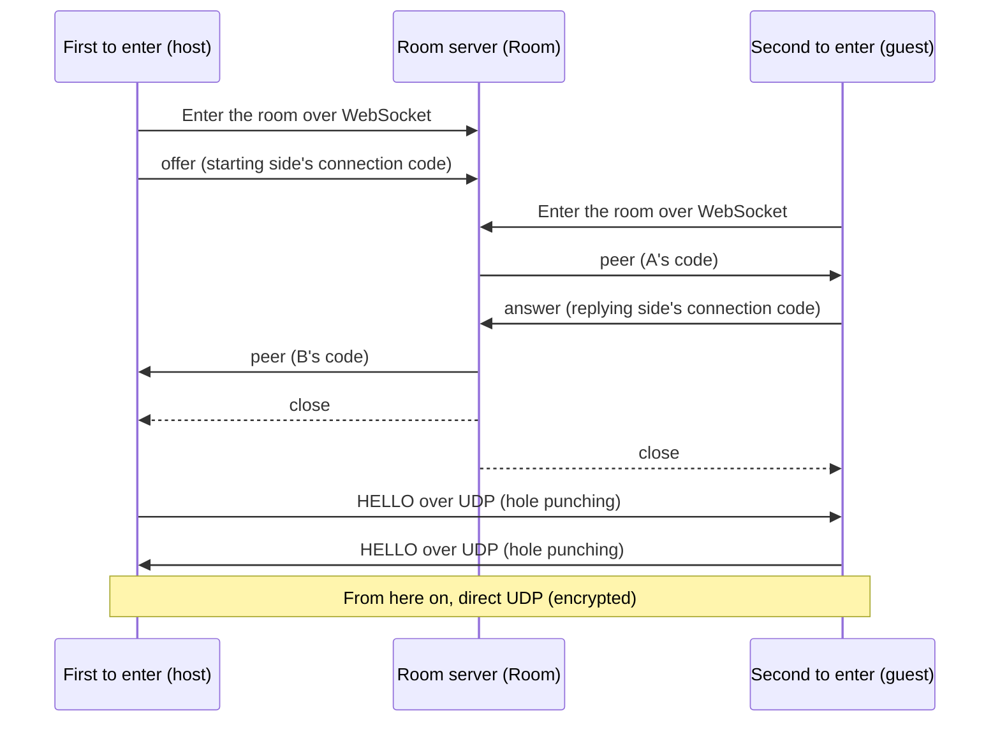

# HiganRTool technical notes

[日本語](./TECHNICAL.md) ・ [README](./README.en.md)

This document explains how HiganRTool works, for people involved in developing the tool, engineers, and anyone concerned about security.
For how to play, see the [README](./README.en.md).
Values (limits, timeouts and so on) are taken from constants in the source in this repository.
If this document and the source disagree, treat the source as correct.
This document was written by AI (see "[About the use of AI](./README.en.md#about-the-use-of-ai)" in the README).

## Contents

1. [Overview](#1-overview)
2. [Hooking into the game](#2-hooking-into-the-game)
3. [Synchronization](#3-synchronization)
4. [Networking](#4-networking)
5. [Connecting](#5-connecting)
6. [Room server](#6-room-server)
7. [Spectating](#7-spectating)
8. [Replays](#8-replays)
9. [Automatic updates](#9-automatic-updates)
10. [Logs and personal data](#10-logs-and-personal-data)
11. [Building and testing](#11-building-and-testing)
12. [Prior work](#12-prior-work)


## 1. Overview

The tool is a Rust workspace (`Cargo.toml`) plus a server written in TypeScript.
The game is 32-bit, so every Rust part is built for `i686-pc-windows-msvc` (static CRT).

- **Loader** (`src/loader`, `HiganRTool.exe`): Starts the game suspended, makes it load the DLL, and then lets it run. Before that, it checks for updates.
- **DLL** (`src/dll`, `HiganRTool.dll`): The main part, running inside the game process. It handles hooks, reading and writing game memory, drawing, sending and receiving UDP, and talking to the room server.
- **Core** (`src/core`): Protocol encoding and decoding, the connection state machine, the lockstep and rollback state machines, connection codes, replay parsing, and so on. It does not depend on Win32, and `#![forbid(unsafe_code)]` forbids `unsafe`. Every byte that arrives from the network is parsed here.
- **Room server** (`src/server`): A small server on Cloudflare Workers and Durable Objects. It only relays connection codes, runs the random-match queue and the spectator list, and redirects update downloads.
- **Fake opponent** (`src/peer_sim`, `peer_sim.exe`): A test opponent that speaks the protocol without the game. It is not shipped.
- **Manifest signing tool** (`src/manifest_sign`): Used by the distributor to sign the update manifest. It is not shipped.
- **Replay Repair Tool** (`HiganRTool_replay_fix.exe`): Fixes the header of replays saved by v1.0.0 when the two players used different charge settings. It never changes the original files.

`unsafe` is confined to the layers of the DLL and loader that touch Win32, hooks and game memory, and each use has a `// SAFETY:` comment explaining why it is sound.



Match traffic goes directly between the two players' PCs over UDP.
The room server is used only until the players find each other; match traffic never passes through it.


## 2. Hooking into the game

### 2-1. Launch and injection

The loader works in this order (`src/loader/src/launch.rs`):

1. Check that the DLL exists.
2. Read the `th09.exe` file and check that it is ver.1.50a (2-2).
3. Call `CreateProcessW` with `CREATE_SUSPENDED`, creating the game process with its main thread stopped.
4. Write the DLL's absolute path into the game process with `VirtualAllocEx` and `WriteProcessMemory`.
5. Make the game call `LoadLibraryW` through `CreateRemoteThread`, and wait for it to finish (up to 60 seconds; after 10 seconds it tells you that security software may be checking it).
6. Free the memory and let the game run with `ResumeThread`.

If any step fails, the loader kills the game, which has not run a single instruction yet, with `TerminateProcess`.
This prevents a game without the tool from starting and being mistaken for one with it.

The game takes no arguments, so `lpCommandLine` of `CreateProcessW` is NULL (`src/loader/src/real.rs`).
In that case Windows uses the executable's path, without quotes, as the command line. This is the same form as when vpatch starts the game.
Discord's game capture recognizes the game by its command-line string, so an entry registered for vpatch matches as it is.
The game does not use the contents of the command line.

Before starting the game, the loader checks that the game is not already running (`src/loader/src/single.rs`, `src/core/src/game_running.rs`).
If it is running, the loader starts nothing and exits after showing "Touhou 9 is already running."
This is because a game started second writes `th09.cfg` when it detects the double launch and exits.

- **Double-launch marker**: When the game starts, it creates a named mutex, `Touhou 08 App`, to prevent a double launch. A plain launch, vpatch and HiganRTool all create it. The loader refuses if this name already exists.
  In a normal launch, the started game keeps this name too, so that thprac can find the running game by it.
  Only development launches make this marker nameless, so that they do not collide with a game the user is playing, and they skip this check.
- **`th09.exe` with the same path**: The loader also looks in the process list for a `th09.exe` with the same path. Differences in case, `..` and the `\\?\` prefix are normalized before comparing.
- **Simultaneous launches**: When two loaders run at almost the same time, there is a moment when neither `th09.exe` is in the list yet. The span from the check to the end of the launch is serialized with a named mutex whose name is derived from the game path (FNV-1a, 64-bit). If another loader holds it, the loader refuses.
- **When the check is impossible**: If neither the process list nor the mutex can be obtained, the loader starts the game without refusing. A double launch is better than not being able to launch at all.

Some old Wine versions (such as CrossOver on Mac) lack `ProcessPrng` in `bcryptprimitives.dll`, or have it only as a stub that aborts when called (`src/prng_shim`).
Rust's standard library draws the seed for `HashMap` with this function, so without a workaround the loader and the DLL would crash around startup.
So the `build.rs` of the loader and the DLL delays loading until the first call with `/DELAYLOAD:`, and MSVC's delay-load hooks return a replacement function.
When the DLL cannot be loaded or has no `ProcessPrng` export, the failure hook substitutes it. When the export exists but is a stub, the notification hook substitutes it, only on Wine.
On Windows, the real `ProcessPrng` is used.
The replacement fills the buffer with `SystemFunction036` (RtlGenRandom) from `advapi32.dll`, and only if that cannot be obtained, with a non-cryptographic seed. That seed is used only for `HashMap`; cryptographic keys never go through this path (the DLL draws them directly with `BCryptGenRandom`).
When the loader uses the replacement, it writes how many times to the loader's log.

The DLL's `DllMain` runs under the loader lock, so it does no heavy work.
It refuses a second load with a per-process named mutex, applies only the replacements that must be in place before the game's main thread runs (the window-creation call, the gamepad D-pad entry and the two calls that save a replay), starts one thread of its own, and returns.
That thread verifies and installs all other hooks.

### 2-2. Version check

Both the loader and the DLL check that the `th09.exe` file is ver.1.50a, by comparing values in the executable's header and the bytes at the program's entry point (`src/core/src/pe.rs`).
If any of them differs, the loader does not start the game and the DLL writes nothing to memory.
Other versions of the game are not supported.

### 2-3. Hook sites

Hook sites are kept in one table with the location, the expected bytes and the instruction boundaries (`src/dll/src/th09_addr.rs`).
Before writing, the tool compares the current bytes at that location with the expected bytes, and writes nothing to a site that does not match.
If another tool has already patched a site, that site is left alone instead of being broken.

There are mainly two kinds of patch:

- **Call target replacement**: Rewrites only the 4-byte target of an instruction that calls a game function, so that it calls a function of the tool instead. No trampoline is needed.
- **Inline detour**: Used only on runs of 5 bytes or more that contain no relative jumps or calls.

To write, the tool suspends every other thread, checks that no thread's EIP lies inside the range being rewritten, re-reads the bytes while the threads are still suspended, and writes only if they still match.
If some EIP is inside the range, it resumes everything, waits briefly and tries again (up to 50 times).
After writing, it restores the page protection and flushes the instruction cache.

The main sites are:

| Location | How it is patched | How it is used |
|---|---|---|
| The call to the routine that reads input every frame | Call target replacement | Input replacement and waiting for the opponent (2-4, 3-2) |
| The exit that skips the game update and only draws | Verified only (not rewritten) | Return point when the opponent's input does not arrive in time (3-2) |
| The call to the routine that waits for the time at the start of a frame | Call target replacement | Frame pacing (3-7) |
| The call to the routine that updates the game state within a frame | Call target replacement | Runs the update several times for rollback re-simulation and spectator fast-forward (3-3, 7) |
| Just before the end of drawing (`EndScene`) | Inline detour | Draws the tool's text and menus |
| The call to the routine that starts a match | Call target replacement | Detects the start of a match |
| Just after a replay is saved and its file is closed | Inline detour | Detects that a replay was saved (8) |
| The call that creates the window (`CreateWindowExA`) | Call replacement (inside `DllMain`) | Applies the size and position from `[window]` |
| The two calls to the replay-saving routine (the save screen, and the game's built-in netplay auto-save) | Call target replacement (inside `DllMain`) | Keeps the allocation estimate from coming out too small before saving, and adds the mark after saving (8-2) |

### 2-4. Input replacement

The game keeps input in three parts: 1P, 2P, and the two combined.
HiganRTool uses the same building blocks as the game's own built-in netplay.

1. It has the game's own input-reading function read the local input as 1P. The value follows the 1P key configuration.
   When the 1P input device is a gamepad, the keyboard (FULL layout) also works.
   For this, the input the game itself reads for both players combined is added.
   So if a different gamepad is selected as the 2P input device and it is connected, that gamepad's input is mixed in as well.
   Until the match is set, input is read the game's own way.
2. Only the bits for Z, X, Shift, Esc, Ctrl and the directions are sent (Ctrl is used for skipping dialogue and random character / map select). The opponent's bits also take effect on your side, so keys such as the screenshot key are not sent.
3. It orders the two values by seat and lets the game's own input-building function produce all three parts. The previous value, press and release edges, and key repeat are produced by the game itself, so the rules are exactly those of the unmodified game.

The local input is read at the same point as in the unmodified game (the start of the input update), so reading input adds no delay.

### 2-5. Where the tool writes

The tool does not modify files in the game folder (exe, settings, save data, `replay\`).
The only place it newly writes inside the game folder is `Replay_HiganRTool\` (8).
The one exception is a replay that the user saved from the game's menu: the tool appends one USER chunk to the end of that single file once the game has finished saving it (8-2). No other byte is changed.
Settings (`HiganRTool.ini`), logs and similar files go in the tool's own folder.

### 2-6. Rules for code on the game thread

Keeping latency as low as possible comes first, so code that runs on the game thread follows these rules:

- It does not allocate on the heap (only fixed-size arrays and ring buffers; `src/core/tests/alloc_check.rs` checks this).
- It does no blocking work such as file I/O. Log lines are pushed to a ring buffer and written by another thread.
- It does not panic. Each hook entry is wrapped in `catch_unwind`; if it ever panics, that entry passes straight through to the original code from then on, and the game keeps running as if unmodified.


## 3. Synchronization

The tool relies on the game being deterministic: if both players run the game with the same sequence of inputs, they get the same result.
It never sends the screen or game state; it exchanges inputs only.

### 3-1. Frame numbers

- **capture_frame**: The frame at which the local input was read.
- **delay**: The input delay in frames.
- **apply_frame** = capture_frame + delay: The frame at which both players use that input.

Right after the start, apply_frames 0 to delay−1 run with input 0 on both sides.
A **seg** (segment) is a number that increases each time the game enters the match scene (including rematches).
Frame numbers restart from 0 in each seg.

### 3-2. Delay netcode

This is the same approach as adonis: wait until the opponent's input arrives.

- The local input is sent over UDP as soon as it is read.
- If the opponent's input is missing, the game thread waits up to 16 ms, woken by receive events. While waiting, it resends to the opponent every 4 ms its own inputs that the opponent has not yet acknowledged.
- If nothing arrives within 16 ms, that frame does not advance the game update and only draws (the hook returns to the exit that skips the game update). This is the same exit the game's built-in netplay uses when it waits. Drawing and window message handling keep running, so the waiting indicator and cancel still work.
- At the start of the frame (before reading local input) it also waits up to 16 ms for the opponent's input. Because the two PCs' frames are out of phase, the side that runs ahead used to wait for the opponent's input after reading its own input; this moves that wait to before the input is read (`[netplay] head_wait`).

### 3-3. Rollback netcode

Frames whose opponent input has not arrived are run on a prediction, then rolled back and re-simulated when the real input arrives.
Rollback is used only when both players choose it; if either chooses delay, the delay netcode is used.

- **D**: The delay (input delay) under rollback. It is set the same way as for the delay netcode (3-4). apply_frame = capture_frame + D, as in the delay netcode.
- **Prediction**: Repeat the opponent's last confirmed input.
- **F** (confirmed frontier): The frame after the last frame for which both players' real inputs are known.
- **R** (prediction limit): When N − F (the gap between the current frame and the frontier) reaches R, the game waits as in the delay netcode (default 8, range 1–16). R is a local setting and is not sent over the network.

Only one state snapshot is kept: the state at the start of F.
After `Present`, if the opponent's input has arrived, the tool restores the snapshot → updates with confirmed input up to F' → takes a new snapshot → updates with predicted input up to the current frame.
Because re-simulation happens after `Present`, it adds no time between reading input and `Present`.

- **What is snapshotted**: The game's global variable ranges and the regions for players, bullets, enemies, effects and so on.
- **Rolling back allocations**: During a match, the game thread's allocations are redirected to a single region reserved by the DLL (16 MiB by default; `src/core/src/arena.rs`). The allocator state is snapshotted together with it, so restoring also rolls back allocations and frees, and the same sequence of allocations returns the same addresses.
- **Scene boundaries**: If a scene change or similar happens while running on prediction, the game waits until F catches up. Prediction never crosses a scene boundary.
- **Time sync**: From two numbers carried in the opponent's INPUT, each side estimates how many frames it is ahead. Only the side that is ahead inserts render-only frames, at most one every 3 frames, to even things out.
- **Sound effects**: A sound effect that first occurs during re-simulation is played once, after the re-simulation. By default, hit sounds and cut-in sounds are held until they are confirmed (`rollback_hit_se`, `rollback_cutin_se`).

### 3-4. Delay and auto

The delay can be set to `auto` or to 0 to 8 frames.
For both netcodes, the initial value comes from the "Delay" item in the menu or from `[netplay] delay` in `HiganRTool.ini` (`auto` or `0` to `8`; the default is `auto`).
Both players can change it with Ctrl+number key, even during a match (9 is auto).
A change by the guest is a request to the host.
The host puts a schedule, "from this frame, the delay is x", into INPUT, and both players switch at that same frame.
Because the switch is tied to a frame number rather than to the moment of the key press, network latency cannot make the two input sequences diverge.

Auto picks a recommended value from the round-trip time (RTT):

- **Recommended value**: Based on the one-way time (RTT ÷ 2) divided by one frame (1000 ÷ 60 ms), clamped to 1–8. It is 0 only when the round trip is small and stable.
  - Delay mode: the one-way frames rounded up (⌈RTT × 3 ÷ 100⌉). Anything lower makes every frame wait for the opponent's input.
  - Rollback: half of the one-way frames, rounded to the nearest (an exact half goes down). Prediction covers the other half. 30 ms RTT gives 1, 150 ms gives 2, 280 ms gives 4, 400 ms gives 6.
  - Zero: the recommendation is 0 only when the largest of the last 8 round trips is at most 8 ms in delay mode or 16 ms in rollback. A single round trip above that rules it out, and so does having fewer than 3 measurements.
- **RTT**: The median of the last 8 PING/PONG exchanges, sent once per second. PONG is answered by the receive thread, so the length of a game frame is not included.
- **Re-evaluation**: Only when 9 is pressed, when the guest asks for auto, and at the start of each seg; it does not follow the RTT during a match. So that an RTT sitting on a boundary does not flip the value every match, the value goes up only if "RTT − 5 ms" still gives a higher recommendation, and goes down only after two lower recommendations in a row.

### 3-5. Synchronizing the selection screens

In menus such as character select, the two players exchange their menu inputs and both operate the same screens.
Only the key presses that move to another screen are ordered by the host and handed to both players (STEP_REQ and STEP).
The final choices (character, color, map, random seed and so on) are exchanged and checked with SELECT.
When both players select "妖怪 対 妖怪" in Match Mode, the match is set (READY).

### 3-6. Sync check (CHECK)

At frame 0 of each seg and every 30 frames after that, both players send and compare these values (`src/core/src/check.rs`):

- The RNG state and the number of RNG draws
- Both players' lives

Under rollback, only confirmed frames are compared.
If any value differs, the tool sends BYE (reason: desync) to the opponent, ends the connection and stops the match. On screen, it asks the players to send the logs to GitHub Issues.
Continuing after a mismatch would only show the two players two different matches.

### 3-7. Frame pacing

HiganRTool takes over vpatch's job (frame pacing).
It replaces the call to the routine that waits for the time at the start of a frame, and waits there in place of the game's own clock.

- **Windowed**: Ticks a 60.000 fps grid in integer `QueryPerformanceCounter` units. Each deadline is computed as "base + ⌊j × QPF ÷ 60⌋", so rounding errors do not accumulate. A late frame is not made up for; the phase of the grid is kept. A frame starts at the moment of its deadline, and there is no wait before `Present`. The default (`[pacing] wait = passive`) sleeps on a high-resolution waitable timer until a margin before the deadline, then yields with `Sleep(0)` and spins for the last 1 ms. With `wait = active`, it yields with `Sleep(0)` all the way to the deadline (slightly lower latency, higher CPU usage).
- **Fullscreen**: If the device's `PresentationInterval` is `IMMEDIATE` (vsync off), the tool ticks the same grid as in windowed mode. Otherwise it leaves pacing to the game's own clock and vsync.
- **Vsync** (`[pacing] vsync`): The game asks the custom.exe "no vsync" flag at two places (startup and the end of its refresh-rate measurement). The tool replaces those two calls and answers with the `HiganRTool.ini` value (`game` passes the saved value, `on` answers "vsync on", `off` answers "vsync off").
  The default is `off`. With `off`, the game skips the refresh-rate measurement at startup and creates the fullscreen device with `IMMEDIATE`, so, as in "Fullscreen" above, it runs on the same 60.000 fps grid as windowed mode.
  The saved value in `th09.cfg` is not changed.
- **Lost device**: While a fullscreen device is lost (another window is in front), the game's main loop calls `TestCooperativeLevel` without sleeping. The tool replaces that call and sleeps 10 ms each time it fails.

The display mode is read every frame.
Do not use vpatch together with the tool (both patch the same site).

### 3-8. Latency policy

Minimizing input latency takes priority over everything else.

- Input is read just before the game reads it, and sent immediately.
- Waiting for the opponent is driven by receive events, not by polling at a fixed interval.
- Every packet carries all recent unacknowledged input, so a single lost packet is filled in without waiting for a resend.
- There is no DTLS, SCTP or WebRTC in between; encryption (see 4-3) runs directly on plain UDP (its cost is on the order of microseconds per packet).
- Work for the room server, spectators and replays is done off the game thread.


## 4. Networking

### 4-1. Packet layout

A UDP datagram is at most 1200 bytes (to stay under the path MTU).
Byte order is little-endian.
Every packet starts with a 12-byte header:

| Offset | Size | Content |
|---:|---:|---|
| 0 | 4 | magic `"HGRT"` |
| 4 | 1 | Protocol version (currently 9) |
| 5 | 1 | Type |
| 6 | 2 | Reserved (0) |
| 8 | 4 | session_id (random number chosen by the side that starts the connection) |

UDP guarantees neither order nor delivery, so acknowledgement and resending are handled per message type.
Each type has a fixed body length, and packets of the wrong length are dropped.

### 4-2. Types

| Value | Name | Direction | Content |
|---:|---|---|---|
| 1 | HELLO | Both | Starts the connection. Name, preferred netcode, random number that decides the coordinator, seat preference, whether spectators are accepted, whether the host-selection method is used, build number, ephemeral public key, NAT type, D for rollback |
| 2 | HELLO_ACK | Both | Reply to HELLO, including the public key |
| 10 | AGREE | Coordinator → peer (the peer echoes the same content back) | Fixed 14 bytes. The host's seat, netcode, delay (or D), which side is the host, and the upstream bandwidth and NAT type of both sides used to decide |
| 3 | INPUT | Both | seg, ack (the next apply_frame needed from the peer), first apply_frame, inputs (up to 32), delay change schedule, timestamps for measuring the round trip (own send time, plus the send time of the last INPUT received from the peer and how long it was held) |
| 4 | CHECK | Both | Sync check (3-6) |
| 8 / 9 | PING / PONG | Both | Liveness and RTT measurement (once per second) |
| 11 | SELECT | Both | Selection results |
| 16 | MENU | Both | Input on the selection screens, and cursor positions |
| 17 / 18 | STEP_REQ / STEP | Both | Request for a screen-changing key press, and the order decided by the host |
| 20 | READY | Both | "妖怪 対 妖怪" has been selected |
| 21 | HOST_STATE | Host → guest | Display-only values (such as whether auto is on) |
| 22 | PROBE | Both (before the connection only) | A 1200-byte packet for measuring upstream bandwidth, sent 10 times back to back. The body is a sequence number (0 to 9) and zero padding |
| 23 | PROBE_RESULT | Non-coordinator → coordinator (before the connection only) | The upstream bandwidth of the coordinator, estimated from the PROBE train (B/s; 0 means it could not be measured) |
| 15 | BYE | Both | End (finished, disconnected, desync, cancelled) |
| 13 | SPECTATE_JOIN | Spectator → host or relay | Request to spectate. Name, fast-forward speed (`ff_max`), build number, public key, relay fields (public key for relaying, NAT type, number of parent changes (epoch), record number to resume from, candidate addresses) |
| 14 | SPECTATE_STREAM | Host or relay → spectator | Spectator records (up to 16) |
| 19 | SPECTATE_ACK | Spectator → host or relay | What was received (end of the contiguous range, plus a bitmap of up to 511 records after it), relay status (number of descendants, and "do not introduce"), number of the last admission request received |
| 24 | SPECTATE_INTRO | Host → spectator | Introduction of a relay. The spectator's nonce and epoch, the relay's public key for relaying, the relay's candidate addresses |
| 25 | SPECTATE_ADMIT | Host → relay | Request to admit a child. Request number, number of the record where the child starts, the child's nonce, epoch, public key and candidate addresses |
| 26 | SPECTATE_REHOME | Relay → child | No body. A signal from the relay telling its children that it will not forward records to them any more, so they should go back to the original host |
| 27 | SPECTATE_MEASURE | Host → spectator | A request to measure upstream bandwidth. The request number |
| 28 | SPECTATE_PAIR | Spectator → host | A packet of exactly 1200 bytes used to measure upstream bandwidth (one of a pair). Measurement request number, pair number, position in the pair |

The side whose HELLO carries the larger role_nonce becomes the coordinator and sends AGREE.
The host is not necessarily the coordinator.
When both sides announce in HELLO that they use the host-selection method, the host is decided in this order:

1. **NAT type**: If only one side is unreachable from its peer (symmetric NAT without UPnP), the other side is the host. If either side's type is unknown, this step does not decide.
2. **Upstream bandwidth**: After receiving the peer's HELLO, each side sends 10 PROBE packets back to back to the source of that HELLO. The receiver estimates the peer's upstream bandwidth as (difference between the largest and smallest sequence numbers received) × 1200 bytes ÷ (difference between the arrival times of those two packets). If one side is at least 1.25 times the other, the higher one is the host.
3. **role_nonce**: Otherwise the side with the larger role_nonce (the coordinator) is the host.

The non-coordinator returns its estimate in PROBE_RESULT.
The coordinator's decision is carried in AGREE together with both estimates and both NAT types.
The non-coordinator verifies it with the same formula and drops the AGREE if it does not match.
In a LAN connection the waiting side gets the larger role_nonce, so it stays the host as before.

The host decides the order of screen changes and the delay schedule.
The host is also the one that creates the spectator records and streams them to spectators (a spectator acting as a relay may forward the records it received from the host to its children; see 7).
Liveness is checked with PING/PONG once per second; if nothing arrives for 60 seconds, it treats the peer as lost and ends the connection.

### 4-3. Encryption and authentication

The tool does not implement its own cryptography; it uses packages from RustCrypto and `x25519-dalek` (`src/core/src/auth.rs`, `src/core/src/seal.rs`).

The side that starts the connection draws a 16-byte secret and passes it to the peer inside the connection code (5-1).
A per-connection key K is derived from the secret.
The key-exchange packets and PROBE (HELLO, HELLO_ACK, SPECTATE_JOIN, PROBE) are not encrypted; they carry an HMAC tag made with K at the end.
Without the secret, nobody can create or modify these packets.
Every other packet is encrypted with ephemeral X25519 keys.

```
K        = HMAC-SHA256(key = secret, msg = "HGRT v0 auth" || session_id)
tag      = first 16 bytes of HMAC-SHA256(K, header || body)        (HELLO, HELLO_ACK, SPECTATE_JOIN, PROBE)

shared   = X25519(own private key, peer public key)
64 bytes = HKDF-SHA256(ikm = shared, salt = K,
                       info = "HGRT v5 keys" || session_id || first public key || second public key)
           first 32 bytes = key for "first → second", last 32 bytes = key for "second → first"
packet   = header (12 bytes) || nonce field (8 bytes) || encrypted body || tag (16 bytes)   (ChaCha20-Poly1305; the header is associated data)
nonce    = 4 zero bytes || sender id (1 byte) || sequence number (7 bytes)
```

`||` means concatenation; session_id and the sequence number are little-endian.

- **Ephemeral keys**: A new X25519 private key is generated from the OS random number generator for each connection, and the public keys are exchanged in HELLO / HELLO_ACK. "First" is the side with the larger HELLO random number for a match, and the side that forwards (the host, or a relay) for spectating.
- **No nonce reuse**: The sender id is fixed per sending thread, and each sender's sequence number counts up from 0 and is never reset, so the same nonce is never used twice with the same key.
- **Weak public keys**: If a public key would make the shared value zero, no keys are derived.

Because the keys are ephemeral, recorded traffic cannot be decrypted even if the secret or the connection code leaks later (forward secrecy).
Spectating uses the same scheme, with separate keys for each spectator.
The key between a relay and its child is derived with the same formula from a throwaway key the relay generates and the child's key, so it differs from the key between the host and the relay (7).

**What this does not protect against**:

- Someone who has seen the starting side's connection code (which contains the secret) and can get onto the network path can mount a man-in-the-middle attack by substituting public keys. In room matches the code passes through the room server, so the same applies to whoever operates the server. Someone who has seen the code still cannot decrypt traffic that was recorded earlier.
- HELLO, HELLO_ACK and SPECTATE_JOIN are not encrypted, so names, build numbers and public keys can be read on the path. The content of a connection code (name, candidate IP addresses and ports) is not encrypted either; it is only base64url-encoded.
- Because players connect directly, your opponent and spectators can see your global IP address.
- A spectator acting as a relay handles the relayed records in decrypted form. The records include both players' inputs, names and selection results. A relay and its child spectators can see each other's global IP addresses, and the relay can also see the child's spectator name.

### 4-4. Version and build number

- **Protocol version** (currently 9; `wire::PROTO_VER`): Carried in the header, in HELLO and at the start of the connection code. A peer with a different version is refused before connecting, as "the peer's version is different", after its tag has been verified. There is no backward compatibility.
- **Build number** (`update::BUILD_NUMBER`): An increasing number assigned to each released zip. It is carried in connection codes, HELLO and SPECTATE_JOIN, and a mismatch is refused before a single packet is encrypted. Synchronization depends on both players running the same code, so different builds never connect. Your own builds (number 0) connect only with other number-0 builds.


## 5. Connecting

### 5-1. Connection codes

A connection code is a string that carries everything needed to connect (`src/core/src/code.rs`).
In room matches the room server passes it along; with the connection code method, the players copy and send it to each other.

- **Starting side's code**: Version, build number, kind, session_id, expiry, name, **16-byte secret**, network type flags, and candidate addresses (up to 8). It ends with the first 4 bytes of a SHA-256 checksum to catch copy errors.
- **Replying side's code**: Has no secret and ends with the first 16 bytes of `HMAC-SHA256(K, body)`. A third party who does not know the secret cannot forge a reply code to substitute the candidates.
- **Spectating code**: Same layout as the starting side's code, with a secret drawn separately from the match and the host's spectating public key. A spectator's reply has the same layout as a replying side's code.

The text is base64url (without `=`). Codes expire after 30 minutes.
A spectator's reply expires at the same time as the watch code it answers (the expiry the host set when it posted that code). The host checks it against its own clock, so a spectator's clock being off does not make the reply expire.
They are read in the order "characters → length → version → kind → checksum or tag → build number → content → expiry", so that copy errors, version mismatches and expired codes are not confused with one another.

### 5-2. Candidate addresses and STUN

A connection code lists the addresses where you might be reachable (candidates):

- **IPv6**: The address, if the OS's default source address is a globally routable IPv6 address (2000::/3).
- **LAN**: The address of the receiving socket.
- **External IPv4**: The address seen by a STUN Binding Request.

They are tried in the order IPv6 → LAN → external IPv4.
The shipped settings use two STUN servers (public STUN servers from Cloudflare and Google).
The second one is used only to detect a NAT that changes the external port per destination (symmetric NAT), by querying from the same port and comparing the port seen by the two servers.
The result goes into the code's network type flags and is used to choose the message shown when a connection fails.

Until the connection is made, the tool sends a Binding Request again every 15 seconds from the receiving socket to the first STUN server (`KEEP_INTERVAL_MS`; `src/core/src/stun.rs`, `src/dll/src/net_udp.rs`).
This keeps the external port that the router assigned from expiring.
While spectators are being served, it continues after the connection too (7).

### 5-3. UPnP

While waiting and during a match, the tool asks the home router through UPnP (IGD) for a UDP port mapping for the receiving port (`src/core/src/upnp.rs`, `src/dll/src/upnp.rs`).

- It discovers the router with SSDP and sends `AddPortMapping` to WANIPConnection or WANPPPConnection. The lease is one hour, and the mapping is removed with `DeletePortMapping` when done.
- It only reads `http://` URLs that point to an IPv4 address inside the LAN. Even if a device's reply points to an outside address, nothing is sent outside.
- The mapped port is added as a candidate only if the router's external address matches the address seen by STUN (otherwise it assumes double NAT and removes the mapping).
- A spectator who can act as a relay (`[spectate] relay = 1` and joined through the spectating room) also asks for a mapping of its receiving port when spectating starts. It does not wait for the result before it starts spectating, and a successful mapping is used when the host judges the NAT type while choosing relays (7).
- You can turn it off with `upnp = off` in `HiganRTool.ini`.

### 5-4. Hole punching

Both players send HELLO to every candidate of the other every 20 ms.
A NAT lets in replies from addresses it has sent to, so when both sides send at the same time, a path opens.
The first path that gets a reply is used; if nothing connects within 10 seconds, the procedure is restarted and keeps going.

### 5-5. Pairs that cannot connect

- Both players are behind symmetric NATs, and neither can open a port (no UPnP).
- A network that does not pass UDP.

There is no relay server (such as TURN).
A relay would add latency and make a server carry match traffic.


## 6. Room server

### 6-1. Endpoints

Clients connect with WebSocket over HTTPS (`wss://`).
Room matches, random matches and the spectator list all run on Durable Objects.

| Path | Durable Object | Purpose |
|---|---|---|
| `/v0/rooms/<room name>` | `Room` (one per room name) | Relays connection codes between two players |
| `/v0/random/<build number>` | `RandomQueue` (one per build number) | Random-match queue |
| `/v0/watch/<build number>/post` / `view` | `WatchList` (one per build number) | List of random matches in progress (posting side / viewing side) |
| `/update/manifest`, `/update/files/<name>` | None | 302 redirect to the update manifest and files |

Connection counting uses a separate `ConnectLimiter` (one per IP).

### 6-2. Room match

A room holds at most two people.
The first to enter becomes the host and the second becomes the guest.



The room's host / guest (the side that makes the code / the side that replies) is not the same thing as the match's host / guest (decided by the host-selection method in 4-2).

- **Room names**: 1 to 32 characters. The client accepts only ASCII letters and digits and `-` `_` `@`. The server applies NFKC, trims surrounding whitespace and lowercases the name before looking up the room, so names that differ only in case are the same room.
- **Timeouts**: 10 minutes from when the first person enters. Once the guest has arrived, the answer must come within 1 minute. When a room expires, the client enters again automatically.
- **Keepalive**: The client sends a ping every 30 seconds. The server answers it automatically without waking the Durable Object.

### 6-3. Random match

- There is one queue per build number, so players on different builds are never paired.
- Players are paired two at a time in order of arrival. Each pair gets a new room name (`q.` + 120 random bits as 30 hex digits), sent to both, and the queue connection is closed.
- The two players then enter that room as in 6-2, and from there it works like a room match. An assigned room expires after 1 minute.
- The client cannot type `.`, so assigned room names never collide with names typed by people, and they cannot be guessed.
- A player can stay in the queue for 10 minutes; after that, the client re-enters automatically.

### 6-4. Spectator list

This is the list of random matches in progress.

- The list is posted by the match host of a random match, and only when both players have `[spectate] enable = 1`. The guest's setting reaches the host as one bit in the first packet of the connection (HELLO).
- The host sends the assigned room name, both names, the netcode, the delay, and the number and limit of spectators to the server.
- The server checks the format of the assigned room name and derives the spectating room name itself (`w.` + the first 8 bytes of the SHA-256 of the assigned room name, in hex). The server does not keep the assigned room name and never lists it. Arbitrary spectating room names cannot be posted, so spectating rooms for room matches never appear in the list.
- When the posting side's connection closes, the entry is removed.
- The list holds up to 100 entries in total and up to 2 per IP address (per /64 for IPv6).
- The server sends the whole list to viewers when they open it, and sends the whole list again whenever it changes (at most once per second).

### 6-5. What the server does not record

- State is kept only in values attached to WebSocket connections (attachments); nothing is written to storage except timeout alarms. A connection code disappears when its connection closes.
- The Worker code writes nothing to the logs (no room names, connection codes or IP addresses). The only exception is one fixed line when the connection counter itself fails.
- The connection counter keys on the IPv4 address or the IPv6 /64 and keeps only the times of connections in the last 60 seconds. It is deleted 60 seconds after the last connection.
- List entries (names and so on) are kept only while the posting side stays connected.

Match traffic does not go through the server and is encrypted, so the server cannot read the match (see also "What this does not protect against" in 4-3).

### 6-6. Rate limits

Each IP address (IPv6 /64) can connect up to 30 times per 60 seconds (counted over a sliding window).
Beyond that the server returns 429 with `Retry-After: 60`.
Before that, a coarse limit of 120 per 60 seconds is applied with Cloudflare rate limiting (so that abuse cannot use up the Durable Object request quota).
A message is limited to 2048 bytes and a connection code to 1024 characters; anything larger is closed without being read.


## 7. Spectating

- **Connect to the host first**: A spectator first connects to the match host. This adds no traffic to the guest or between the two players.
  Only the match host creates and streams the spectator records. The host is chosen separately from the coordinator, as the side that is easier to punch through to and has the thicker upstream (4-2).
  The host sends a spectator that has caught up one packet per frame (60 packets a second), so when the host serves one spectator directly, its upload is about 3 KB/s of UDP payload (about 4.6 KB/s including IPv4 headers; an estimate). Spectator traffic is sent by the host's receive thread; the game thread only writes once to a ring buffer.
  To reduce the host's upload as spectators increase, spectators can relay to each other (see "Relay tree" below).
- **Limit**: 10 spectators. Descendants of a relay and spectators that have been introduced and are awaiting a reply are counted too.
- **How to join**: For a room match, the host keeps re-entering a spectating room (`w.` + the first 8 bytes of the SHA-256 of the room name, in hex) as the host, leaving a spectating code there. A spectator enters the same room as the guest, receives the spectating code, and sends the host a reply carrying its own candidate addresses through the room. The host sends short packets to the spectator's candidates to open a path, then accepts the spectator's SPECTATE_JOIN. For a random match, the spectator enters the same spectating room from the list in 6-4.
- **Stream**: The host puts everything that has been decided (selection screen input, selection results, match input, names, match status, verification, the end) into "records" with a single sequence number, and sends them. The spectator reports what it has received in an ACK to the host (or, if it is a child of a relay, to that relay), and the host resends only the missing records (the resend interval is based on the RTT).
  The host may send a spectator records only up to 512 records (the send window, `SEND_WINDOW`) past the end of what that spectator has received contiguously.
  This is enough to carry the maximum fast-forward speed (about 1,000 records per second) without a gap, even on a line with a 300 ms round trip. The width of the received-range bitmap (sack) is matched to it at 511 records (4-2).
- **Relay tree**: In random matches and room matches (spectating through the spectating room), spectators relay records to each other (`src/core/src/spectate/tree.rs`).
  The host makes spectators with a thick upstream that can accept incoming connections into relays. There are at most 2 relays (`RELAYS`), and each relay takes care of at most 4 children (`RELAY_CHILDREN`).
  A spectator who arrives later is sent to a relay with room. What the host sends directly is basically the 2 relays. Spectators that cannot be given to a relay (thin upstream, cannot accept connections, the relays are full, and so on) are accepted directly by the host, within the total of 10.
  A spectator with `[spectate] relay = 0` (default 1) never becomes a relay. Spectators who join with a connection-code match's or a LAN watch code are not relays either, so the host streams to them directly.
  A spectator who can become a relay allocates a ring buffer of the same size as the host's (262,144 records, about 9.4 MB) when spectating starts.
- **Choosing relays**: When the host sends a new spectator to a relay and fewer than 2 relays exist, it chooses as relays the suitable spectators that the host serves directly, in order of thickest upstream. A suitable spectator meets all of the following:
  - Its JOIN carries a public key for relaying (`relay = 1`).
  - Its NAT type is one that the other side can reach. A spectator behind a symmetric NAT without UPnP, or whose type is unknown, is not chosen.
  - Its upstream estimate is at least 27,880 B/s (about 0.22 Mbps), the thickness at which it can serve 4 children catch-up traffic at the default fast-forward limit (8x).
  - It has not answered "do not introduce" in its ACK.

  The upstream estimate is measured by the host, only while relays are lacking, by sending one spectator at a time a measurement request (SPECTATE_MEASURE) (`src/core/src/spectate/uplink.rs`).
  A spectator who receives the request sends the host 10 pairs of exactly 1200-byte packets (SPECTATE_PAIR), one pair every 100 ms. For each pair, the host derives a bandwidth from the difference between the arrival times of the two packets, and if there are at least 3 usable pairs (pairs whose two packets did not arrive out of order), it takes their median as the estimate.
  The host closes the measurement of a spectator 2 seconds after sending it the measurement request. A spectator that could not be measured gets another measurement request after 30 seconds (at most 2 requests in total). While the round trip of the match has grown and the spectator stream is being throttled (see "Prioritizing the match" below), no measurement request is sent.
- **Introduction and admission**: A spectator always sends its JOIN to the original host first. After deriving the key, the host either accepts it directly, or returns an introduction of a relay (SPECTATE_INTRO) encrypted with the key for that spectator.
  At the same time it sends the relay an admission request (SPECTATE_ADMIT). The request has a number. The relay puts that number in its ACK to the host to confirm receipt, and the host resends the request if the number does not come back. A request lives for 10 seconds.
  The relay accepts only the child named in the request (a JOIN whose nonce, epoch and public key match). The relay sends hole-punching packets to the child's candidates.
  The relay puts the records received from the host into its own ring buffer with their numbers unchanged, and forwards them to its children. The key with a child is derived from a throwaway key generated by the relay, with the same formula as in 4-3. The relay decrypts the records it receives and re-encrypts them with each child's key.
  A relay has no round trip of a match, so it is not throttled by round-trip growth (only the per-spectator limit applies).
- **Returning from the tree**: A child that hears no records from its relay for 3 seconds (`REJOIN_MS`), or receives REHOME from it, advances its epoch by 1 and sends JOIN to the original host again, with the number of the record to resume from (`resume_from`).
  The host either introduces another relay or accepts the spectator directly. If it still has the records to resume from in its ring buffer, it streams from there.
  A child that gets no records from the relay within 3 seconds of the introduction goes back with a "direct only" mark and is not introduced again.
  A relay sends REHOME to its children when it stops spectating and when it has not heard from the host for 3 seconds. The host does not newly introduce anyone to a relay whose ACK has not arrived for 2.5 seconds. That relay's descendants keep being counted until the relay is removed.
  When the verification (see "Verification" below) mismatches, a spectator under a relay also goes back to the original host with the "direct only" mark.
- **Swapping**: At a match boundary (right after the start of a seg is appended), if there are more direct spectators than the 2 relays, the host sends the direct spectators one at a time to a relay. This reduces the host's upload.
  The ones sent are those that cannot become relays, have received everything up to that boundary, and have sent an ACK within the last 2.5 seconds. The next one is not sent until the relay receives the request or 10 seconds pass.
- **Full house and returning spectators**: When the limit is reached, the host answers a new spectator's JOIN with BYE (cancel). This requires computing an encryption key, so the host sends at most one per second in total.
  A spectator that has not connected yet keeps resending JOIN while waiting, and shows that the match is full when the wait times out. A spectator that was connected and could not be put back because the host was full stops spectating and shows on its own screen that the match is full.
  When a relay drops, the host holds seats so that its children can return to the original host. For 5 seconds after the relay is removed (`REJOIN_MS` + 2 seconds), as many seats as that relay had descendants are kept empty, and they count in the fullness check for new spectators.
  A returning spectator (identified by nonce and public key) can take a held seat even when the host is full. This puts returning spectators ahead of new ones.
- **Re-querying STUN**: While spectators are being served, the tool sends a Binding Request again every 15 seconds from the receiving socket to the same STUN server, even after the match connection is made (only when the destination is IPv4; `src/dll/src/net_udp.rs`).
  "While spectators are being served" means while the host is waiting for spectators in the spectating room, and while it is hosting a match in which both players allow spectating.
  When the match is connected over IPv6, the host's IPv4 port mapping can lapse and the port in the watch code can become stale. This was added on that assumption (the cause is an estimate).
  When the external address or port changes, the watch code is rebuilt. If nobody has received the code that was posted, the host re-enters the spectating room and posts the new code.
- **Prioritizing the match**: So that spectator traffic does not congest the match, the spectator stream has a limit that is lowered when the round trip of the match grows (`src/core/src/spectate_rate.rs`).
  - **Limit**: Catch-up traffic per spectator is at most that spectator's fast-forward speed (`ff_max`) × the normal record rate × 1.25 (6,970 B/s when `ff_max` is 8). The normal record rate is one second of records sent packed 16 records per packet, as during catch-up (697 B/s). It is smaller than the one-packet-per-frame traffic to a caught-up spectator (about 3 KB/s) because the per-packet header and authentication tag are spread over 16 records. The total is at most the sum of the two largest limits. Normal traffic to spectators that have caught up is not counted against this limit.
  - **Measuring the round trip**: The round trip of the match is measured with every INPUT. INPUT carries its own send time and the send time of the last INPUT received from the peer together with how long it was held; subtracting the time the peer held it gives one sample.
  - **Growth**: The growth is the difference between the minimum of the last 4 samples and the minimum over the last 10 seconds. Spectator traffic only goes through the host's upstream, so the growth in the peer-to-self direction is subtracted, leaving the time spent waiting in the host's own upstream.
  - **Lowering**: When the growth exceeds 20 ms, the total limit is halved, down to 1/8. The interval between successive cuts is twice the usual round trip (100 to 1000 ms). If it keeps growing after the limit is fully lowered, traffic to spectators that have caught up is stopped as well (only keep-alive signals remain). If there has been no catch-up traffic in the last second, it is stopped at once instead of halved.
  - **Restoring**: Once the growth is back to 10 ms or less, stopped traffic is restored after 1.5 seconds. The lowered limit is raised by 1/8 per second (back to full from the floor in 7 seconds). While the samples are older than 1.5 seconds (menus, pause), it neither lowers nor restores.
- **Margin**: A spectator starts playing once 3 frames of records have built up (so it is shown about 50 ms behind the host). This delay applies only to spectators, never to the two players.
  Records keep being received even while the game is stopped (for example, while the window is being dragged). Up to about one hour of records is held; when that fills up, the watch ends.
- **Catching up**: A spectator who joins mid-match receives everything from the start of the current seg. On the spectator's side, time spent on the selection screens is skipped, and while more than 6 frames of match input are queued, the game update is run several times per drawn frame to fast-forward. Normal speed resumes at 3 frames or fewer.
  The number of updates run per drawn frame is at most `[spectate] ff_max`, counting the normal one (`src/core/src/spectate_pace.rs`). The range is 1 to 16 and the default is 8, which means 8 times normal speed.
  The actual speed is decided from the number of queued frames and the average rate at which records arrive from the host, with `ff_max` as the upper limit. Extra time per drawn frame is capped at 8 ms, so on a slow PC that cap takes effect first.
  `ff_max` is a setting on the spectator's side. The spectator carries it in JOIN, and the host uses it to decide the limit for catch-up traffic to that spectator (see "Prioritizing the match" above).
- **Pause**: When a spectator presses Esc during a match, the local game's pause menu opens. The pause menu reads only one combined input (both seats merged), so the spectator's local input is fed into that one only and the match input is left alone. The frame where Esc is pressed and the frames while the pause is open do not consume records; the next record is consumed on the update 20 frames after the resume is chosen. While the pause cannot be opened (during the host's pause being replayed, the end-of-match menu, and so on), records are not consumed and only drawing continues (shown as "Paused"; press Esc again to return). If the open / close timing is off, the rest of that seg uses the drawing-only pause. Records keep being received during the pause, so the host's resends do not increase.
- **Stopping**: Hold Esc for 3 seconds (inside or outside a match), or choose "Return to title" → "Yes" in the pause menu. When stopping inside a match, the spectator's input keeps being generated until the scene leaves the match, and the game is sent back to the title.
- **Verification**: During a match the host appends a verification record (`Record::Check`; type 9, 13 bytes) every 60 frames. It carries the frame number, the RNG state and draw count, both players' lives, and how the value was made (the game's values, or a digest of the input since the start of the seg). The spectator compares it with its own value for the same frame and counts mismatches in the log.
  If its parent is the host, a mismatch does not stop the watch.
  If its parent is a relay, the mismatched record came from that relay, and the local pause has not gone out of step, the spectator sends BYE to that relay and goes back to the original host with the "direct only" mark. This is so that a relay that rewrites records can be noticed.
  Name, match status and verification records do not advance match time, so they are excluded from the buffered-record count, fast-forward and pacing.
- **Refusing**: If either player has `[spectate] enable = 0`, no match can be watched.
  In a random match, the match is not posted to the list. In a room match, the host enters the spectating room and sends a refusal to the spectator. The room server then closes the spectator's connection with code 4403, so the spectator learns of the refusal right away. With connection codes, no watch code is made. With LAN, the host sends a refusal to the spectator (reason `WatchOff`).

Matches connected with connection codes cannot be spectated through a room, because there is no room name to derive a spectating room from.
Instead, the host copies a watch code with Ctrl+C, and the spectator pastes it with "Paste watch code". The spectator then connects directly to the host without going through the room server.
A watch code expires after 30 minutes, and the spectator cannot connect unless the host's port can be reached from outside.


## 8. Replays

### 8-1. Automatic saving

After a match ends and input exchange has finished, the tool directly calls the game's own replay-saving function once, with a different destination path.
The replay format, checksum and compression are produced by the game itself, so the file plays back like any other replay.

- **Location**: `<game folder>\Replay_HiganRTool\`. The layout is chosen with `[replay] layout` (`peer` = a "1P vs 2P" folder, `date`, `flat`, `pack50`).
- **File name**: `th9_udXXXX.rpy`, up to 9999 per folder.
- Before player names are used as folder names, `\ / : * ? " < > |`, control characters and characters missing from Shift-JIS are replaced, and reserved names (`CON`, `NUL` and so on) are avoided.
- Spectators also save the matches they watched to the end.

### 8-2. The `HGRT` mark

The tool detects that the save has finished at the site just after the file is closed (2-3), and another thread appends one USER chunk to the end of the same file (`src/core/src/replay.rs`).
Its content is, in order: `USER`, total length (u32), tag `HGRT`, body, NUL.
USER chunks are outside the game's checksum, so the game reads the file as usual.
A file that already has an `HGRT` chunk is left alone, and a file whose USER chunks are malformed is not touched.

The body is tab-separated ASCII, starting with `HIGANR` and the mark version.
The version is 1 for the mark of an automatic netplay save (8-1) and 2 for the mark of a replay saved from the game's menu (see "Mark for replays saved from the menu" below).
The table below lists the keys of version 1.
Values are percent-encoded (`%` plus 2 hex digits) except for letters, digits and `-` `_` `.` `~`.
Japanese names are encoded byte by byte as UTF-8, and the `:` in times becomes `%3A`.
Readers skip keys they do not know.

| Key | Content |
|---|---|
| `peer` / `self` / `side` | Opponent's name, own name, own seat (1 or 2) |
| `lat` / `ping` | Delay, RTT (ms) |
| `result` | `win` / `lose` / `draw` / `abort` |
| `at` | Local time of the PC that saved it (`YYYY-MM-DDThh:mm:ss`, no time zone). For example, `2026-09-25T23%3A05%3A09` is 23:05:09 on 25 September 2026 |
| `sync` | `rollback` or `delay` |
| `build` | HiganRTool build number |
| `start` | Match start time (UTC UNIX seconds) |
| `n` | Which match this is within the connection |
| `net` | RTT median and maximum, stall count, number of re-simulations, number of frames re-simulated |
| `r1`–`r16` | Per round: frames, winner, lives, C2 and C3 counts, boss attack counts, reversal counts, scores |
| `rx` | Number of rounds beyond the limit that could not be recorded |
| `charge` | The charge settings of 1P and 2P used in the match (`0` = slow / `1` = charge). The same values are written into the replay header |
| `role` / `p1` / `p2` | Only when saved by a spectator: `watch` and both names |

IP addresses, ports, connection codes, room names and connection IDs are never written (the keys come from a closed list).

**Mark for replays saved from the menu**: A replay saved from the game's menu (the Story, Extra and Match save) also gets a USER chunk of the same form after saving finishes (`src/dll/src/menu_save.rs`, `src/dll/src/menu_save_win.rs`, `src/core/src/replay.rs`).
This is so that replays from the normal modes can also be recognized as having been made with a game started through HiganRTool.

- **Body**: One tab-separated line: `HIGANR`, `2` (`MENU_MARK_VERSION`), `kind=menu`, `ver=` (HiganRTool's version name, up to 32 bytes) and `build=` (the build number), in that order. It has no netplay records, so it has a different form from version 1. A reader that knows only version 1, or a `kind` value it does not know, can skip it.
- **When it is added**: The two places in the game that call the replay-saving routine (the save screen, and the game's built-in netplay auto-save) are redirected, inside `DllMain`, to an entry point of the tool. After the saving routine returns, the entry point only writes the path, start time and `game_mode` to atomic variables, and does not touch any file. Another thread picks them up and adds the chunk only if all of the following hold:
  - The path has one of the two expected forms (`replay/th9_NN.rpy`, `./replay/th9_udnNNN.rpy`).
  - The working folder is the game folder.
  - The file's modification time is at or after the start of this save.
  - The plaintext part of the replay can be read and it does not yet have an `HGRT` mark.
- **Writing to the game's files**: The only thing added is the USER chunk at the end of the one file that has just been saved. No other byte is changed. After adding it, the tool reads the file back and verifies that the earlier part is byte-for-byte the same, that the end equals the chunk added, and that the mark can be read.
- **Avoiding a crash when saving**: The game's saving routine estimates the size of the buffer it allocates from 10 words (the per-stage flags) left on the caller's stack. When saving Story, Extra or Match, if those words are 0, the stages are not counted, the estimate comes out too small, and in a long match the routine writes past the buffer and the game crashes.
  Just before calling the saving routine, the tool writes the real per-stage flags from the replay header into the place where those 10 words are read (only in the area below its own stack's esp). It computes the estimate from the values after writing, and does not call the saving routine if the estimate is smaller than the size needed. The automatic netplay save (8-1) also calls the saving routine through the same trampoline (`src/dll/src/replay_save_win.rs`).


## 9. Automatic updates

In released builds, the loader checks for a new version before starting the game (`src/core/src/update.rs`, `src/loader/src/update.rs`).

1. It fetches the manifest from the room server's `/update/manifest`. The server only redirects with 302 to the distribution location (the latest GitHub Release).
2. It verifies the Ed25519 signature on the manifest's last line with the public key built into the exe. The signature covers the body with a fixed string (`"HiganRTool update manifest v1\n"`) in front, so signatures made for other purposes cannot be reused. The body is read only after the signature checks out.
3. If the version is newer, it asks in a window whether to update.
4. On "Yes", it downloads every file and checks that each size and SHA-256 matches the manifest.
5. It writes each file to `<name>.new`, reads it back, then replaces the files one by one: "current file → `.old`", "`.new` → real name". If a step fails, it undoes the steps in reverse order. Its own exe is replaced last, and the new exe is started again with the same arguments.

- The check gives up after about 2 seconds in total. Even without network access, the game start is not delayed any longer than that. A network failure means "start without checking", and no window is shown.
- The manifest is limited to 8 KiB and each file to 64 MiB.
- File names that can be replaced follow fixed rules (only ASCII letters, digits and `.` `_` `-`; up to 64 characters; no `..`; not a user file such as `HiganRTool.ini`, not the logs, not `th09.exe`, not a Windows reserved name). A name outside these rules is not used even if a signed manifest lists it.
- `.old` files are deleted on the next start after the new version has successfully started the game.
- The check is skipped for your own builds (build number 0), for an exe placed inside the game folder, with `[loader] update_check = 0`, and in a few other cases.
- The private key is not in this repository.


## 10. Logs and personal data

### 10-1. Logs

- Logs are written to `logs\` in the tool's folder, one file per day (`dll_YYYYMMDD.log`).
- Released builds delete logs older than 3 days on each start.
- The default (`[log] detail = 0`) is brief: start-up, connections, match milestones, errors and a final summary only.
- With `detail = 1`, the tool also writes detailed progress and per-frame CSV files (`_net_frames.csv.gz`, `_pacing.csv.gz`). Use it only when investigating a problem.

### 10-2. What is kept out of the logs

Just before writing, every log line goes through a scrubbing step (`src/core/src/log_scrub.rs`).
Being careful at each call site cannot catch things mixed into OS error messages, which is why it is done at the single exit.

- The name of the Windows user folder → `<user>`
- Paths of the tool and game folders → fixed placeholders
- IP addresses → the kind of address (same PC, home network, outside) and the port
- Long strings shaped like connection codes → hidden

Player names and room names are never written to the logs in the first place.

### 10-3. What others can see

- **Opponent and spectators**: Your global IP address, player name and build number.
- **Spectators among themselves**: In the spectator relay tree (7), a relay and its child spectators can see each other's global IP addresses. The relay can also see the child's spectator name.
- **Random match**: Strangers can see your IP address. Anyone can watch a match from the list when both players accept spectators, so the host's IP address is visible to unknown spectators too.
- **Room server**: Room names, connection codes (including the name, candidate addresses and the secret) and the connecting IP address. The server does not store them (6-5).


## 11. Building and testing

```
rustup target add i686-pc-windows-msvc
cargo build --release
```

This produces `higanrtool_loader.exe` and `higanrtool.dll` in `target\i686-pc-windows-msvc\release\`.
Rename them to `HiganRTool.exe` and `HiganRTool.dll` and put them in the same folder.
Visual Studio Build Tools is used as the linker.
The target and the static CRT are set in `.cargo/config.toml`.

- Released zips are built by a separate procedure that embeds the build number and enables the `dist` feature (which turns on automatic updates, embeds the shipped settings file, and leaves out strings used only in development logs, such as references to the notes for each hook point).
- Your own builds get build number 0 and cannot connect to the released zip. Number-0 builds can connect to each other.
- This repository runs tests with GitHub Actions on every push and pull request (`.github/workflows/tests.yml`): the Rust tests (`cargo test --workspace`), the release build, and the server tests (vitest).
  Locally, run `cargo test --workspace`, and `npm ci` and `npm test` in `src/server`, to run the same set.
- Dependabot checks for updates of dependencies (Rust crates, the npm packages in `src/server` and GitHub Actions) weekly and opens pull requests.
  They are taken in after the tests pass.
- Verification on the actual game, and tests that check its preparation (test settings and procedures) or compare against analysis notes, run only in the development environment.
  Their data is not in this repository, so those tests are not built here.
- Real-time tests (`#[ignore]`) can be run locally with `cargo test --workspace -- --ignored`.


## 12. Prior work

All code was written from scratch.
The following were used only as references for how things work (no code was copied):

- **adonis**: The existing netplay tool for this game. Where to take input, the idea of input delay, and how automatic saving behaves. There is no compatibility with it.
- **Ju.N.Owen**: The netplay tool for Touhou 19. How rooms and connection codes are used, and the in-game menu.
- **thprac**: Starting the game suspended and loading a DLL into it, and adding a mark to a replay's USER chunk.
- **giuroll**: The idea of tracking allocations so that rollback can undo them.
- **vpatch**: The job of frame pacing. Only for comparing and measuring latency, the tool also has a mode that re-implements vpatch's waiting in its own words (not used by default).
- **Hooking tools such as MinHook**: Suspending all threads and checking EIP before writing.

The packages used and their licenses are listed in `THIRD_PARTY_LICENSES.txt` in the released zip.
For cryptography it uses RustCrypto (`hmac`, `sha2`, `hkdf`, `chacha20poly1305`), `x25519-dalek` and `ed25519-dalek`.
