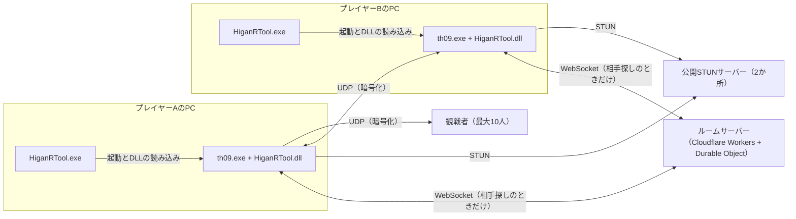
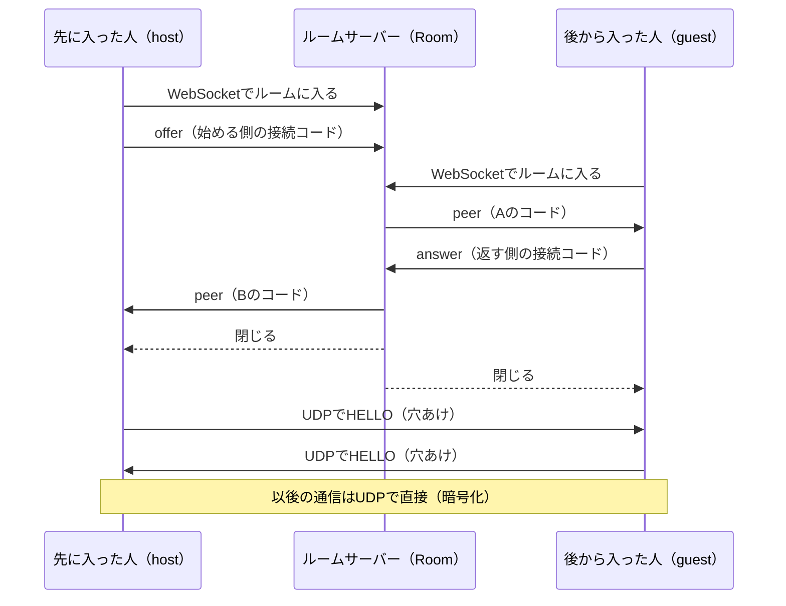

# HiganRToolの技術資料

[English](./TECHNICAL.en.md) ・ [README](./README.md)

HiganRToolの仕組みを、このツールの開発に関わる人・技術者・セキュリティが気になる人に向けて説明します。
遊び方は[README](./README.md)を見てください。
値（上限・期限など）は、このリポジトリのソースの定数から取っています。
資料とソースが食い違ったときは、ソースが正しいものとして読んでください。

## 目次

1. [全体の作り](#1-全体の作り)
2. [花映塚への組み込み](#2-花映塚への組み込み)
3. [同期](#3-同期)
4. [通信](#4-通信)
5. [接続](#5-接続)
6. [ルームサーバー](#6-ルームサーバー)
7. [観戦](#7-観戦)
8. [リプレイ](#8-リプレイ)
9. [自動アップデート](#9-自動アップデート)
10. [ログと個人情報](#10-ログと個人情報)
11. [ビルドと検査](#11-ビルドと検査)
12. [参考にしたもの](#12-参考にしたもの)


## 1. 全体の作り

Rustのワークスペース（`Cargo.toml`）と、TypeScriptのサーバーでできています。
花映塚は32bitなので、Rustの部分はすべて`i686-pc-windows-msvc`向けにビルドします（静的CRT）。

- **ローダー**（`src/loader`、`HiganRTool.exe`）: 花映塚を止めたまま起動してDLLを読み込ませ、それから動かします。起動の前に自動アップデートを確かめます。
- **DLL**（`src/dll`、`HiganRTool.dll`）: 花映塚のプロセスの中で動く本体です。フック・ゲームのメモリの読み書き・描画・UDPの送受信・ルームサーバーとの通信を受け持ちます。
- **中核**（`src/core`）: プロトコルのエンコードとデコード、接続の状態機械、lockstepとrollbackの状態機械、接続コード、リプレイの解析などです。Win32に依存せず、`#![forbid(unsafe_code)]`で`unsafe`を禁止しています。ネットワークから来るバイト列は、すべてここで読みます。
- **ルームサーバー**（`src/server`）: Cloudflare WorkersとDurable Objectで動く、小さなサーバーです。接続コードの受け渡し・ランダムマッチの待ち列・観戦の一覧・アップデートの転送だけを行います。
- **偽の対戦相手**（`src/peer_sim`、`peer_sim.exe`）: 花映塚を使わずにプロトコルを話す検査用の相手です。配布物には入りません。
- **目録の署名の道具**（`src/manifest_sign`）: 配布する側がアップデートの目録に署名する道具です。配布物には入りません。
- **リプレイの修正の道具**（`HiganRTool_replay_fix.exe`）: v1.0.0で保存した、2人のチャージの設定が違うリプレイの見出しを直します。元のファイルは書き換えません。

`unsafe`は、DLLとローダーのWin32・フック・ゲームのメモリに触る層に閉じ込め、1か所ずつ`// SAFETY:`で理由を書いています。



対戦の通信は2人のPCの間でUDPで直接行います。
ルームサーバーを使うのは相手を見つけるまでで、試合の通信は通りません。


## 2. 花映塚への組み込み

### 2-1. 起動と注入

ローダーは次の順に進みます（`src/loader/src/launch.rs`）。

1. DLLがあるかを確かめます。
2. `th09.exe`のファイルを読み、ver.1.50aかを確かめます（2-2）。
3. `CreateProcessW`を`CREATE_SUSPENDED`で呼び、主スレッドを止めたまま花映塚のプロセスを作ります。
4. `VirtualAllocEx`と`WriteProcessMemory`で、DLLの絶対パスを相手のプロセスに書きます。
5. `CreateRemoteThread`で`LoadLibraryW`を呼ばせ、終わるまで待ちます（上限60秒。10秒たっても終わらないときは、セキュリティソフトの確認を待っている可能性を知らせます）。
6. 領域を返し、`ResumeThread`で花映塚を動かします。

途中で失敗したら、まだ1命令も動いていない花映塚を`TerminateProcess`で終わらせます。
ツールの入っていない花映塚が立ち上がって、取り違えるのを防ぐためです。

DLLの`DllMain`は、ローダーロックの下で走るので重い仕事をしません。
プロセスごとの名前つきミューテックスで二重の読み込みを断り、ウィンドウを作る呼び出しの差し替え（花映塚の主スレッドが動く前でないと間に合わないもの）だけをして、自分のスレッドを1本起こして戻ります。
ほかのフックの照合と設置は、そのスレッドが行います。

### 2-2. バージョンの確かめ

ローダーとDLLの両方が、`th09.exe`のファイルがver.1.50aかを、実行ファイルのヘッダの値と、プログラムの入口のバイト列で照合します（`src/core/src/pe.rs`）。
1つでも違えば、ローダーは花映塚を起動せず、DLLはメモリに何も書きません。
ほかのバージョンの花映塚には対応していません。

### 2-3. フック地点

フック地点は、場所・期待するバイト列・命令の境目を1つの表に持っています（`src/dll/src/th09_addr.rs`）。
書き込む前に、その場所のいまのバイト列が期待するバイト列と一致するかを照合し、合わなければその地点には何も書きません。
ほかのツールが同じ地点を書き換えていても、合わない地点を壊さずに残します。

書き方は主に2種類です。

- **呼び出し先の差し替え**: ゲームの関数を呼ぶ命令の、飛び先の4バイトだけを書き換え、このツールの関数を呼ばせます。トランポリンは要りません。
- **inline detour**: 5バイト以上の、相対の分岐や呼び出しを含まない命令の並びだけを対象にします。

書くときは、自分以外のスレッドを全部止め、どのスレッドのEIPも書き換える範囲に無いことを確かめ、止めたままもう一度読み直して一致を確かめてから書きます。
EIPが範囲にあれば、全部を再開して少し待ち、やり直します（最大50回）。
書いた後は保護を戻し、命令キャッシュを流します。

主な地点は次のとおりです。

| 書き換える場所 | 書き換え方 | 使い方 |
|---|---|---|
| 毎フレームの入力を読む処理の呼び出し | 呼び出し先の差し替え | 入力の差し替えと相手の待ち（2-4・3-2） |
| ゲームの更新を飛ばして描画だけを行う出口 | 照合だけ（書き換えない） | 相手の入力が間に合わないときの戻り先（3-2） |
| フレームの始まりで時刻を待つ処理の呼び出し | 呼び出し先の差し替え | フレームのペースを取る（3-7） |
| フレームの中でゲームの状態を更新する処理の呼び出し | 呼び出し先の差し替え | rollbackの進め直しと観戦の早送りで、更新を何回も回す（3-3・7） |
| 描画の終わり（`EndScene`）の直前 | inline detour | 画面の文字やメニューを描く |
| マッチを始める処理の呼び出し | 呼び出し先の差し替え | マッチの始まりを知る |
| リプレイを保存し、ファイルを閉じた直後 | inline detour | 保存できたことを知る（8） |
| ウィンドウを作る呼び出し（`CreateWindowExA`） | 呼び出しの差し替え（`DllMain`の中で） | `[window]`の大きさと位置を使う |

### 2-4. 入力の差し替え

花映塚は入力を、1P・2P・2人を合わせたもの、の3つに分けて持ちます。
HiganRToolは、ゲーム自身の内蔵ネット対戦と同じ部品を使います。

1. 自分の入力を、ゲーム自身の入力を読む関数に1Pとして読ませます。1Pのキー設定どおりの値になります。
   1Pの入力機器がパッドのときは、キーボードのFULLの配置の入力も足します。
   2Pの入力機器もパッドなら、そのパッドの入力も混ざります。
2. 送る値は、Z・X・Shift・Esc・方向のビットだけに絞ります。相手のビットは自分の側でも効くので、スクリーンショットのキーなどは送りません。
3. 2人の値を席の順に並べ、ゲーム自身の入力を組み立てる関数に3つを作らせます。前のフレームの値・押した瞬間・離した瞬間・リピートの数え方もゲーム自身が作るので、素のゲームと同じ規則になります。

自分の入力を読む地点は素のゲームと同じ（入力の更新の最初）なので、入力の読み込みによる遅れは増えません。

### 2-5. 書き込む場所

ゲームのフォルダのファイル（exe・設定・セーブ・`replay\`）は書き換えません。
ゲームのフォルダに書くのは`Replay_HiganRTool\`の中だけです（8）。
設定（`HiganRTool.ini`）・ログなどは、ツールのフォルダに書きます。

### 2-6. ゲームのスレッドで守ること

遅延を最小にすることを最優先にしているので、ゲームのスレッドで走るコードには次の決まりがあります。

- ヒープを確保しません（固定長の配列とリングバッファだけを使います。検査`src/core/tests/alloc_check.rs`が見ます）。
- ファイルの読み書きなど、止まりうる処理をしません。ログはリングバッファに積み、別のスレッドが書きます。
- パニックさせません。フックの入口ごとに`catch_unwind`で包み、万一パニックしたら、以後その入口は元の処理へそのまま流します（素のゲームとして動き続けます）。


## 3. 同期

2人が同じ入力の列でゲームを進めれば、同じ結果になる（決定的に動く）ことを使います。
相手のPCの画面や状態は送らず、入力だけを交換します。

### 3-1. フレーム番号

- **capture_frame**: 自分の入力を読んだフレームです。
- **delay**: 入力の遅れのフレーム数です。
- **apply_frame** = capture_frame + delay: その入力を2人が使うフレームです。

始まった直後のapply_frame 0〜delay−1は、2人とも入力0で進めます。
**seg**（セグメント）は、マッチの場面に入るたびに1つ進む番号です（再戦でも進みます）。
フレーム番号はsegごとに0から数えます。

### 3-2. delay方式

adonisと同じ、相手の入力が揃うまで待つ方式です。

- 自分の入力は、読んだその場でUDPで送ります。
- 相手の入力が無ければ、受信のイベントで起きながら最大16ms待ちます。待っている間も、4msごとに未確認の入力を送り直します。
- 16msで届かなければ、そのフレームはゲームの更新を進めずに描画だけを行います（ゲームの更新を飛ばす出口へ戻します）。ゲーム自身の内蔵ネット対戦が待つときと同じ出口です。描画とウィンドウのメッセージ処理は止まらないので、待機の表示やキャンセルが効きます。
- フレームの始まり（自分の入力を読む前）にも、相手の入力を最大16ms待ちます。2台のフレームの位相のずれで、先に進む側が入力を読んだ後に待っていた時間を、入力の前へ寄せるためです（`[netplay] head_wait`）。

### 3-3. rollback方式

相手の入力が届いていないフレームを予測で進め、届いたら戻して進め直す方式です。
2人ともrollbackを選んだときだけrollbackになり、片方でもdelayならdelay方式になります。

- **D**: rollbackのディレイ（入力の遅れ）です。delay方式と同じ設定で決めます（3-4）。apply_frame = capture_frame + Dは、delay方式と同じです。
- **予測**: 相手の直前の確定した入力を繰り返します。
- **F**（確定の前線）: 2人の本物の入力が揃った最後のフレームの次です。
- **R**（予測の上限）: N − F（いまのフレームと確定の前線の差）がRに達したら、delay方式と同じく待ちます（既定8。1〜16）。Rは各自の設定で、ネットワークには載せません。

状態のコピーは1つだけ持ちます（Fの始まりの状態）。
`Present`の後で、相手の入力が届いていれば、コピーを書き戻し → 確定した入力でF'まで更新 → コピー → 予測の入力でいまのフレームまで更新、の順に行います。
進め直しは`Present`の後に行うので、入力を読んでから`Present`までの間には時間が足されません。

- **コピーの範囲**: ゲームのグローバル変数の範囲と、プレイヤー・弾・敵・エフェクトなどの領域です。
- **確保の巻き戻し**: マッチの中のゲームのスレッドの確保は、DLLが予約した1つの領域（既定16MiB）へ向けます（`src/core/src/arena.rs`）。割り当て器の状態も一緒にコピーするので、書き戻すと確保と解放も巻き戻り、同じ順の確保には同じアドレスが返ります。
- **場面の境目**: 予測で進めている間に場面の切り替えなどが起きたら、Fが追いつくまで待ちます。予測で場面の境目をまたぎません。
- **時刻合わせ**: 相手のINPUTに載る2つの数から、自分が相手より何フレーム先にいるかを見積もります。先にいる側だけが、3フレームに1回まで描画だけのフレームを入れて揃えます。
- **効果音**: 進め直しで初めて起きた効果音は、進め直しの後で1回だけ鳴らします。被弾の音は、既定では確定するまで鳴らしません（`rollback_hit_se`）。

### 3-4. ディレイとauto

ディレイは`auto`か0〜8フレームから選べます。
同期方式によらず、初めの値はメニューの「ディレイ」か、`HiganRTool.ini`の`[netplay] delay`（`auto`・`0`〜`8`。既定は`auto`）で決めます。
試合中でも、2人ともCtrl＋数字キーで変えられます（9はauto）。
ゲストの変更はホストへの要求になります。
ホストは「このフレームからディレイをxにする」という予定をINPUTに載せ、2人はその同じフレームで切り替えます。
押した瞬間ではなくフレーム番号で切り替えるので、通信の遅れがあっても2人の入力の列はずれません。

autoは、往復の時間（RTT）から推奨値を決めます。

- **推奨値**: 片道（RTT ÷ 2）を1フレーム（1000 ÷ 60ms）で割ったフレーム数を元にし、1〜8に収めます。
  - delay方式: 片道のフレーム数を切り上げます（⌈RTT × 3 ÷ 100⌉）。これより小さいと、毎フレーム相手の入力を待ちます。
  - rollback: 片道のフレーム数の半分を四捨五入します（ちょうど半分は低い方）。残りの半分は予測で埋めます。往復30msで1、150msで2、280msで4、400msで6です。
- **RTT**: 1秒に1回のPING/PONGの、直近8回の中央値です。PONGは受信のスレッドが返すので、ゲームのフレームの長さは入りません。
- **見直し**: 9を押したとき・ゲストがautoを求めたとき・segの始まりにだけ見直します。マッチの途中では追いません。RTTが境目で揺れてマッチごとに値が替わらないよう、上げるのは「RTT − 5ms」でも推奨値が上がるときだけ、下げるのは2回続けて下がったときだけにしています。

### 3-5. 選択画面の同期

キャラ選択などのメニューでは、2人のメニューの入力を交換して、同じ画面を互いに操作します。
画面を移る押下だけは、ホストが順番を決めて2人に配ります（STEP_REQとSTEP）。
選んだ結果（キャラ・色・マップ・乱数の種など）はSELECTで送り合って確かめます。
2人がMatch Modeの「妖怪 対 妖怪」を選ぶと、対戦が成立します（READY）。

### 3-6. 同期の確かめ（CHECK）

各segのフレーム0と、以後30フレームごとに、次の値を送り合って比べます（`src/core/src/check.rs`）。

- 乱数の状態と、乱数を引いた回数
- 2人のライフ

rollbackでは、確定したフレームの値だけで比べます。
1つでも食い違ったら、BYE（理由: 同期ズレ）を送って接続を終え、その試合を止めて、ログを送ってもらうよう画面に出します。
食い違ったまま続けても、2人の画面は別の試合になってしまうためです。

### 3-7. フレームのペース

vpatchの役目（フレームのペース）はHiganRTool自身が持ちます。
フレームの始まりで時刻を待つ処理の呼び出しを差し替え、ゲーム自身の時計の代わりに待ちます。

- **ウィンドウ**: `QueryPerformanceCounter`の整数で、60.000fpsの格子を刻みます。期限の時刻は毎回「基点 + ⌊j × QPF ÷ 60⌋」で作り、端数が積もりません。遅れたフレームは取り戻さず、格子の位相は保ちます。期限の瞬間にフレームを始め、`Present`の前では待ちません。既定（`b-spin`）は期限の直前まで回って待ちます。`[pacing] auto_window = b-hybrid`にすると、期限の手前まで寝てCPUの使用率を下げます（遅延はわずかに増えます）。
- **全画面**: ゲーム自身の時計と垂直同期に任せます。

画面の形はフレームごとに読みます。
vpatchと併用しないでください（同じ地点を書き換えます）。

### 3-8. 遅延についての方針

入力の遅延を最小にすることを、ほかの何よりも優先しています。

- 入力はゲームが読む直前に取り、その場で送ります。
- 相手の待ちは、一定の間隔ではなく、受信のイベントで起きます。
- 毎回のパケットに、まだ確認されていない直近の入力をまとめて載せ、1つ落ちても送り直しを待たずに埋めます。
- DTLS・SCTP・WebRTCを挟まず、素のUDPに自前の暗号化を載せます（暗号化の費用は1通あたりマイクロ秒の桁です）。
- ルームサーバー・観戦・リプレイの仕事は、ゲームのスレッドの外で行います。


## 4. 通信

### 4-1. パケットの形

UDPの1データグラムは1200バイト以下です（経路のMTUを割らないため）。
バイト順はリトルエンディアンです。
すべてのパケットは12バイトのヘッダで始まります。

| オフセット | 幅 | 中身 |
|---:|---:|---|
| 0 | 4 | magic `"HGRT"` |
| 4 | 1 | プロトコルのバージョン（いまは8） |
| 5 | 1 | 種類 |
| 6 | 2 | 予約（0） |
| 8 | 4 | session_id（接続を始める側が作る乱数） |

順序も到達も保証しないので、確認と送り直しはメッセージごとに自分で持ちます。
本文の長さは種類ごとに決まっていて、合わないものは捨てます。

### 4-2. 種類

| 値 | 名前 | 向き | 中身 |
|---:|---|---|---|
| 1 | HELLO | 両方向 | 接続の始まり。名前・望む同期方式・役を決める乱数・席の希望・観戦を受け付けるか・ビルド番号・使い捨ての公開鍵 |
| 2 | HELLO_ACK | 両方向 | HELLOへの返し。公開鍵を含む |
| 10 | AGREE | ホスト → ゲスト | ホストが決めた席・同期方式・delay（またはD） |
| 3 | INPUT | 両方向 | seg・確認（相手から次に要るapply_frame）・最初のapply_frame・入力（最大32個）・ディレイの切り替えの予定 |
| 4 | CHECK | 両方向 | 同期の確かめ（3-6） |
| 8 / 9 | PING / PONG | 両方向 | 生存の確かめとRTTの測定（1秒に1回） |
| 11 | SELECT | 両方向 | 選択の結果 |
| 16 | MENU | 両方向 | 選択画面の入力と、カーソルの位置 |
| 17 / 18 | STEP_REQ / STEP | 両方向 | 画面を移る押下の要求と、ホストが決めた順番 |
| 20 | READY | 両方向 | 「妖怪 対 妖怪」を選んだ |
| 21 | HOST_STATE | ホスト → ゲスト | 表示用の値（autoかどうかなど） |
| 15 | BYE | 両方向 | 終わり（終了・切断・同期ズレ・取り消し） |
| 13 | SPECTATE_JOIN | 観戦者 → ホスト | 観戦の申し込み。名前・ビルド番号・公開鍵 |
| 14 | SPECTATE_STREAM | ホスト → 観戦者 | 観戦の記録（最大16個） |
| 19 | SPECTATE_ACK | 観戦者 → ホスト | 受け取った範囲（連続の終わりと、その後ろの63個のビット） |

ホストとゲストは、HELLOに載せた乱数の大きい側がホストです。
ホストは、AGREEの中身・画面を移る順番・ディレイの予定を決めます。
観戦者へ配るのもホストです（7）。
1秒に1回のPING/PONGで生存を確かめ、60秒何も届かなければ切れたものとして終わります。

### 4-3. 暗号化と認証

暗号は自作せず、RustCryptoと`x25519-dalek`のパッケージを使っています（`src/core/src/auth.rs`・`src/core/src/seal.rs`）。

接続を始める側が16バイトの秘密を引き、接続コードに載せて相手に渡します（5-1）。
秘密からは、接続ごとの鍵Kを作ります。
鍵の交換の便（HELLO・HELLO_ACK・SPECTATE_JOIN）は暗号化せず、Kで作ったHMACのタグを末尾に付けます。
秘密を知らない者は、この便を作ることも書き換えることもできません。
それ以外の全部の便は、X25519の使い捨ての鍵で暗号化します。

```
K        = HMAC-SHA256(key = 秘密, msg = "HGRT v0 auth" || session_id)
タグ     = HMAC-SHA256(K, ヘッダ || 本文) の先頭16バイト        （HELLO・HELLO_ACK・SPECTATE_JOIN）

共有の値 = X25519(自分の秘密鍵, 相手の公開鍵)
64バイト = HKDF-SHA256(ikm = 共有の値, salt = K,
                       info = "HGRT v5 keys" || session_id || 前の公開鍵 || 後ろの公開鍵)
           前の32バイト = 「前 → 後ろ」の鍵、後ろの32バイト = 「後ろ → 前」の鍵
便       = ヘッダ12バイト || nonceの欄8バイト || 暗号化した本文 || タグ16バイト   （ChaCha20-Poly1305。ヘッダは追加の認証データ）
nonce    = 0の4バイト || 送り手の印1バイト || 通し番号7バイト
```

`||`はバイト列をつなぐことを表し、session_idと通し番号はリトルエンディアンです。

- **使い捨ての鍵**: 接続ごとにOSの乱数でX25519の秘密鍵を作り、公開鍵をHELLO / HELLO_ACKで交換します。「前」は、対戦ではHELLOの乱数の大きい側、観戦ではホストです。
- **nonceを2回使わない**: 送り手の印は送るスレッドごとに固定し、通し番号は送り手ごとに0から増やして戻さないので、同じ鍵で同じnonceを2回使いません。
- **弱い公開鍵**: 共有の値が0になる公開鍵を受けたら、鍵を作りません。

使い捨ての鍵なので、後から秘密や接続コードが漏れても、記録された中身は読めません（前方秘匿）。
観戦も同じ式で、観戦者ごとに別の鍵になります。

**守れないもの**:

- 始める側の接続コード（秘密を含みます）を見た者が通信の経路に割り込めれば、公開鍵を差し替えて中継する攻撃は防げません。ルームマッチではコードがルームサーバーを通るので、サーバーを運用する者にも同じことが言えます。コードを見た者が、すでに記録された通信を後から読むことはできません。
- HELLO・HELLO_ACK・SPECTATE_JOINは暗号化しないので、名前・ビルド番号・公開鍵は経路の上から読めます。接続コードの中身（名前・候補のIPアドレスとポート）も暗号化していません（base64urlで書いただけです）。
- 直接つなぐ方式なので、相手と観戦者には自分のグローバルIPアドレスが見えます。

### 4-4. バージョンとビルド番号

- **プロトコルのバージョン**（いまは8。`wire::PROTO_VER`）: ヘッダ・HELLO・接続コードの先頭に載せます。違う相手とは、タグを確かめた後に「相手のバージョンが違う」として、つながる前に断ります。後方互換は持ちません。
- **ビルド番号**（`update::BUILD_NUMBER`）: 配布するzipごとに付く、増えていく番号です。接続コード・HELLO・SPECTATE_JOINに載せ、自分と違えば1通も暗号化する前に断ります。同期は2人のコードが同じことに頼っているので、違うビルドとはつなぎません。自分でビルドしたもの（番号0）は、番号0どうしでだけつながります。


## 5. 接続

### 5-1. 接続コード

接続コードは、接続に要るものをまとめた文字列です（`src/core/src/code.rs`）。
ルームマッチではルームサーバーが受け渡し、接続コードの方式ではプレイヤーがコピーして送り合います。

- **始める側**のコード: バージョン・ビルド番号・種類・session_id・有効期限・名前・**秘密16バイト**・回線の型の印・候補のアドレス（最大8個）。末尾はコピーの誤りを見つけるSHA-256の先頭4バイトです。
- **返す側**のコード: 秘密を持たず、末尾が`HMAC-SHA256(K, 本文)`の先頭16バイトです。秘密を知らない第三者が、返す側のコードを偽って候補を差し替えることはできません。
- **観戦用**のコード: 始める側と同じ形で、対戦とは別に引いた秘密と、ホストの観戦用の公開鍵を持ちます。観戦者の返しは返す側と同じ形です。

文字はbase64url（`=`なし）で、有効期限は30分（観戦者の返しは5分）です。
読む順は「文字 → 長さ → バージョン → 種類 → 検算かタグ → ビルド番号 → 中身 → 有効期限」で、コピーの誤り・バージョン違い・期限切れを取り違えないようにしています。

### 5-2. 候補のアドレスとSTUN

接続コードには、自分に届きうるアドレス（候補）を並べます。

- **IPv6**: OSの既定の送り元が世界に通じるIPv6（2000::/3）なら、そのアドレス。
- **LAN**: 受信ソケットのアドレス。
- **外側のIPv4**: STUNのBinding Requestで見えたアドレス。

試す順はIPv6 → LAN → 外側のIPv4です。
配布の設定では、STUNの問い合わせ先を2か所（CloudflareとGoogleの公開STUNサーバー）にしています。
2か所目は、同じポートから聞いて1か所目と見えたポートを比べ、宛先ごとに外側のポートを変える型（シンメトリックNAT）かを見分けるためだけに使います。
結果は接続コードの「回線の型の印」に載せ、つながらなかったときに出す文を選ぶのに使います。

### 5-3. UPnP

待機中と対戦中だけ、家のルーターにUPnP（IGD）で受信ポートのUDPの割り当てを頼みます（`src/core/src/upnp.rs`・`src/dll/src/upnp.rs`）。

- SSDPで探し、WANIPConnectionかWANPPPConnectionの`AddPortMapping`を送ります。期限は1時間で、終わったら`DeletePortMapping`で消します。
- 読むURLは、LANの中のIPv4のアドレスを指す`http://`だけです。機器の返事が外のアドレスを指していても、外へは送りません。
- ルーターの外側のアドレスがSTUNで見えたアドレスと同じときだけ、割り当てたポートを候補に載せます（違えば二重NATと見て消します）。
- `HiganRTool.ini`の`upnp = off`で使わなくできます。

### 5-4. 穴あけ

2人とも、相手の全部の候補へHELLOを20msごとに送ります。
NATは、自分が送った相手からの返事を通すので、2人が同時に送り合うと経路が開きます。
最初に返事が来た経路を使い、10秒でつながらなければ手順を作り直して続けます。

### 5-5. つながらない組

- 2人ともシンメトリックNATで、どちらもポートを開けられない（UPnPが使えない）組。
- UDPが通らない回線。

中継サーバー（TURNなど）は持っていません。
中継を使うと遅延が増え、サーバーが試合の通信を受け持つことになるためです。


## 6. ルームサーバー

### 6-1. エンドポイント

クライアントはHTTPSの上のWebSocket（`wss://`）でつなぎます。
ルームマッチ・ランダムマッチ・観戦の一覧は、すべてDurable Objectで動きます。

| パス | Durable Object | 用途 |
|---|---|---|
| `/v0/rooms/<ルーム名>` | `Room`（ルーム名ごと） | 2人の間で接続コードを受け渡す |
| `/v0/random/<ビルド番号>` | `RandomQueue`（ビルド番号ごと） | ランダムマッチの待ち列 |
| `/v0/watch/<ビルド番号>/post` / `view` | `WatchList`（ビルド番号ごと） | 進行中のランダムマッチの一覧（載せる側 / 見る側） |
| `/update/manifest`・`/update/files/<名前>` | 使わない | アップデートの目録とファイルへの302の転送 |

回数の数えには、別に`ConnectLimiter`（IPごと）を使います。

### 6-2. ルームマッチ

1つのルームに入れるのは2人までです。
先に入った人がhost、後から入った人がguestになります。



ここでのhost / guest（コードを作る側 / 返す側）と、対戦のホスト / ゲスト（HELLOの乱数で決まる）は別のものです。

- **ルーム名**: 1〜32文字です。クライアントはASCIIの英数字と`-` `_` `@`だけを受けます。サーバーはNFKC・前後の空白の除去・小文字化をしてからルームを引くので、大文字と小文字の違いは同じルームになります。
- **期限**: 最初の人が入ってから10分です。guestが揃ってからanswerを送るまでは1分です。期限が切れたら、クライアントは自動で入り直します。
- **生存の確かめ**: クライアントは30秒ごとにpingを送ります。サーバーはDurable Objectを起こさずに自動で返します。

### 6-3. ランダムマッチ

- 待ち列はビルド番号ごとに1つで、違うビルドの人とは組になりません。
- 来た順に2人ずつ組にし、組ごとに新しいルーム名（`q.`＋乱数120bitの16進30文字）を2人へ返して閉じます。
- 2人はそのルーム名で6-2のルームに入り、以後はルームマッチと同じ流れです。割り当てたルームの期限は1分です。
- クライアントは`.`を打てないので、割り当てたルーム名は人が打つ名前とぶつからず、推測もできません。
- 待ち列にいられるのは10分で、切れたらクライアントが自動で入り直します。

### 6-4. 観戦の一覧

進行中のランダムマッチの一覧です。

- 載せるのは、ランダムマッチの対戦のホストです。2人とも`[spectate] enable = 1`のときだけ載せます。ゲストの設定は、接続の最初のパケット（HELLO）の1ビットでホストへ伝わります。
- ホストは割り当てのルーム名・2人の名前・同期方式・ディレイ・観戦者の数と上限を送ります。
- サーバーは割り当てのルーム名の形を確かめ、観戦用のルーム名（`w.`＋割り当てのルーム名のSHA-256の先頭8バイトの16進）を自分で作ります。割り当てのルーム名は持たず、一覧にも出しません。任意の観戦用のルーム名は載せられないので、ルームマッチの観戦用のルームが一覧に出ることはありません。
- 載せる側の接続が切れたら、一覧から消します。
- 一覧に載るのは全体で100件まで、1つのIP（IPv6は/64）から2件までです。
- 見る側には、開いたときに一覧の全体を送り、変わったら全体を送り直します（1秒に1回までにまとめます）。

### 6-5. 記録しないもの

- 状態はWebSocketの接続に付けた値（attachment）にだけ置き、ストレージには書きません（書くのは期限のアラームだけです）。接続コードは、その接続が閉じれば消えます。
- Workerのコードは、ログに何も書きません（ルーム名・接続コード・IPアドレスを出しません）。回数の数えの仕組みが落ちたときだけ、固定の文を1行出します。
- 回数の数えは、IPv4のアドレスかIPv6の/64を鍵に、直近60秒の接続の時刻だけを持ちます。最後の接続から60秒たつと消します。
- 一覧の値（名前など）は、載せる側の接続が続いている間だけ持ちます。

試合の通信はサーバーを通らず、暗号化もしているので、サーバーから試合の中身は読めません（4-3の「守れないもの」も見てください）。

### 6-6. 回数の制限

1つのIP（IPv6は/64）から、60秒に30回までつなげます（滑る期間で数えます）。
超えたら429と`Retry-After: 60`を返します。
その前に、Cloudflareのrate limitingで60秒に120回までの粗い制限をかけています（Durable Objectの要求の数を荒らしに使い切られないため）。
1通は2048バイトまで、接続コードは1024文字までで、超えたら中を読まずに閉じます。


## 7. 観戦

- **ホストにだけつなぐ**: 観戦者は対戦のホストにだけつなぎ、ゲストや2人の間の通信は増やしません。ホストの上りは、観戦者1人あたり約3KB/s（見積もり）です。観戦の送りはホストの受信のスレッドが行い、ゲームのスレッドはリングバッファに1回書くだけです。
- **上限**: 10人です。
- **入り方**: ルームマッチでは、ホストが観戦用のルーム（`w.`＋ルーム名のSHA-256の先頭8バイトの16進）にhostとして入り直し続け、観戦用のコードを置きます。観戦者は同じルームにguestとして入り、コードを受け取って返しを送ります。ホストは観戦者の候補へ短いパケットを送って穴を開け、観戦者のSPECTATE_JOINを受けます。ランダムマッチでは、6-4の一覧から同じ観戦用のルームに入ります。
- **流れ**: ホストは、使うと決まったもの（選択画面の入力・選択の結果・試合の入力・名前・終わり）を「記録」として1本の通し番号に並べて送ります。観戦者は受け取った範囲を返し、ホストは届いていない記録だけを送り直します（送り直しの間隔はRTTから決めます）。
- **余裕**: 観戦者は、記録が3フレーム分たまってから使い始めます（ホストより約50ms遅れて映ります）。この遅れは観戦者だけにかかり、対戦する2人にはかかりません。
- **追いつき**: 途中から入った観戦者には、いまのsegの始まりから送ります。選択画面の待ちは詰め、試合の入力が6フレームより多くたまっている間は、1回の描画の中でゲームの更新を最大16回余分に回して早送りします（1回の描画で余分に使う時間は8msまで）。3フレーム以下になったら普段の速さに戻します。
- **断る**: ランダムマッチでは、2人のどちらかが`[spectate] enable = 0`なら一覧に載りません。ルームマッチでは、`enable = 0`の人がホストのとき、観戦用のルームに入りません。対戦のホストは乱数で決まるので、ルームマッチで観戦を断るときは2人とも`enable = 0`にします。

接続コードでつないだマッチは、観戦用のルーム名が無いので、ルームを通した観戦はできません。
代わりに、ホストがCtrl＋Cでコピーする観戦コードを、観戦者が「観戦コード入力」で貼ると、ルームのサーバーを通さずにホストへ直接つないで観戦できます。
観戦コードの有効期限は30分で、ホストのポートに外から届かないと接続できません。


## 8. リプレイ

### 8-1. 自動保存

マッチが終わり、入力の交換も終わった後で、ゲーム自身のリプレイを保存する関数を、保存先のパスを変えて1回直接呼びます。
リプレイの形式・チェックサム・圧縮はゲーム自身が作るので、普通のリプレイと同じように再生できます。

- **保存先**: `<ゲームのフォルダ>\Replay_HiganRTool\`。分け方は`[replay] layout`で選べます（`peer` = 「1P vs 2P」のフォルダ・`date`・`flat`・`pack50`）。
- **ファイル名**: `th9_udXXXX.rpy`。1つのフォルダに9999個までです。
- フォルダの名前にする前に、プレイヤー名の`\ / : * ? " < > |`・制御文字・Shift-JISに無い文字を置き換え、予約名（`CON` `NUL`など）を避けます。
- 観戦者も、最後まで観戦したマッチを保存します。

### 8-2. 印（`HGRT`）

保存が終わったことをファイルを閉じた直後の地点（2-3）で知り、別のスレッドが同じファイルの末尾にUSERチャンクを1つ足します（`src/core/src/replay.rs`）。
中身は、`USER`・全長（u32）・タグ`HGRT`・本文・NULの順です。
USERチャンクはゲームのチェックサムの外なので、ゲームはそのまま読めます。
すでに`HGRT`があるファイルには足さず、USERチャンクの形が壊れているファイルには何もしません。

本文はタブ区切りのASCIIで、先頭は`HIGANR`と印のバージョン（1）です。
値の中の名前などは、UTF-8をパーセント符号化して書きます。
読み手は知らないキーを読み飛ばします。

| キー | 中身 |
|---|---|
| `peer` / `self` / `side` | 相手の名前・自分の名前・自分の席（1か2） |
| `lat` / `ping` | ディレイ・RTT（ms） |
| `result` | `win` / `lose` / `draw` / `abort` |
| `at` | 手元の時刻 |
| `sync` | `rollback`か`delay` |
| `build` | HiganRToolのビルド番号 |
| `start` | マッチの開始時刻（UTCのUNIX秒） |
| `n` | 接続の中で何マッチ目か |
| `net` | RTTの中央値と最大・止まった回数・進め直しの回数・進め直しで進めた数 |
| `r1`〜`r16` | ラウンドごとのフレーム数・勝者・ライフ・C2とC3の数・ボスアタックの数・リバーサルの数・スコア |
| `rx` | 上限を超えて書けなかったラウンドの数 |
| `charge` | マッチで使った1Pと2Pのチャージの型（`0` = slow / `1` = charge）。リプレイの見出しにも同じ値を書きます |
| `role` / `p1` / `p2` | 観戦者が保存したときだけ。`watch`と2人の名前 |

IPアドレス・ポート・接続コード・ルーム名・接続のIDは書きません（キーは閉じた一覧で決めています）。


## 9. 自動アップデート

配布するビルドのローダーは、花映塚を起動する前に新しいバージョンを確かめます（`src/core/src/update.rs`・`src/loader/src/update.rs`）。

1. ルームサーバーの`/update/manifest`から目録を取ります。サーバーは配布の場所（GitHubのReleasesの最新）へ302で転送するだけです。
2. 目録の最後の行のEd25519の署名を、exeに埋め込んだ公開鍵で確かめます。署名は、固定の文字列（`"HiganRTool update manifest v1\n"`）を前に付けた本文に対して作るので、ほかの用途の署名を使い回せません。署名が合ってから初めて本文を読みます。
3. 今より新しいバージョンなら、更新するかをウィンドウで尋ねます。
4. 「はい」なら全部のファイルを取り、大きさとSHA-256が目録と一致することを確かめます。
5. `<名前>.new`に書いて読み戻した後、1つずつ「いまのファイル → `.old`」「`.new` → 本来の名前」と置き換えます。途中で失敗したら逆の順に戻します。自分のexeは最後に置き換え、新しいexeを同じ引数で起動し直します。

- 確かめる通信は、全体で約2秒で見切ります。ネットワークに出られないときも、花映塚の起動をそれ以上遅らせません。通信の失敗は「確かめずに起動」になり、ウィンドウは出ません。
- 目録は8KiBまで、1ファイルは64MiBまでです。
- 置き換えられるファイル名は規則で決まっています（ASCIIの英数字と`.` `_` `-`だけ、64文字まで、`..`を含まない、利用者の設定（`HiganRTool.ini`など）・ログ・`th09.exe`・Windowsの予約名でない）。規則の外の名前は、署名つきの目録に書いてあっても使いません。
- `.old`は、新しいバージョンが花映塚を起動できた次の起動で消します。
- 確かめないのは、自分でビルドしたもの（ビルド番号0）・ゲームのフォルダの中に置いたexe・`[loader] update_check = 0`と書いたときなどです。
- 秘密の鍵はリポジトリに入っていません。


## 10. ログと個人情報

### 10-1. ログ

- ツールのフォルダの`logs\`に、日ごとに1ファイル（`dll_YYYYMMDD.log`）書きます。
- 配布するビルドは、3日より前のログを起動のたびに消します。
- 既定（`[log] detail = 0`）は簡潔で、起動・接続・試合の節目・異常・終わりのまとめだけを書きます。
- `detail = 1`にすると、詳細な経過と、フレームごとのCSV（`_net_frames.csv.gz`・`_pacing.csv.gz`）も書きます。不具合を調べるときだけ使います。

### 10-2. ログに書かないもの

ログに書く直前に、すべての行を伏せの処理に通します（`src/core/src/log_scrub.rs`）。
書き手ごとに気を付けるだけでは、OSのエラーの文などに混ざる分を防げないためです。

- Windowsのユーザーのフォルダの名前 → `<user>`
- ツールとゲームのフォルダのパス → 決まった印
- IPアドレス → アドレスの種類（同じPC・家の中・外）とポート
- 接続コードの形の長い文字列 → 伏せる

プレイヤー名・ルーム名は、もともとログに書きません。

### 10-3. 相手に見えるもの

- **相手と観戦者**: グローバルIPアドレス、プレイヤー名、ビルド番号です。
- **ランダムマッチ**: 知らない相手にもIPアドレスが見えます。2人とも観戦を受け付けているマッチは一覧から誰でも観戦できるので、ホストのIPアドレスは知らない観戦者にも見えます。
- **ルームサーバー**: ルーム名・接続コード（名前・候補のアドレス・秘密を含みます）・接続元のIPアドレスです。保存はしません（6-5）。


## 11. ビルドと検査

```
rustup target add i686-pc-windows-msvc
cargo build --release
```

`target\i686-pc-windows-msvc\release\`に`higanrtool_loader.exe`と`higanrtool.dll`ができます。
`HiganRTool.exe`と`HiganRTool.dll`に名前を変えて、同じフォルダに置いてください。
リンカにVisual Studio Build Toolsを使います。
ターゲットと静的CRTは`.cargo/config.toml`で指定しています。

- 配布するzipは、別の手順でビルド番号を埋め込み、`dist`の機能を付けてビルドしています（自動アップデートが動き、配る設定ファイルの中身を持ち、解析の出典の文字列を外します）。
- 自分でビルドしたものはビルド番号が0になり、配布しているzipとはつながりません。番号0どうしならつながります。
- この公開リポジトリで保証しているのはビルドだけです。ソースの中の検査は、開発用の環境で回しています（検査が読み込むデータの一部は、このリポジトリに入っていません）。
- 開発用の環境では、中核の単体の検査・2台の模型・偽の対戦相手（`peer_sim`）との対戦・ゲームを使わないDLLの検査・サーバーの検査（vitest）・リリースのビルドの成果物が`pei-i386`であることの確かめを回しています。


## 12. 参考にしたもの

コードはすべて自作です。
次のものは、仕組みだけを参考にしました（コードはコピーしていません）。

- **adonis**: 花映塚の既存のネット対戦ツール。入力の地点・ディレイの考え方・自動保存の振る舞い。互換は持ちません。
- **Ju.N.Owen**: 獣王園のネット対戦ツール。ルームと接続コードの使い方・ゲームの中のメニュー。
- **thprac**: サスペンドで起動してDLLを読み込ませる方法と、リプレイのUSERチャンクに印を足す形。
- **giuroll**: 確保を追跡して巻き戻すrollbackの考え方。
- **vpatch**: フレームのペースを取る役目。遅延を比べて測るためだけに、vpatchの待ち方を自分の言葉で組み直したモードも持っています（既定では使いません）。
- **MinHookなどのフックの道具**: 全スレッドを止めてEIPを確かめてから書く手順。

使っているパッケージとライセンスは、配布するzipの`THIRD_PARTY_LICENSES.txt`にあります。
暗号はRustCrypto（`hmac`・`sha2`・`hkdf`・`chacha20poly1305`）・`x25519-dalek`・`ed25519-dalek`を使っています。
