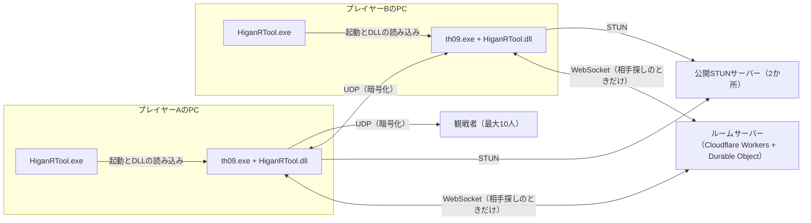
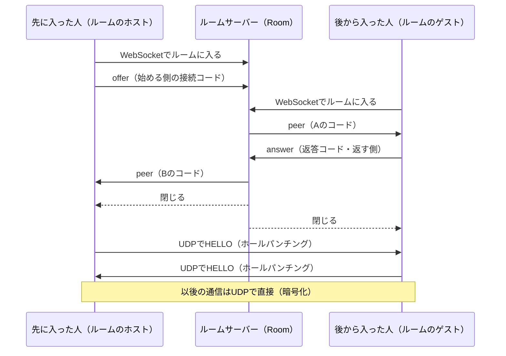

# HiganRToolの技術資料

[English](./TECHNICAL.en.md) ・ [README](./README.md)

HiganRToolの仕組みを、このツールの開発に関わる人・技術者・セキュリティが気になる人に向けて説明します。
遊び方は[README](./README.md)を見てください。
値（上限・期限など）は、このリポジトリのソースの定数から取っています。
資料とソースが食い違ったときは、ソースが正しいものとして読んでください。
この資料はAIが書いたものです（詳しくはREADMEの「[AIの使用について](./README.md#aiの使用について)」）。

## 目次

1. [全体の作り](#1-全体の作り)
2. [花映塚への組み込み](#2-花映塚への組み込み)
3. [同期](#3-同期)
4. [通信](#4-通信)
5. [接続](#5-接続)
6. [ルームサーバー](#6-ルームサーバー)
7. [観戦](#7-観戦)
8. [リプレイ](#8-リプレイ)
9. [自動更新](#9-自動更新)
10. [ログと個人情報](#10-ログと個人情報)
11. [ビルドとテスト](#11-ビルドとテスト)
12. [参考にしたもの](#12-参考にしたもの)


## 1. 全体の作り

Rustのワークスペース（`Cargo.toml`）と、TypeScriptのサーバーでできています。
花映塚は32bitなので、Rustの部分はすべて`i686-pc-windows-msvc`向けにビルドします（静的CRT）。

- **ローダー**（`src/loader`、`HiganRTool.exe`）: 花映塚をサスペンド状態で起動してDLLを読み込ませ、それから動かします。起動の前に自動更新を確かめます。
- **DLL**（`src/dll`、`HiganRTool.dll`）: 花映塚のプロセスの中で動く本体です。フック・ゲームのメモリの読み書き・描画・UDPの送受信・ルームサーバーとの通信を受け持ちます。
- **コア**（`src/core`）: プロトコルのエンコードとデコード、接続のステートマシン、delay方式とrollbackのステートマシン、接続コード、リプレイの解析などです。Win32に依存せず、`#![forbid(unsafe_code)]`で`unsafe`を禁止しています。ネットワークから来るバイト列は、すべてここで読みます。
- **ルームサーバー**（`src/server`）: Cloudflare WorkersとDurable Objectで動く、小さなサーバーです。接続コードの受け渡し・ランダムマッチのキュー・観戦の一覧・更新ファイルのリダイレクトだけを行います。
- **模擬の対戦相手（ピアシミュレータ）**（`src/peer_sim`、`peer_sim.exe`）: 花映塚を使わずにプロトコルを話すテスト用の相手です。配布物には入りません。
- **ハッシュ一覧（マニフェスト）の署名ツール**（`src/manifest_sign`）: 配布する側が、`/update/manifest`で配る更新ファイルのハッシュ一覧に署名するツールです。配布物には入りません。
- **リプレイ修復ツール**（`HiganRTool_replay_fix.exe`）: v1.0.0で保存した、2人のチャージの設定が違うリプレイのヘッダを直します。元のファイルは書き換えません。

`unsafe`は、DLLとローダーのWin32・フック・ゲームのメモリに触る層に閉じ込め、1か所ずつ`// SAFETY:`で理由を書いています。



対戦の通信は2人のPCの間でUDPで直接行います。
ルームサーバーを使うのは相手を見つけるまでで、試合の通信は通りません。


## 2. 花映塚への組み込み

### 2-1. 起動と注入

ローダーは次の順に進みます（`src/loader/src/launch.rs`）。

1. DLLがあるかを確かめます。
2. `th09.exe`のファイルを読み、ver.1.50aかを確かめます（2-2）。
3. `CreateProcessW`を`CREATE_SUSPENDED`で呼び、メインスレッドをサスペンド状態にして花映塚のプロセスを作ります。
4. `VirtualAllocEx`と`WriteProcessMemory`で、DLLの絶対パスをゲームのプロセスに書きます。
5. `CreateRemoteThread`で`LoadLibraryW`を呼ばせ、終わるまで待ちます（上限60秒。10秒たっても終わらないときは、セキュリティソフトの確認を待っている可能性を知らせます）。
6. メモリを解放し、`ResumeThread`で花映塚を動かします。

途中で失敗したら、まだ1命令も動いていない花映塚を`TerminateProcess`で終わらせます。
ツールの入っていない花映塚が立ち上がって、取り違えるのを防ぐためです。

花映塚に渡す引数は無いので、`CreateProcessW`の`lpCommandLine`はNULLにします（`src/loader/src/real.rs`）。
このときWindowsは、実行ファイルのパスを引用符なしでそのままコマンドラインにします。
vpatchで起動したときと同じ形です。
Discordのゲームキャプチャは花映塚をコマンドラインの文字列で見分けるので、vpatchで登録した項目がそのまま当たります。
花映塚はコマンドラインの中身を使いません。

ローダーは、花映塚を起動する前に、花映塚が動いていないかをチェックします（`src/loader/src/single.rs`・`src/core/src/game_running.rs`）。
動いていれば何も起動せず、「花映塚はすでに起動しています。」と出して終わります。
後から起動した花映塚は、二重起動を検出して終わるときに`th09.cfg`を書き出してしまうためです。

- **二重起動の印**: 花映塚は起動すると、二重起動を防ぐ名前つきミューテックス`Touhou 08 App`を作ります。
  素の起動・vpatch・HiganRToolのどれでも作られます。
  ローダーはこの名前が既にあれば断ります。
  普段の起動では、ローダーは起動した花映塚のこの名前を替えずに残します。
  thpracがこの名前で動いている花映塚を見つけるためです。
  開発用の起動だけは、使っている人の花映塚とぶつからないよう、この印を名前なしにして確認もしません。
- **同じパスの`th09.exe`**: プロセスの一覧からも、同じパスの`th09.exe`を探します。
  大文字・小文字、`..`、`\\?\`の接頭辞の違いはそろえて比べます。
- **同時の起動**: 2つのローダーがほぼ同時に走ると、互いの`th09.exe`がまだ一覧に無い瞬間があります。
  確認から起動の終わりまでを、ゲームのパスのFNV-1a（64ビット）から決めた名前のミューテックスで1つずつにします。
  別のローダーが持っているときは断ります。
- **確認できないとき**: プロセスの一覧もミューテックスも取れなければ、断らずに起動します。
  起動できなくなるより、二重に起動するほうがましだからです。

古いWine（MacのCrossOverなど）には、`bcryptprimitives.dll`の`ProcessPrng`が無いものや、実装が呼ぶと中断する穴埋めのままのものがあります（`src/prng_shim`）。
Rustの標準ライブラリは`HashMap`の乱数の種をこの関数で引くので、そのままではローダーやDLLが動き出す前後に落ちます。
そこで、ローダーとDLLの`build.rs`が`/DELAYLOAD:`で最初の呼び出しまで読み込みを遅らせ、MSVCの遅延読み込みのフックで代わりの関数を返します。
DLLが読めない場合とDLLに`ProcessPrng`のエクスポートが無い場合は失敗のフックで、エクスポートはあるが穴埋めの場合は通知のフックで差し替えます。
通知のフックはWineの上でだけ差し替えます。
Windowsでは本物の`ProcessPrng`を使います。
代わりの関数は`advapi32.dll`の`SystemFunction036`（RtlGenRandom）で埋め、引けないときだけ非暗号の種で埋めます。
この種は`HashMap`のためだけに使い、暗号の鍵はこの経路を通りません（DLLが`BCryptGenRandom`で直接引きます）。
ローダーが代わりを使ったときは、使った回数をローダーのログに書きます。

DLLの`DllMain`は、ローダーロックの下で走るので重い仕事をしません。
プロセスごとの名前つきミューテックスで二重の読み込みを断り、花映塚のメインスレッドが動く前でないと間に合わない差し替え（ウィンドウを作る呼び出し・パッドの十字キーの入口・リプレイを保存する2か所の呼び出し）だけをして、自分のスレッドを1本作って戻ります。
ほかのフックの照合と設置は、そのスレッドが行います。

### 2-2. バージョンチェック

ローダーとDLLの両方が、`th09.exe`のファイルがver.1.50aかを、PEヘッダの値と、エントリポイントのバイト列で照合します（`src/core/src/pe.rs`）。
1つでも違えば、ローダーは花映塚を起動せず、DLLはメモリに何も書きません。
ほかのバージョンの花映塚には対応していません。

### 2-3. フック地点

フック地点は、場所・期待するバイト列・命令の境目を1つの表に持っています（`src/dll/src/th09_addr.rs`）。
書き込む前に、その場所のいまのバイト列が期待するバイト列と一致するかを照合し、合わなければその地点には何も書きません。
ほかのツールが同じ地点を書き換えていても、合わない地点を壊さずに残します。

書き方は主に2種類です。

- **呼び出し先の差し替え**: ゲームの関数を呼ぶ命令の、飛び先の4バイトだけを書き換え、このツールの関数を呼ばせます。トランポリンは要りません。
- **inline detour**: 5バイト以上の、相対の分岐や呼び出しを含まない命令の並びだけを対象にします。

書くときは、自分以外のスレッドを全部止め、どのスレッドのEIPも書き換える範囲に無いことを確かめ、止めたままもう一度読み直して一致を確かめてから書きます。
EIPが範囲にあれば、全部を再開して少し待ち、やり直します（最大50回）。
書いた後はページ保護を戻し、命令キャッシュをフラッシュします。

主な地点は次のとおりです。

| 書き換える場所 | 書き換え方 | 使い方 |
|---|---|---|
| 毎フレームの入力を読む処理の呼び出し | 呼び出し先の差し替え | 入力の差し替えと相手の待ち（2-4・3-2） |
| ゲームの更新を飛ばして描画だけを行う出口 | 照合だけ（書き換えない） | 相手の入力が間に合わないときの戻り先（3-2） |
| フレームの始まりで時刻を待つ処理の呼び出し | 呼び出し先の差し替え | フレームペーシングを行う（3-7） |
| フレームの中でゲームの状態を更新する処理の呼び出し | 呼び出し先の差し替え | rollbackの再シミュレーションと観戦の早送りで、更新を何回も回す（3-3・7） |
| 描画の終わり（`EndScene`）の直前 | inline detour | 画面の文字やメニューを描く |
| マッチを始める処理の呼び出し | 呼び出し先の差し替え | マッチの始まりを知る |
| リプレイを保存し、ファイルを閉じた直後 | inline detour | 保存できたことを知る（8） |
| ウィンドウを作る呼び出し（`CreateWindowExA`） | 呼び出しの差し替え（`DllMain`の中で） | `[window]`の大きさと位置を使う |
| リプレイを保存する関数を呼ぶ2か所（保存画面と、ゲーム内蔵のネット対戦の自動保存） | 呼び出し先の差し替え（`DllMain`の中で） | 保存の前に確保の見積もりが小さくならないようにし、保存が済んだ後に印を足す（8-2） |

### 2-4. 入力の差し替え

花映塚は入力を3つに分けて持ちます。1P用、2P用、2人を合わせたものです。
HiganRToolは、ゲーム自身の内蔵ネット対戦と同じ部品を使います。

1. 自分の入力を、ゲーム自身の入力を読む関数に1Pとして読ませます。1Pのキー設定どおりの値になります。
   1Pの入力機器がパッドのときは、キーボード（FULLの配置）でも操作できるようにします。
   このとき、ゲーム自身が2人分を合わせて読む入力を足します。
   そのため、2Pの入力機器に別のパッドを選んでいて、そのパッドもつながっていると、そのパッドの入力も混ざります。
   対戦が成立するまでは、ゲーム自身の読み方のままです。
2. 送る値は、Z・X・Shift・Esc・Ctrl・方向のビットだけに絞ります（Ctrlは会話のスキップとキャラ・マップのランダム選択に使います）。相手のビットは自分の側でも効くので、スクリーンショットのキーなどは送りません。
3. 2人の値を席の順に並べ、ゲーム自身の入力を組み立てる関数に3つを作らせます。前のフレームの値・押した瞬間・離した瞬間・リピートの数え方もゲーム自身が作るので、素のゲームと同じ規則になります。

自分の入力を読む地点は素のゲームと同じ（入力の更新の最初）なので、入力の読み込みによる遅れは増えません。

### 2-5. 書き込む場所

ゲームのフォルダのファイル（exe・設定・セーブ・`replay\`）は書き換えません。
ゲームのフォルダに新しく書くのは`Replay_HiganRTool\`の中だけです（8）。
例外は、利用者がゲームのメニューで保存したリプレイです。
保存し終えたその1ファイルの末尾に、USERチャンクを1つ足します（8-2）。
ほかのバイトは変えません。
設定（`HiganRTool.ini`）・ログなどは、ツールのフォルダに書きます。

### 2-6. ゲームのスレッドで守ること

遅延を最小にすることを最優先にしているので、ゲームのスレッドで走るコードには次の決まりがあります。

- ヒープを確保しません（固定長の配列とリングバッファだけを使います。テスト`src/core/tests/alloc_check.rs`が見ます）。
- ファイルの読み書きなどのブロッキング処理をしません。ログはリングバッファに積み、別のスレッドが書きます。
- パニックさせません。フックのエントリごとに`catch_unwind`で包み、万一パニックしたら、以後そのエントリは元の処理へそのまま流します（素のゲームとして動き続けます）。


## 3. 同期

2人が同じ入力の列でゲームを進めれば、同じ結果になる（決定的に動く）ことを使います。
相手のPCの画面や状態は送らず、入力だけを交換します。

### 3-1. フレーム番号

- **capture_frame**: 自分の入力を読んだフレームです。
- **delay**: 入力の遅れのフレーム数です。
- **apply_frame** = capture_frame + delay: その入力を2人が使うフレームです。

始まった直後のapply_frame 0〜delay−1は、2人とも入力0で進めます。
**seg**（セグメント）は、マッチのシーンに入るたびに1つ進む番号です（再戦でも進みます）。
フレーム番号はsegごとに0から数えます。

### 3-2. delay方式

adonisと同じ、相手の入力が揃うまで待つ方式です。

- 自分の入力は、読んだその場でUDPで送ります。
- 相手の入力が無ければ、受信のイベントが来るたびに相手の入力が届いたかをチェックしながら、最大16ms待ちます。待っている間も、4msごとに、相手からまだACKが来ていない自分の入力を相手へ再送します。
- 16msで届かなければ、そのフレームはゲームの更新を進めずに描画だけを行います（ゲームの更新を飛ばす出口へ戻します）。ゲーム自身の内蔵ネット対戦が待つときと同じ出口です。描画とウィンドウのメッセージ処理は止まらないので、待機の表示やキャンセルが効きます。
- フレームの始まり（自分の入力を読む前）にも、相手の入力を最大16ms待ちます。2台のフレームの位相のずれで先に進む側が、入力を読んだ後に相手の入力を待っていた時間を、入力を読む前の待ちへ移すためです（`[netplay] head_wait`）。

### 3-3. rollback方式

相手の入力が届いていないフレームを予測で進め、届いたらロールバックして再シミュレーションする方式です。
2人ともrollbackを選んだときだけrollbackになり、片方でもdelayならdelay方式になります。

- **D**: rollbackのディレイ（入力の遅れ）です。delay方式と同じ設定で決めます（3-4）。apply_frame = capture_frame + Dは、delay方式と同じです。
- **予測**: 相手の直前の確定した入力を繰り返します。
- **F**（確定済みの境界（confirmed frontier））: 2人の本物の入力が揃った最後のフレームの次です。
- **R**（予測の上限）: N − F（いまのフレームと確定済みの境界の差）がRに達したら、delay方式と同じく待ちます（既定8。1〜16）。Rは各自の設定で、ネットワークには送りません。

状態のスナップショットは1つだけ持ちます（Fの始まりの状態）。
`Present`の後で、相手の入力が届いていれば、スナップショットを復元 → 確定した入力でF'まで更新 → スナップショットを取る → 予測の入力でいまのフレームまで更新、の順に行います。
再シミュレーションは`Present`の後に行うので、入力を読んでから`Present`までの間には時間が足されません。

- **スナップショットの範囲**: ゲームのグローバル変数の範囲と、プレイヤー・弾・敵・エフェクトなどの領域です。
- **アロケーションのロールバック**: マッチの中のゲームのスレッドのメモリ確保は、DLLが予約した1つのメモリ領域（アリーナ）（既定16MiB）へ向けます（`src/core/src/arena.rs`）。アロケータの状態もスナップショットに含めるので、復元するとメモリ確保と解放もロールバックされ、同じ順のメモリ確保には同じアドレスが返ります。
- **シーン境界**: 予測で進めている間にシーンの切り替えなどが起きたら、Fが追いつくまで待ちます。予測でシーン境界をまたぎません。
- **タイムシンク（進み具合の調整）**: 相手のINPUTに含まれる2つの数から、自分が相手より何フレーム先にいるかを見積もります。先にいる側だけが、3フレームに1回まで描画だけのフレームを入れて揃えます。
- **効果音**: 再シミュレーションで初めて起きた効果音は、再シミュレーションの後で1回だけ鳴らします。被弾の音とカットインの音は、既定では確定するまで鳴らしません（`rollback_hit_se`・`rollback_cutin_se`）。

### 3-4. ディレイとauto

ディレイは`auto`か0〜8フレームから選べます。
同期方式によらず、初めの値はメニューの「ディレイ」か、`HiganRTool.ini`の`[netplay] delay`（`auto`・`0`〜`8`。既定は`auto`）で決めます。
試合中でも、2人ともCtrl+数字キーで変えられます（9はauto）。
ゲストの変更はホストへの要求になります。
ホストは「このフレームからディレイをxにする」という予定をINPUTに含め、2人はその同じフレームで切り替えます。
押した瞬間ではなくフレーム番号で切り替えるので、通信の遅れがあっても2人の入力の列はずれません。

autoは、往復の時間（RTT）から推奨値を決めます。

- **推奨値**: 片道（RTT ÷ 2）を1フレーム（1000 ÷ 60ms）で割ったフレーム数を元にし、1〜8に収めます。往復が小さく安定しているときだけ0にします。
  - delay方式: 片道のフレーム数を切り上げます（⌈RTT × 3 ÷ 100⌉）。これより小さいと、毎フレーム相手の入力を待ちます。
  - rollback方式: 片道のフレーム数の半分を四捨五入します（ちょうど半分は低い方）。残りの半分は予測で埋めます。往復30msで1、150msで2、280msで4、400msで6です。
  - 0にする条件: 直近8回の往復の最大が、delay方式で8ms以下、rollbackで16ms以下のときです。1回でも超えたら0にしません。往復を3回測るまでも0にしません。
- **RTT**: 1秒に1回のPING/PONGの、直近8回の中央値です。PONGは受信のスレッドが返すので、ゲームのフレームの長さは入りません。
- **見直し**: 9を押したとき・ゲストがautoを求めたとき・segの始まりにだけ見直します。マッチの途中では追いません。RTTが境目で揺れてマッチごとに値が替わらないよう、上げるのは「RTT − 5ms」でも推奨値が上がるときだけ、下げるのは2回続けて下がったときだけにしています。

### 3-5. 選択画面の同期

キャラ選択などのメニューでは、2人のメニューの入力を交換して、同じ画面を互いに操作します。
画面遷移のキー押下だけは、ホストが順番を決めて2人に配ります（STEP_REQとSTEP）。
選んだ結果（キャラ・色・マップ・乱数シードなど）はSELECTで送り合って確かめます。
2人がMatch Modeの「妖怪 対 妖怪」を選ぶと、対戦が成立します（READY）。

### 3-6. 同期チェック（CHECK）

各segのフレーム0と、以後30フレームごとに、次の値を送り合って比べます（`src/core/src/check.rs`）。

- 乱数の状態と、乱数を引いた回数
- 2人のライフ

rollbackでは、確定したフレームの値だけで比べます。
1つでも食い違ったら、相手へBYE（理由: 同期ズレ）を送って接続を終え、その試合を止めます。
画面には、ログをGitHubのIssuesへ送ってほしいことを出します。
食い違ったまま続けても、2人の画面は別の試合になってしまうためです。

### 3-7. フレームペーシング

vpatchの役目（フレームペーシング）はHiganRTool自身が持ちます。
フレームの始まりで時刻を待つ処理の呼び出しを差し替え、ゲーム自身の時計の代わりに待ちます。

- **ウィンドウ**: `QueryPerformanceCounter`の整数で、60.000fpsのグリッドを刻みます。期限の時刻は毎回「基準時刻 + ⌊j × QPF ÷ 60⌋」で作るので、丸め誤差が蓄積しません。遅れたフレームは取り戻さず、グリッドの位相は保ちます。期限の瞬間にフレームを始め、`Present`の前では待ちません。既定（`[pacing] wait = passive`）は、期限の余裕の手前まで高分解能の待機タイマーでスリープし、その後は`Sleep(0)`で譲り、最後の1msはスピンで待ちます。`wait = active`にすると、期限まで`Sleep(0)`で譲り続けます（遅延はわずかに減り、処理は重くなります）。
- **フルスクリーン**: デバイスの`PresentationInterval`が`IMMEDIATE`（垂直同期なし）なら、ウィンドウと同じグリッドを刻みます。それ以外はゲーム自身の時計と垂直同期に任せます。
- **垂直同期**（`[pacing] vsync`）: ゲームはcustom.exeの「垂直同期を取らない」のフラグを2か所（起動時と、リフレッシュレートの計測の終わり）で問い合わせます。
  この2つの呼び出しを差し替え、`HiganRTool.ini`の値で答えます（`game`は保存値のまま・`on`は「取る」・`off`は「取らない」）。
  既定は`off`です。
  `off`ではゲームが起動時にリフレッシュレートの計測を飛ばし、フルスクリーンのデバイスを`IMMEDIATE`で作るので、上の「フルスクリーン」と同じく、ウィンドウと同じ60.000fpsのグリッドで進みます。
  `th09.cfg`の保存値は変えません。
- **デバイスの喪失**: フルスクリーンのデバイスが失われている間（別のウィンドウが前面にある間）、ゲームのメインループはスリープせずに`TestCooperativeLevel`を呼び続けます。この呼び出しを差し替え、失敗したら10msスリープします。

表示モードはフレームごとに読みます。
vpatchと併用しないでください（同じ地点を書き換えます）。

### 3-8. 遅延についての方針

入力の遅延を最小にすることを、ほかの何よりも優先しています。

- 入力はゲームが読む直前に取り、その場で送ります。
- 相手の待ちは、一定の間隔で確かめるのではなく、受信のイベントが来るたびに確かめます。
- 毎回のパケットに、まだACKされていない直近の入力をまとめて含め、1つ落ちても再送を待たずに埋めます。
- DTLS・SCTP・WebRTCを挟まず、素のUDPに暗号化（4-3）を載せます（暗号化の費用は1通あたりマイクロ秒の桁です）。
- ルームサーバー・観戦・リプレイの仕事は、ゲームのスレッドの外で行います。


## 4. 通信

### 4-1. パケットの形

UDPの1データグラムは1200バイト以下です（パスMTUを超えないため）。
バイト順はリトルエンディアンです。
すべてのパケットは12バイトのヘッダで始まります。

| オフセット | サイズ | 中身 |
|---:|---:|---|
| 0 | 4 | magic `"HGRT"` |
| 4 | 1 | プロトコルのバージョン（いまは9） |
| 5 | 1 | 種類 |
| 6 | 2 | 予約（0） |
| 8 | 4 | session_id（接続を始める側が作る乱数） |

順序も到達も保証しないので、ACKと再送はメッセージごとに自分で持ちます。
本文の長さは種類ごとに決まっていて、合わないものは捨てます。

### 4-2. 種類

| 値 | 名前 | 向き | 中身 |
|---:|---|---|---|
| 1 | HELLO | 両方向 | 接続の始まり。名前・望む同期方式・取りまとめ役を決める乱数・席の希望・観戦を受け付けるか・ホストの決め方を使うか・ビルド番号・一時公開鍵・NATの種類・rollbackのときのD |
| 2 | HELLO_ACK | 両方向 | HELLOへの返し。公開鍵を含む |
| 10 | AGREE | 取りまとめ役 → 相手（相手は同じ中身を返す） | 14バイト固定。ホストの席・同期方式・delay（またはD）・どちらがホストか・決め方に使った両者の上り帯域とNATの種類 |
| 3 | INPUT | 両方向 | seg・ACK（相手から次に要るapply_frame）・最初のapply_frame・入力（最大32個）・ディレイの切り替えの予定・往復の測定用の時刻（自分の送信時刻と、最後に受けた相手の送信時刻およびそれを持っていた時間） |
| 4 | CHECK | 両方向 | 同期チェック（3-6） |
| 8 / 9 | PING / PONG | 両方向 | 生存確認とRTTの測定（1秒に1回） |
| 11 | SELECT | 両方向 | 選択の結果 |
| 16 | MENU | 両方向 | 選択画面の入力と、カーソルの位置 |
| 17 / 18 | STEP_REQ / STEP | 両方向 | 画面遷移のキー押下の要求と、ホストが決めた順番 |
| 20 | READY | 両方向 | 「妖怪 対 妖怪」を選んだ |
| 21 | HOST_STATE | ホスト → ゲスト | 表示用の値（autoかどうかなど） |
| 22 | PROBE | 両方向（接続の前だけ） | 上り帯域を測る1200バイトのパケット。10通を続けて送る。本文は通し番号（0〜9）と0の詰め物 |
| 23 | PROBE_RESULT | 取りまとめ役でない側 → 取りまとめ役（接続の前だけ） | PROBEの列から見積もった、取りまとめ役の上り帯域（B/s。0は測れなかった） |
| 15 | BYE | 両方向 | 終わり（終了・切断・同期ズレ・取り消し） |
| 13 | SPECTATE_JOIN | 観戦者 → ホスト・中継役 | 観戦の申し込み。名前・早送りの速さ（`ff_max`）・ビルド番号・公開鍵・中継の欄（中継用の公開鍵・NATの種類・親を替えた回数（epoch）・続きの記録番号・候補のアドレス） |
| 14 | SPECTATE_STREAM | ホスト・中継役 → 観戦者 | 観戦レコード（最大16個） |
| 19 | SPECTATE_ACK | 観戦者 → ホスト・中継役 | 受信済みの範囲（連続受信の末尾と、その後ろ最大511記録分の受信済みビットマップ）・中継の状態（子孫の数と「紹介しないで」）・最後に受けた受け入れの依頼の番号 |
| 24 | SPECTATE_INTRO | ホスト → 観戦者 | 中継役の紹介。観戦者のnonceとepoch・中継役の中継用の公開鍵・中継役の候補のアドレス |
| 25 | SPECTATE_ADMIT | ホスト → 中継役 | 子の受け入れの依頼。依頼の番号・子が流れ始める記録の番号・子のnonce・epoch・公開鍵・候補のアドレス |
| 26 | SPECTATE_REHOME | 中継役 → 子 | 本文なし。この中継役はもう子へ記録を配信しないので、元のホストへ戻るよう子に伝える合図 |
| 27 | SPECTATE_MEASURE | ホスト → 観戦者 | 上りの測定依頼。依頼の番号 |
| 28 | SPECTATE_PAIR | 観戦者 → ホスト | 上りの測定に使う、1200バイトちょうどのパケット（組の2通）。測定依頼の番号・組の番号・組の中の順 |

HELLOに含めたrole_nonceの大きい側が取りまとめ役で、AGREEを送ります。
ホストは取りまとめ役とは限りません。
両者がHELLOでホストの決め方を使うと名乗った接続では、次の順で決まります。

1. **NATの種類**: 片方だけが相手から届かない型（シンメトリックNATでUPnPなし）なら、もう片方がホストです。型が分からない側がいれば、ここでは決めません。
2. **上り帯域**: 相手のHELLOを受けたら、その送信元へPROBEを10通続けて送ります。受け手は、到着した最小と最大の通し番号の差×1200バイトを、その2通の到着時刻の差で割って、相手の上り帯域を見積もります。一方が他方の1.25倍以上なら、太い方がホストです。
3. **role_nonce**: どちらでも決まらなければ、role_nonceの大きい側（取りまとめ役）がホストです。

取りまとめ役でない側は、見積もりをPROBE_RESULTで取りまとめ役へ返します。
取りまとめ役が決めた結果は、両者の見積もりとNATの種類と一緒にAGREEに載ります。
取りまとめ役でない側は同じ式で検証し、合わなければAGREEを捨てます。
LANの接続は、待つ側のrole_nonceを大きくするので、これまでどおり待つ側がホストです。

ホストは、画面遷移の順番とディレイの予定を決めます。
観戦の記録を作って観戦者へ送るのもホストです（観戦者のうち中継役が、ホストから受けた記録を子へ送ることもあります。7）。
1秒に1回のPING/PONGで生存確認をし、60秒何も届かなければ、相手が切れたものとして接続を終えます。

### 4-3. 暗号化と認証

暗号は自作せず、RustCryptoと`x25519-dalek`のクレートを使っています（`src/core/src/auth.rs`・`src/core/src/seal.rs`）。

接続を始める側が16バイトのシークレットを引き、接続コードに含めて相手に渡します（5-1）。
シークレットからは、接続ごとの鍵Kを作ります。
鍵の交換のパケットとPROBE（HELLO・HELLO_ACK・SPECTATE_JOIN・PROBE）は暗号化せず、Kで作ったHMACのタグを末尾に付けます。
シークレットを知らない者は、このパケットを作ることも書き換えることもできません。
それ以外の全部のパケットは、X25519の一時鍵（エフェメラル鍵）で暗号化します。

```
K        = HMAC-SHA256(key = シークレット, msg = "HGRT v0 auth" || session_id)
タグ     = HMAC-SHA256(K, ヘッダ || 本文) の先頭16バイト        （HELLO・HELLO_ACK・SPECTATE_JOIN・PROBE）

共有秘密 = X25519(自分の秘密鍵, 相手の公開鍵)
64バイト = HKDF-SHA256(ikm = 共有秘密, salt = K,
                       info = "HGRT v5 keys" || session_id || 前の公開鍵 || 後ろの公開鍵)
           前の32バイト = 「前 → 後ろ」の鍵、後ろの32バイト = 「後ろ → 前」の鍵
パケット = ヘッダ12バイト || nonceフィールド8バイト || 暗号化した本文 || タグ16バイト   （ChaCha20-Poly1305。ヘッダは関連データ（AAD））
nonce    = 0の4バイト || 送信者ID 1バイト || シーケンス番号7バイト
```

`||`はバイト列をつなぐことを表し、session_idとシーケンス番号はリトルエンディアンです。

- **一時鍵**: 接続ごとにOSの乱数でX25519の秘密鍵を作り、公開鍵をHELLO / HELLO_ACKで交換します。
  「前」は、対戦ではHELLOの乱数の大きい側、観戦では観戦者へ記録を配信する側（ホスト、または中継役）です。
- **nonceを2回使わない**: 送信者IDは送るスレッドごとに固定し、シーケンス番号は送り手ごとに0から増やして戻さないので、同じ鍵で同じnonceを2回使いません。
- **弱い公開鍵**: 共有秘密が0になる公開鍵を受けたら、鍵を作りません。

一時鍵なので、後からシークレットや接続コードが漏れても、記録された中身は読めません（前方秘匿性）。
観戦も同じ式で、観戦者ごとに別の鍵になります。
中継役と子の間の鍵は、中継役が作る使い捨ての鍵と子の鍵から同じ式で作るので、ホストと中継役の間の鍵とは別です（7）。

**守れないもの**:

- 始める側の接続コード（シークレットを含みます）を見た者が通信の経路に割り込めれば、中間者攻撃（MITM）は防げません。ルームマッチではコードがルームサーバーを通るので、サーバーを運用する者にも同じことが言えます。コードを見た者が、すでに記録された通信を後から読むことはできません。
- HELLO・HELLO_ACK・SPECTATE_JOINは暗号化しないので、名前・ビルド番号・公開鍵は経路の上から読めます。接続コードの中身（名前・候補のIPアドレスとポート）も暗号化していません（base64urlで書いただけです）。
- 直接接続する方式なので、相手と観戦者には自分のグローバルIPアドレスが見えます。
- 観戦の中継役になった観戦者は、中継する記録を復号した形で扱います。
  記録には、2人の入力・名前・選択の結果が含まれます。
  中継役とその子の観戦者には、互いのグローバルIPアドレスが見え、中継役には子の観戦者名も見えます。

### 4-4. バージョンとビルド番号

- **プロトコルのバージョン**（いまは9。`wire::PROTO_VER`）: ヘッダ・HELLO・接続コードの先頭に含めます。違う相手とは、タグを検証した後に「相手のバージョンが違う」として、接続する前に断ります。後方互換は持ちません。
- **ビルド番号**（`update::BUILD_NUMBER`）: 配布するzipごとに付く、増えていく番号です。接続コード・HELLO・SPECTATE_JOINに含め、自分と違えば1通も暗号化する前に断ります。同期は2人のコードが同じことに頼っているので、違うビルドとは接続しません。自分でビルドしたもの（番号0）は、番号0どうしでだけ接続できます。


## 5. 接続

### 5-1. 接続コード

接続コードは、接続に要るものをまとめた文字列です（`src/core/src/code.rs`）。
ルームマッチではルームサーバーが受け渡し、接続コードの方式ではプレイヤーがコピーして送り合います。

- **始める側**のコード: バージョン・ビルド番号・種類・session_id・有効期限・名前・**シークレット16バイト**・ネットワーク種別のフラグ・候補のアドレス（最大8個）。末尾はコピーの誤りを見つけるチェックサム（SHA-256の先頭4バイト）です。
- **返答コード（返す側）**: シークレットを持たず、末尾が`HMAC-SHA256(K, 本文)`の先頭16バイトです。シークレットを知らない第三者が、返答コード（返す側）を偽って候補を差し替えることはできません。
- **観戦用**のコード: 始める側と同じ形で、対戦とは別に引いたシークレットと、ホストの観戦用の公開鍵を持ちます。観戦者の返答コードは、返答コード（返す側）と同じ形です。

文字はbase64url（`=`なし）で、有効期限は30分です。
観戦者の返答コードの有効期限は、返す先の観戦用のコードの有効期限（ホストが預けた時の時計の値）と同じです。ホストは自分の時計で比べるので、観戦者のPCの時計がずれていても期限切れにはなりません。
読む順は「文字 → 長さ → バージョン → 種類 → チェックサムかタグ → ビルド番号 → 中身 → 有効期限」で、コピーの誤り・バージョン違い・期限切れを取り違えないようにしています。

### 5-2. 候補のアドレスとSTUN

接続コードには、自分に届きうるアドレス（候補）を並べます。

- **IPv6**: OSの既定の送り元がグローバルに到達可能なIPv6（2000::/3）なら、そのアドレス。
- **LAN**: 受信ソケットのアドレス。
- **外部IPv4アドレス**: STUNのBinding Requestで見えたアドレス。

試す順はIPv6 → LAN → 外部IPv4アドレスです。
配布の設定では、STUNの問い合わせ先を2か所（CloudflareとGoogleの公開STUNサーバー）にしています。
2か所目は、同じポートから聞いて1か所目と見えたポートを比べ、宛先ごとに外部ポートを変える型（シンメトリックNAT）かを見分けるためだけに使います。
結果は接続コードの「ネットワーク種別のフラグ」に含め、接続できなかったときに出す文を選ぶのに使います。

接続するまでの間は、受信ソケットから1か所目のSTUNサーバーへ、15秒ごとにBinding Requestを送り直します（`KEEP_INTERVAL_MS`。`src/core/src/stun.rs`・`src/dll/src/net_udp.rs`）。
ルーターが割り当てた外部ポートを、期限切れにしないためです。
ホストが観戦者を受け付けている間は、対戦の接続の後も続けます（7）。

### 5-3. UPnP

待機中と試合中だけ、家庭用ルーターにUPnP（IGD）でポートマッピングを頼みます（`src/core/src/upnp.rs`・`src/dll/src/upnp.rs`）。

- SSDPで探し、WANIPConnectionかWANPPPConnectionの`AddPortMapping`を送ります。リース期限は1時間で、終わったら`DeletePortMapping`で消します。
- 読むURLは、LANの中のIPv4のアドレスを指す`http://`だけです。機器の返事が外のアドレスを指していても、外へは送りません。
- ルーターの外部アドレスがSTUNで見えたアドレスと同じときだけ、マッピングしたポートを候補に含めます（違えば二重NATと見て消します）。
- 観戦者も、中継役になれるとき（`[spectate] relay = 1`で、観戦用のルームから入った場合）は、観戦の開始時に受信ポートのマッピングを頼みます。
  結果は待たずに観戦を始め、マッピングできたことは、ホストが中継役を選ぶときのNATの種類の判定に使われます（7）。
- `HiganRTool.ini`の`upnp = off`で使わなくできます。

### 5-4. UDPホールパンチング

2人とも、相手の全部の候補へHELLOを20msごとに送ります。
NATは、自分が送った相手からの返事を通すので、2人が同時に送り合うと経路が開きます。
最初に返事が来た経路を使い、10秒で接続できなければ手順を作り直して続けます。

### 5-5. 接続できない組み合わせ

- 2人ともシンメトリックNATで、どちらもポートを開けられない（UPnPが使えない）組。
- UDPが通らない回線。

中継サーバー（TURNなど）は持っていません。
中継を使うと遅延が増え、サーバーが試合の通信を受け持つことになるためです。


## 6. ルームサーバー

### 6-1. エンドポイント

クライアントはHTTPSの上のWebSocket（`wss://`）で接続します。
ルームマッチ・ランダムマッチ・観戦の一覧は、すべてDurable Objectで動きます。

| パス | Durable Object | 用途 |
|---|---|---|
| `/v0/rooms/<ルーム名>` | `Room`（ルーム名ごと） | 2人の間で接続コードを受け渡す |
| `/v0/random/<ビルド番号>` | `RandomQueue`（ビルド番号ごと） | ランダムマッチのキュー |
| `/v0/watch/<ビルド番号>/post` / `view` | `WatchList`（ビルド番号ごと） | 進行中のランダムマッチの一覧（投稿側 / 閲覧側） |
| `/update/manifest`・`/update/files/<名前>` | 使わない | ハッシュ一覧とファイルへの302リダイレクト |

レート制限には、別に`ConnectLimiter`（IPごと）を使います。

### 6-2. ルームマッチ

1つのルームに入れるのは2人までです。
先に入った人がルームのホスト（host）、後から入った人がルームのゲスト（guest）になります。



ここでのルームのホスト / ゲスト（コードを作る側 / 返す側）と、対戦のホスト / ゲスト（4-2のホストの決め方で決まる）は別のものです。

- **ルーム名**: 1〜32文字です。クライアントはASCIIの英数字と`-` `_` `@`だけを受けます。サーバーはNFKC・前後の空白の除去・小文字化をしてからルームを引くので、大文字と小文字の違いは同じルームになります。
- **タイムアウト**: 最初の人が入ってから10分です。ルームのゲストが揃ってからanswerを送るまでは1分です。タイムアウトしたら、クライアントは自動で入り直します。
- **キープアライブ**: クライアントは30秒ごとにpingを送ります。サーバーはDurable Objectを起こさずに自動で返します。

### 6-3. ランダムマッチ

- キューはビルド番号ごとに1つで、違うビルドの人とは組になりません。
- 来た順に2人ずつ組にし、組ごとに新しいルーム名（`q.`＋乱数120bitの16進30文字）を2人へ返して閉じます。
- 2人はそのルーム名で6-2のルームに入り、以後はルームマッチと同じ流れです。割り当てたルームのタイムアウトは1分です。
- クライアントは`.`を打てないので、割り当てたルーム名は人が打つ名前とぶつからず、推測もできません。
- キューにいられるのは10分で、切れたらクライアントが自動で入り直します。

### 6-4. 観戦の一覧

進行中のランダムマッチの一覧です。

- 一覧に投稿するのは、ランダムマッチの対戦のホストです。2人とも`[spectate] enable = 1`のときだけ投稿します。ゲストの設定は、接続の最初のパケット（HELLO）の1ビットでホストへ伝わります。
- ホストは、割り当てのルーム名・2人の名前・同期方式・ディレイ・観戦者の数と上限をサーバーへ送ります。
- サーバーは割り当てのルーム名の形を確かめ、観戦用のルーム名（`w.`＋割り当てのルーム名のSHA-256の先頭8バイトの16進）を自分で作ります。割り当てのルーム名は持たず、一覧にも出しません。任意の観戦用のルーム名は一覧に出せないので、ルームマッチの観戦用のルームが一覧に出ることはありません。
- 投稿側の接続が切れたら、一覧から消します。
- 一覧に載るのは全体で100件まで、1つのIP（IPv6は/64）から2件までです。
- サーバーは、閲覧側が一覧を開いたときに一覧の全体を送り、変わったら全体を再送します（1秒に1回までにまとめます）。

### 6-5. 記録しないもの

- 状態はWebSocketの接続に付けた値（attachment）にだけ置き、ストレージには書きません（書くのはタイムアウトのアラームだけです）。接続コードは、その接続が閉じれば消えます。
- Workerのコードは、ログに何も書きません（ルーム名・接続コード・IPアドレスを出しません）。レート制限の仕組みが落ちたときだけ、固定の文を1行出します。
- レート制限は、IPv4のアドレスかIPv6の/64を鍵に、直近60秒の接続の時刻だけを持ちます。最後の接続から60秒たつと消します。
- 一覧の値（名前など）は、投稿側の接続が続いている間だけ持ちます。

試合の通信はサーバーを通らず、暗号化もしているので、サーバーから試合の中身は読めません（4-3の「守れないもの」も見てください）。

### 6-6. レート制限

1つのIP（IPv6は/64）から、60秒に30回まで接続できます（直近60秒で数えます）。
超えたら429と`Retry-After: 60`を返します。
その前に、Cloudflareのrate limitingで60秒に120回までの粗い制限をかけています（Durable Objectの要求の数を荒らしに使い切られないため）。
1通は2048バイトまで、接続コードは1024文字までで、超えたら中を読まずに閉じます。


## 7. 観戦

- **まずホストに接続する**: 観戦者はまず対戦のホストに接続します。
  ゲストや2人の間の通信は増やしません。
  観戦の記録を作って配るのは、対戦のホストだけです。
  ホストは、取りまとめ役とは別に、穴あけしやすく上りの太い方になります（4-2）。
  ホストは、追いついている観戦者へ1フレームごとに1通（1秒に60通）送ります。
  そのため、ホストが観戦者1人を直接受けるときの上りは、UDPの本文で約3KB/s（IPv4のヘッダ込みで約4.6KB/s。見積もり）です。
  観戦者へのパケット送信はホストの受信のスレッドが行い、ゲームのスレッドはリングバッファに1回書くだけです。
  観戦者が増えたときの上りを減らすために、観戦者どうしの中継があります（下の「中継の木」）。
- **上限**: 10人です。
  中継役の子孫と、紹介して返事を待っている観戦者も数えます。
- **入り方**: ルームマッチでは、対戦のホストが観戦用のルーム（`w.`＋ルーム名のSHA-256の先頭8バイトの16進）にルームのホストとして入り直し続け、観戦用のコードを置きます。観戦者は同じルームにルームのゲストとして入り、観戦用のコードを受け取って、自分の候補のアドレスを載せた返答をルーム経由でホストへ送ります。対戦のホストは観戦者の候補へ短いパケットを送ってホールパンチングし、観戦者のSPECTATE_JOINを受けます。ランダムマッチでは、6-4の一覧から同じ観戦用のルームに入ります。
- **流れ**: ホストは、使うと決まったもの（選択画面の入力・選択の結果・試合の入力・名前・対戦の状態・照合・終わり）を「レコード」として1本のシーケンス番号に並べて送ります。観戦者は受信済みの範囲をACKでホスト（中継役の子なら中継役）へ返し、ホストは届いていないレコードだけを再送します（再送の間隔はRTTから決めます）。
  ホストが観戦者ごとに先へ送ってよいのは、その観戦者が連続して受け取った末尾から512レコード（送信ウィンドウ。`SEND_WINDOW`）までです。
  往復300msの回線でも、早送りの最大の速さ（1秒に約1,000レコード）を切らさずに運べる数です。
  受信済みの範囲を返すビットマップ（sack）の幅も、これに合わせて最大511レコードにしています（4-2）。
- **中継の木**: ランダムマッチとルームマッチ（観戦用のルームから入る観戦）では、観戦者どうしで記録を中継します（`src/core/src/spectate/tree.rs`）。
  ホストは、上りが太く接続を受けられる観戦者を中継役にします。
  中継役は最大2人（`RELAYS`）で、それぞれ子を最大4人（`RELAY_CHILDREN`）まで受け持ちます。
  後から来た観戦者の接続先は、空きのある中継役へ回します。
  ホストが直接送るのは基本的に中継役の2人です。
  中継役に回せない観戦者（上りが細い・接続を受けられない・中継役が満員など）は、全体の10人の中で、ホストが直接受けます。
  `[spectate] relay = 0`（既定は1）の観戦者は、中継役になりません。
  接続コードの対戦とLANの観戦コードで入った観戦者も中継役にならないので、ホストが直接送ります。
  中継役になれる観戦者は、ホストと同じ大きさのリングバッファ（262,144レコード、約9.4MB）を観戦の開始時に確保します。
- **中継役の選び方**: ホストは、新しい観戦者を中継役へ回すとき、中継役が2人に満たなければ、ホストが直接受けている観戦者のうち向く人を、上りの太い順に中継役に選びます。
  向く観戦者とは、次を全部満たす人です。
  - JOINに中継用の公開鍵を載せている（`relay = 1`）。
  - NATの種類が相手から届く側である。
    シンメトリックNATでUPnPが使えない観戦者と、種類が分からない観戦者は選びません。
  - 上りの見積もりが27,880B/s（約0.22Mbps）以上である。
    子4人へ、既定の早送りの上限（8倍）で追いつき中のパケットを送れる太さです。
  - ACKで「紹介しないで」を返していない。

  上りの見積もりは、中継役が足りない間だけ、ホストが観戦者に1人ずつ測定依頼（SPECTATE_MEASURE）を送って測ります（`src/core/src/spectate/uplink.rs`）。
  測定依頼を受けた観戦者は、1200バイトちょうどのパケット2通の組（SPECTATE_PAIR）を、100msごとに10組、ホストへ送ります。
  ホストは組ごとに、2通の到着時刻の差から太さを出し、使える組（2通の順序が入れ替わっていない組）が3組以上あれば、その中央値を見積もりにします。
  ホストは、測定依頼を送ってから2秒でその観戦者の測定を締めます。
  測れなかった観戦者には、30秒後にもう1回（最大2回）測定依頼を送ります。
  対戦の往復が延びていて観戦者へのパケット送信を絞っている間（下の「対戦の優先」）は、測定依頼を送りません。
- **紹介と受け入れ**: 観戦者は、まず必ず元のホストにJOINを送ります。
  ホストは鍵を作った後、直接受けるか、中継役の紹介（SPECTATE_INTRO）をその観戦者との鍵で暗号化して返します。
  同時に中継役へ、受け入れの依頼（SPECTATE_ADMIT）を送ります。
  依頼には番号が付いていて、中継役はホストへのACKに受け取った依頼の番号を載せます。
  ホストは、その番号が返ってこなければ依頼を送り直します。
  依頼の寿命は10秒です。
  中継役は、依頼で名指しされた子（nonce・epoch・公開鍵の合うJOIN）だけを受けます。
  中継役は子の候補へ、穴あけのパケットを送ります。
  中継役は、ホストから受けた記録を番号を変えずに自分のリングバッファに積み、子に配ります。
  子との鍵は、中継役が作る使い捨ての鍵から4-3と同じ式で作ります。
  中継役は、受けた記録を復号して、子ごとの鍵で暗号化し直して送ります。
  中継役は、対戦の往復を持たないので、往復の延びによる子へのパケット送信の絞りは掛かりません（観戦者ごとの上限だけが効きます）。
- **木からの復帰**: 子は、中継役から記録が3秒（`REJOIN_MS`）途切れるか、中継役からREHOMEを受けると、epochを1進めて、続きの記録番号（`resume_from`）を載せて元のホストにJOINし直します。
  ホストは、別の中継役を紹介するか、直接受けます。
  ホストは、その続きの記録をリングバッファに持っていれば、そこから観戦者へ送ります。
  紹介から3秒以内に中継役から記録が来ない子は、「直接だけ」の印を付けて戻り、以後は紹介されません。
  中継役は、観戦をやめるときと、ホストから3秒聞こえなくなったときに、子へREHOMEを送ります。
  ホストは、ACKが2.5秒来ない中継役には、新しく紹介しません。
  その中継役の子孫は、中継役を外すまで人数に数え続けます。
  照合（下の「照合」）がずれたときも、中継役の下にいる観戦者は、「直接だけ」の印を付けて元のホストに戻ります。
- **入れ替え**: マッチの切れ目（segの始まりを積んだ直後）に、直接の観戦者が中継役の2人を超えていれば、ホストは直接の観戦者を1人ずつ、中継役の下へ回します。
  ホストの上りを減らすためです。
  回すのは、中継役になれない観戦者のうち、その切れ目まで受け取り済みで、直近2.5秒以内にACKを返している人です。
  中継役が依頼を受け取るか10秒たつまで、次の観戦者は回しません。
- **満員と戻る観戦者**: 満員のとき、ホストは新しい観戦者のJOINにBYE（取消）を返します。
  暗号化の鍵の計算が要るので、返すのはホスト全体で1秒に1通までです。
  接続する前の観戦者は、JOINを送り直しながら待ち、待ちが切れたときに満員と画面に出します。
  接続した後に、満員で入れ直せなかった観戦者は、観戦を終えて自分の画面に満員と出します。
  ホストは、中継役が落ちたときにその子が元のホストに戻れるように、子の席を取り置きます。
  中継役を外してから5秒（`REJOIN_MS` + 2秒）は、その中継役の子孫の数だけ席を空けておき、新しい観戦者の満員の判定に数えます。
  戻ってきた観戦者（nonceと公開鍵で見分けます）は、満員でも取り置いた席に入れます。
  新しい観戦者より先に入れるためです。
- **STUNの聞き直し**: ホストが観戦者を受け付けている間は、対戦の接続の後も、ホストが受信ソケットから同じSTUNサーバーへ15秒ごとに、Binding Requestを送り直します（宛先がIPv4のときだけ。`src/dll/src/net_udp.rs`）。
  受け付けている間とは、ホストが観戦用のルームで観戦者を待つ間と、2人とも観戦を許可した試合でホストを務めている間です。
  対戦がIPv6で接続していると、ホストのIPv4のポートの割り当てが切れて、観戦用のコードのポートが古くなると考えて入れました（原因は推定です）。
  外側のアドレスかポートが変わったら、観戦用のコードを作り直します。
  預けたコードを誰も受け取っていなければ、観戦用のルームに入り直して、新しいコードを預け直します。
- **対戦の優先**: 対戦の通信が詰まらないように、観戦者へのパケット送信には上限があり、対戦の往復が延びたら下げます（`src/core/src/spectate_rate.rs`）。
  - **上限**: 追いつき中の観戦者へのパケット送信は、観戦者1人につき、その観戦者の早送りの速さ（`ff_max`）×ふだんの記録の量×1.25までです（`ff_max`が8なら6,970B/s）。
    ふだんの記録の量は、1秒ぶんの記録を、追いつき中と同じく1通に16レコードずつまとめて送ったときの量（697B/s）です。
    追いついている観戦者へ1フレームごとに1通送る量（約3KB/s）より小さいのは、1通ごとのヘッダと認証タグの分が16分の1になるためです。
    全体は、上限が大きい2人ぶんの和までです。
    追いついている観戦者へのふだんのパケット送信は、この上限に数えません。
  - **往復の測定**: 対戦の往復をINPUTごとに測ります。
    INPUTに自分の送信時刻と、最後に受けた相手のINPUTの送信時刻・それを持っていた時間を載せ、相手が持っていた時間を引いたものを標本にします。
  - **延び**: 直近4標本の往復の最小と、直近10秒の最小の差を延びとします。
    観戦者へのパケット送信はホストの上りだけを通るので、相手から自分への向きの延びを引いて、自分の上りで待った分に絞ります。
  - **絞り方**: 延びが20msを超えたら、全体の上限を半分にします。
    下限は1/8です。
    続けて下げる間隔は、ふだんの往復の2倍（100〜1000ms）です。
    下限まで下げてもなお延びていれば、追いついている観戦者へのパケット送信も止めます（生きている合図だけ残します）。
    直近1秒に追いつき中の観戦者へのパケット送信が無いときは、半分にせずすぐ止めます。
  - **戻し方**: 延びが10ms以下に戻ったら、止めていたパケット送信は1.5秒たってから戻します。
    下げた上限は、1秒に1/8ずつ戻します（下限から7秒で全部に戻ります）。
    標本が1.5秒より古いとき（メニューやポーズ）は、下げも戻しもしません。
- **バッファ**: 観戦者は、レコードが3フレーム分たまってから使い始めます（ホストより約50ms遅れて映ります）。この遅れは観戦者だけにかかり、対戦する2人にはかかりません。
  観戦者は、手元のゲームが止まっている間（ウィンドウのドラッグなど）もレコードを受け取り続けます。受け取ったレコードは約1時間ぶんまで溜めておき、それより多く溜まると観戦を終えます。
- **追いつき**: 途中から入った観戦者には、いまのsegの始まりから送ります。
  観戦者の手元では、選択画面の待ちは詰め、試合の入力が6フレームより多くたまっている間は、1回の描画の中でゲームの更新を複数回回して早送りします。
  3フレーム以下になったら普段の速さに戻します。
  1回の描画で回す更新の数は、普段の1回を含めて最大`[spectate] ff_max`回です（`src/core/src/spectate_pace.rs`）。
  範囲は1〜16、既定は8で、8なら普段の8倍の速さです。
  実際の速さは、たまっている数と、ホストからの記録が届く平均の速さから決め、`ff_max`が上限です。
  1回の描画で余分に使う時間は8msまでなので、処理の遅いPCでは、こちらが先に効きます。
  `ff_max`は観戦者側の設定です。
  観戦者がJOINに載せてホストに伝え、ホストはその観戦者へのパケット送信の上限を決めます（上の「対戦の優先」）。
- **ポーズ**: 観戦者がマッチの中でEscを押すと、手元のゲームのポーズを開きます。ポーズのメニューが読む入力は両席を合成した1本だけなので、その1本にだけ観戦者の手元の入力を入れ、試合の入力は触りません。Escを押したフレームとポーズが開いている間はレコードを使わず、再開が決まってから20フレーム後の更新で次のレコードを使います。ホストのポーズの再現中やマッチの終わりのメニューなど、ポーズを開けない間は、レコードを使わずに描画だけを続けます（「一時停止中」の表示。もう一度Escを押すと戻ります）。開閉のタイミングが外れたら、そのsegの残りは描画だけの一時停止にします。ポーズの間もレコードの受け取りは続くので、ホストの再送は増えません。
- **観戦をやめる**: Escの3秒長押し（マッチの中でも外でも）か、ポーズの「タイトルへ戻る」→「はい」でやめます。マッチの中でやめたときは、場面がマッチを出るまで観戦者の入力を作り続け、ゲームをタイトルへ戻します。
- **照合**: ホストはマッチの最中に60フレームごとに照合レコード（`Record::Check`。種類9・13バイト）を積みます。
  フレーム番号・乱数の状態と抽選回数・両者のライフ・値の作り方（ゲームの値か、segの先頭からの入力のダイジェスト）を載せます。
  観戦者は同じフレームの自分の値と比べ、ずれた回数をログに数えます。
  親がホストなら、ずれても観戦は続けます。
  親が中継役で、ずれた記録がその中継役から来たもので、手元のポーズの崩れが無いときは、その中継役にBYEを送り、「直接だけ」の印を付けて元のホストに戻ります。
  中継役が記録を書き換えても気づけるようにするためです。
  名前・対戦の状態・照合のレコードは試合の時間を進めないので、たまったレコードの数・早送り・速さの調整の数えに入れません。
- **断る**: 2人のどちらかが`[spectate] enable = 0`なら、どの対戦も観戦を受け付けません。
  ランダムマッチでは一覧に載りません。ルームマッチでは、ホストが観戦用のルームで観戦者に断りを返します。それを受けたサーバーが観戦者の接続を閉じる番号4403で閉じるので、観戦者はすぐに断りを知ります。接続コードでは観戦コードを作りません。LANでは観戦者に断り（理由は`WatchOff`）を返します。

接続コードで接続したマッチは、観戦用のルーム名が無いので、ルームを通した観戦はできません。
代わりに、ホストがCtrl+Cでコピーする観戦コードを、観戦者が「観戦コード入力」で貼ると、ルームのサーバーを通さずにホストへ直接接続して観戦できます。
観戦コードの有効期限は30分で、ホストのポートに外から届かないと接続できません。


## 8. リプレイ

### 8-1. 自動保存

マッチが終わり、入力の交換も終わった後で、ゲーム自身のリプレイを保存する関数を、保存先のパスを変えて1回直接呼びます。
リプレイの形式・チェックサム・圧縮はゲーム自身が作るので、普通のリプレイと同じように再生できます。

- **保存先**: `<ゲームのフォルダ>\Replay_HiganRTool\`。分け方は`[replay] layout`で選べます（`peer` = 「1P vs 2P」のフォルダ・`date`・`flat`・`pack50`）。
- **ファイル名**: `th9_udXXXX.rpy`。1つのフォルダに9999個までです。
- フォルダの名前にする前に、プレイヤー名の`\ / : * ? " < > |`・制御文字・Shift_JISに無い文字を置き換え、予約名（`CON` `NUL`など）を避けます。
- 観戦者も、最後まで観戦したマッチを保存します。

### 8-2. `HGRT`マーク

保存が終わったことをファイルを閉じた直後の地点（2-3）で知り、別のスレッドが同じファイルの末尾にUSERチャンクを1つ足します（`src/core/src/replay.rs`）。
中身は、`USER`・全長（u32）・タグ`HGRT`・本文・NULの順です。
USERチャンクはゲームのチェックサムの外なので、ゲームはそのまま読めます。
すでに`HGRT`があるファイルには足さず、USERチャンクの形が壊れているファイルには何もしません。

本文はタブ区切りのASCIIで、先頭は`HIGANR`とマークのバージョンです。
バージョンは、ネット対戦の自動保存（8-1）の印が1、ゲームのメニューで保存したリプレイの印が2です（下の「メニューで保存したリプレイの印」）。
下の表は、バージョン1のキーです。
値は、英数字と`-` `_` `.` `~`以外のバイトをパーセント符号化（`%`＋16進2桁）して書きます。
名前などの日本語はUTF-8のバイトごとに、時刻の`:`は`%3A`になります。
読み手は知らないキーを読み飛ばします。

| キー | 中身 |
|---|---|
| `peer` / `self` / `side` | 相手の名前・自分の名前・自分の席（1か2） |
| `lat` / `ping` | ディレイ・RTT（ms） |
| `result` | `win` / `lose` / `draw` / `abort` |
| `at` | 保存したPCのローカル時刻（`YYYY-MM-DDThh:mm:ss`。タイムゾーンなし）。例: `2026-09-25T23%3A05%3A09`は2026年9月25日23時5分9秒 |
| `sync` | `rollback`か`delay` |
| `build` | HiganRToolのビルド番号 |
| `start` | マッチの開始時刻（UTCのUNIX秒） |
| `n` | 接続の中で何マッチ目か |
| `net` | RTTの中央値と最大・止まった回数・再シミュレーションの回数・再シミュレーションで進めた数 |
| `r1`〜`r16` | ラウンドごとのフレーム数・勝者・ライフ・C2とC3の数・ボスアタックの数・リバーサルの数・スコア |
| `rx` | 上限を超えて書けなかったラウンドの数 |
| `charge` | マッチで使った1Pと2Pのチャージの設定（`0` = slow / `1` = charge）。リプレイのヘッダにも同じ値を書きます |
| `role` / `p1` / `p2` | 観戦者が保存したときだけ。`watch`と2人の名前 |

IPアドレス・ポート・接続コード・ルーム名・接続のIDは書きません（キーは閉じた一覧で決めています）。

**メニューで保存したリプレイの印**: ゲームのメニュー（Story・Extra・Matchの保存）で保存したリプレイにも、保存が済んだ後に同じ形のUSERチャンクを足します（`src/dll/src/menu_save.rs`・`src/dll/src/menu_save_win.rs`・`src/core/src/replay.rs`）。
通常のモードのリプレイも、HiganRToolで起動したものだと判別できるようにするためです。

- **本文**: タブ区切りの1行で、`HIGANR`・`2`（`MENU_MARK_VERSION`）・`kind=menu`・`ver=`（HiganRToolのバージョン名。32バイトまで）・`build=`（ビルド番号）の順です。
  ネット対戦の記録を持たないので、バージョン1とは別の形にしました。
  バージョン1しか知らない読み手や、知らない`kind`の値は、読み飛ばせます。
- **足すとき**: リプレイを保存する関数を呼ぶゲームの2か所（保存画面と、ゲーム内蔵のネット対戦の自動保存）の呼び出し先を、`DllMain`の中で自前の入口に差し替えます。
  入口は、保存関数が戻った後に、パス・開始時刻・`game_mode`を原子変数に書くだけで、ファイルには触りません。
  別のスレッドがそれを拾い、次を全部満たしたときだけ足します。
  - パスが決まった2つの形（`replay/th9_NN.rpy`・`./replay/th9_udnNNN.rpy`）である。
  - 作業フォルダがゲームのフォルダである。
  - ファイルの更新時刻が、今回の保存の開始以後である。
  - リプレイの平文の部分が読めて、`HGRT`の印がまだ無い。
- **ゲームのファイルへの書き込み**: 足すのは、保存し終えた1ファイルの末尾のUSERチャンクだけです。
  ほかのバイトは変えません。
  足した後に読み戻し、前の部分がバイト単位で同じこと・末尾が足したチャンクと一致すること・印が読めることを検証します。
- **保存で落ちる不具合の避け方**: ゲームの保存関数は、確保するバッファの大きさを、呼び出し元のスタックに残っていた10語（面ごとの印）から見積もります。
  Story・Extra・Matchの保存では、そこが0だと面を数え損ない、見積もりが小さくなって、長い試合でバッファを超えて書き込み、ゲームが落ちます。
  HiganRToolは保存関数を呼ぶ直前に、その10語の位置へ、リプレイのヘッダにある本当の面の印を書きます（自分のスタックのespより下の領域だけ）。
  書いた後の値で見積もりを計算し、必要な大きさに足りなければ、保存関数を呼びません。
  ネット対戦の自動保存（8-1）も、同じ踏み台を通して保存関数を呼びます（`src/dll/src/replay_save_win.rs`）。


## 9. 自動更新

配布するビルドのローダーは、花映塚を起動する前に新しいバージョンを確かめます（`src/core/src/update.rs`・`src/loader/src/update.rs`）。

1. ルームサーバーの`/update/manifest`から更新ファイルのハッシュ一覧を取ります。サーバーは配布の場所（GitHubのReleasesの最新）へ302でリダイレクトするだけです。
2. ハッシュ一覧の最後の行のEd25519の署名を、exeに埋め込んだ公開鍵で確かめます。署名は、固定の文字列（`"HiganRTool update manifest v1\n"`）を前に付けた本文に対して作るので、ほかの用途の署名を使い回せません。署名が合ってから初めて本文を読みます。
3. 今より新しいバージョンなら、更新するかをウィンドウで尋ねます。
4. 「はい」なら全部のファイルを取り、大きさとSHA-256がハッシュ一覧と一致することを確かめます。
5. `<名前>.new`に書いて読み戻した後、1つずつ「いまのファイル → `.old`」「`.new` → 本来の名前」と置き換えます。途中で失敗したら逆の順に戻します。自分のexeは最後に置き換え、新しいexeを同じ引数で起動し直します。

- 確かめる通信は、全体で約2秒でタイムアウトします。ネットワークに出られないときも、花映塚の起動をそれ以上遅らせません。通信の失敗は「確かめずに起動」になり、ウィンドウは出ません。
- ハッシュ一覧は8KiBまで、1ファイルは64MiBまでです。
- 置き換えられるファイル名は規則で決まっています（ASCIIの英数字と`.` `_` `-`だけ、64文字まで、`..`を含まない、利用者の設定（`HiganRTool.ini`など）・ログ・`th09.exe`・Windowsの予約名でない）。規則の外の名前は、署名つきのハッシュ一覧に書いてあっても使いません。
- `.old`は、新しいバージョンが花映塚を起動できた次の起動で消します。
- 確かめないのは、自分でビルドしたもの（ビルド番号0）・ゲームのフォルダの中に置いたexe・`[loader] update_check = 0`と書いたときなどです。
- 秘密鍵はリポジトリに入っていません。


## 10. ログと個人情報

### 10-1. ログ

- ツールのフォルダの`logs\`に、日ごとに1ファイル（`dll_YYYYMMDD.log`）書きます。
- 配布するビルドは、3日より前のログを起動のたびに消します。
- 既定（`[log] detail = 0`）は簡潔で、起動・接続・試合の節目・エラー・終わりのまとめだけを書きます。
- `detail = 1`にすると、詳細な経過と、フレームごとのCSV（`_net_frames.csv.gz`・`_pacing.csv.gz`）も書きます。不具合を調べるときだけ使います。

### 10-2. ログに書かないもの

ログに書く直前に、すべての行をマスク処理に通します（`src/core/src/log_scrub.rs`）。
書き手ごとに気を付けるだけでは、OSのエラーの文などに混ざる分を防げないためです。

- Windowsのユーザーのフォルダの名前 → `<user>`
- ツールとゲームのフォルダのパス → 固定のプレースホルダ
- IPアドレス → アドレスの種類（ループバック・プライベート・グローバル）とポート
- 接続コードの形の長い文字列 → マスクする

プレイヤー名・ルーム名は、もともとログに書きません。

### 10-3. 相手に見えるもの

- **相手と観戦者**: グローバルIPアドレス、プレイヤー名、ビルド番号です。
- **観戦者どうし**: 観戦の中継の木（7）では、中継役とその子の観戦者に、互いのグローバルIPアドレスが見えます。
  中継役には、子の観戦者名も見えます。
- **ランダムマッチ**: 知らない相手にもIPアドレスが見えます。2人とも観戦を受け付けているマッチは一覧から誰でも観戦できるので、ホストのIPアドレスは知らない観戦者にも見えます。
- **ルームサーバー**: ルーム名・接続コード（名前・候補のアドレス・シークレットを含みます）・接続元のIPアドレスです。保存はしません（6-5）。


## 11. ビルドとテスト

```
rustup target add i686-pc-windows-msvc
cargo build --release
```

`target\i686-pc-windows-msvc\release\`に`higanrtool_loader.exe`と`higanrtool.dll`ができます。
`HiganRTool.exe`と`HiganRTool.dll`に名前を変えて、同じフォルダに置いてください。
リンカにVisual Studio Build Toolsを使います。
ターゲットと静的CRTは`.cargo/config.toml`で指定しています。

- 配布するzipは、別の手順でビルド番号を埋め込み、`dist`フィーチャーを付けてビルドしています（自動更新が動き、配る`HiganRTool.ini`の中身を持ち、開発用のログにだけ使う文字列（フック地点ごとの調査メモの参照）を外します）。
- 自分でビルドしたものはビルド番号が0になり、配布しているzipとは接続できません。番号0どうしなら接続できます。
- このリポジトリでは、pushとプルリクエストのたびにGitHub Actionsでテストを回しています（`.github/workflows/tests.yml`）。
  Rustのテスト（`cargo test --workspace`）・リリースのビルド・サーバーのテスト（vitest）です。
  手元では`cargo test --workspace`と、`src/server`で`npm ci`・`npm test`を実行すれば同じものを回せます。
- 依存パッケージ（Rustのクレート・`src/server`のnpmパッケージ・GitHub Actions）の更新は、Dependabotが週に1回チェックしてプルリクエストを作ります。
  テストが通るのを検証してから取り込みます。
- 実機の花映塚を使う検証と、その準備（テスト用の設定・手順）や解析メモとの照合を見るテストは、開発用の環境だけで回しています。
  そのデータはこのリポジトリに入っていないので、そうしたテストはここではビルドされません。
- 実時間で動くテスト（`#[ignore]`）は、手元で`cargo test --workspace -- --ignored`を実行すると回せます。


## 12. 参考にしたもの

コードはすべて自作です。
次のものは、仕組みだけを参考にしました（コードはコピーしていません）。

- **adonis**: 花映塚の既存のネット対戦ツール。入力の地点・ディレイの考え方・自動保存の振る舞い。互換は持ちません。
- **Ju.N.Owen**: 獣王園のネット対戦ツール。ルームと接続コードの使い方・ゲームの中のメニュー。
- **thprac**: サスペンド状態で起動してDLLを読み込ませる方法と、リプレイのUSERチャンクにマークを足す形。
- **giuroll**: アロケーションを追跡してロールバックするrollbackの考え方。
- **vpatch**: フレームペーシングを行う役目。vpatchと遅延を比べるためだけに、vpatchの待ち方を自分で書き直したモードも持っています（既定では使いません）。
- **MinHookなどのフックライブラリ**: 全スレッドを止めてEIPを確かめてから書く手順。

使っているクレートとライセンスは、配布するzipの`THIRD_PARTY_LICENSES.txt`にあります。
暗号はRustCrypto（`hmac`・`sha2`・`hkdf`・`chacha20poly1305`）・`x25519-dalek`・`ed25519-dalek`を使っています。
